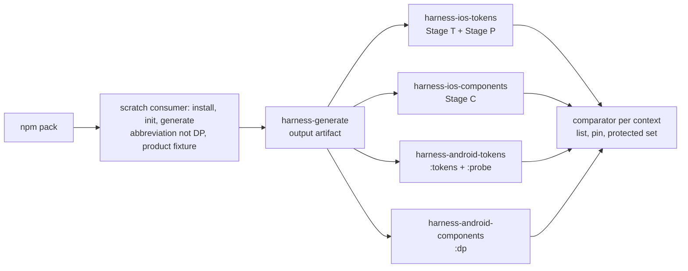

# Design Document: 129 — Consumer-Generation Completeness

**Date**: 2026-11-05
**Spec**: 129 - Consumer-Generation Completeness
**Status**: Design Phase — **R1**, assembled from the four owner inbounds. The seat review comes next (Spec-Feedback-Protocol § "Sequential Formalization Gate"); tasks start after this file merges.
**Author**: Thurgood (assembler; owner of the comparator, § 3). Every other call here is its owner's, cited to the inbound section it comes from. Where owners disagree, or one's call waits on another's unanswered question, the item is in § 16 with both positions, not resolved.
**Go**: Peter, received 2026-11-05T05:38:16Z (orchestrator relay), verbatim: "658 and 664 are merged; go for design".
**Dependencies**: as `requirements.md` header; add Spec 133 (colour-track, placeholder outline, #669), which receives the shadow channel half (§ 8).
**Facts**: `evidence/facts-at-10ec4af5b.md`, the unedited stdout of `spec-facts.sh 129 4d10202b2 10ec4af5b`. No root record's Trigger names this file (checked over the issues root at `10ec4af5b`), so adding it fires none.

**Sources, abbreviated**: **L** = `inbound-from-lina-design-2026-11-05.md` (#665); **D** = `inbound-from-data-design-2026-11-05.md` (#666); **K** = `inbound-from-kenya-design-2026-11-05.md` (#667); **A** = `inbound-from-ada-design-2026-11-05.md` (#668). Measurements, labels (VERIFIED, MEASURED, READ, REASONING) and counter-arguments stay in the inbounds and are not restated; a reader checks a claim there.

---

## Overview

129 makes a stranger's `init` → `generate` produce token output, the component tier included, that compiles and is themed on all three platforms (requirements, Introduction). The design has four parts:

1. **The instrument**: a compile harness on iOS (Kenya, § 1) and Android (Data, § 2), and the comparator that turns diagnostics into a verdict against a pinned list (Thurgood, § 3).
2. **Generation**: native theme emission (§ 4), the native type table, colours and font family (§§ 5–7), shadows (§ 8), the component-tier harvest (§ 9), and reading the consumer's own source (§ 10). These are Ada's, with Lina as co-owner where named.
3. **The component tier's repairs** (Lina, § 13).
4. **Peter's rulings in this round** (§ 0), and what they set.

Requirements 10, 12, 13.3 and 14 get no design call from any inbound beyond what § 0 sets and their own text; § 16 O-19 asks Ada whether that is enough.

---

## 0. Peter's rulings in this round

All times are `date -u` at receipt, by orchestrator relay, as the owner's inbound records them.

| Decision | His words, verbatim | Received | Recorded in | What it sets in 129 |
|---|---|---|---|---|
| Plan decision 5, the Android minimum | "Re: 5, 26" | 05:54:32Z | D § 6, "Ruled" | `minSdk` 26, by the rule "the higher of 26 and the pinned Compose floor" (23 today). The harness pin is 26 (§ 2). `InputCheckboxLegal.android.kt` L242 needs no guard (Lina). The range numbers stay with Spec 132's D4. Core Goals' line is owed (§ 15) |
| Shadow colours, Ada's P-2 | "Re: P-2, (1); but we need to address the surviving issue about the larger migration" | 05:54:32Z | A § P-2, "Decided" | Option (1): the four shadow primitives re-expressed in OKLCH, same colours, no new names (§ 8). The surviving issue (the channel migration) was answered by the colour-track ruling below |
| Plan decision 4, the iOS minimum; plan decision 7, native semver; the colour-track proposal | "yes, 4 (a), 7 (a)" | 13:05:54Z | K § 5 (4 (a)); A § P-1 (7 (a), and the "yes" = colour-track option (iv)) | **4 (a)**: iOS 17.0 stays, and is Req 2.9's deployment target; the floor is asked again at Spec 132's outline, before any native support claim; shipped text says "built for iOS 17.0, not run on 17" until something runs there. **7 (a)**: native changes made before 132's support claim ship in minor releases, item (iii) included, with deprecated-alias emission and D9's public-API diff landing before the claim; this places Req 10.1's release. **(iv)**: Spec 133's folder and its records' Triggers (#669, #670, #671) |

**Not Peter's, and why**: whether item (ii) harvests into the adopter's web output. Lina (L § 5) and Ada (A § D-5, § P-3) both choose "no" (option A), which changes nothing for a web adopter; under the rule Peter read on 2026-11-05 ("It comes to you only if it would break a web adopter"), it is the team's. Option C (retire the package CSS) would go to him, at 17.0.0.

Earlier ruling carried: D1's probe sentence, amended by Peter at 05:14:42Z (requirements, Req 2.7 note).

---

## Architecture

- **Generation** reads one token set from the consumer's barrel (§ 10), builds the theme registry from the consumer's config `themes` (§ 10), harvests our six component-token definition files as a third source on iOS and Android (§ 9), and emits native values in the platform's own types (§§ 5–7).
- **The harness** reads that output in place from the packed install (Req 2.1) and compiles it with the packaged native source. It runs no tests and builds no app.

---

## Components and Interfaces

### 1. The iOS harness

**Owner**: Kenya. **Source**: K § 1, decisions K-1 to K-7. **Satisfies**: Req 2.4, 2.6, 2.7, 2.8, 2.9, 3.2, 3.4, 3.10 (its compiler half), 3.11, 6.2.

- **K-1, three stages on one macOS runner**: Stage T compiles the generated iOS files into a module (`swiftc -emit-module … -c -wmo -parse-as-library -module-name DPHarnessTokens -swift-version 6 -diagnostic-style llvm`, target `arm64-apple-ios<min>-simulator`); Stage P compiles the generated probe with plain `import`, and only once Stage T wrote a module (until then it prints `probe: blocked (token module not built)`); Stage C compiles the generated files with every non-test packaged `.swift` as module `DesignerPunk`, at `-swift-version 5`, without waiting for Stage T. `<min>` is 17.0 (§ 0).
- **K-2, normalisation**: only `^<path>:<line>:<col>: error: ` lines are keys; root prefixes `gen:`, `pkg:`, `probe:`; the message kept whole; no line or column; a count per key. Compiler-internal messages are ordinary keys, admitted on a pin change (Req 3.5 (a)).
- **K-3, the probe** is generated from the consumer's `token-index/` (every entry with a non-null `platforms.ios`), one `_ = <path>` line per read, and prints `probe: read <n> of <m> index names (…)`, failing when `n ≠ m`. Two inputs are asked of Ada (§ 16 O-5).
- **K-4, a self-test at each stage's start**: a missing-return fixture must give exactly one `missing return` error; at Stage P, a planted `internal` member must give exactly one inaccessible entry and a read count of 2 of 2. A stage that fails it fails as `self-test`.
- **K-5, row 9's interim text guard** in `tokenIndexPlatformNames.test.ts` (Ada implements, Kenya's oracle): every index iOS name is declared `public` inside a `public` enclosing type; one known-bad fixture line; it retires in the PR where Stage P first prints a full read count, named in that PR's body.
- **K-6, toolchain match**: the pin names the Xcode by version, build and app path; the workflow sets `DEVELOPER_DIR`; each stage reads `xcodebuild -version`, the SDK version and build, and `swiftc --version`, and fails on any field that differs (`toolchain missing` when the path is absent).
- **K-7, the Xcode pin**: the newest Xcode 26 minor on `macos-26` when the harness unit is cut, re-read by the tasks round; 27.x if that read finds it on a standard label. It becomes Peter's only if a label other than `macos-26` or `macos-15` is needed (plan decision 6).

### 2. The Android harness

**Owner**: Data. **Source**: D § 1.1–1.5. **Satisfies**: Req 2.4, 2.6 (as corrected in this PR), 2.7, 2.8, 2.9, 3.2, 3.4, 3.5 (c), 3.11.

- **§ 1.1, three modules in one Gradle build** (`harness/android/`), each `com.android.library` with the Compose compiler plugin: `:tokens` (the generated Kotlin only) and `:probe` (generated from the index, depending on `:tokens`, every read inside `@Composable`) feed `harness-android-tokens`; `:dp` (the generated Kotlin and every non-test packaged `.kt`, read in place, with Icon-Base `res/`) feeds `harness-android-components`, which counts only diagnostics in package files. The generated files compile twice. Req 2.6's Android sentence is corrected to this layout in this PR (§ 15).
- **§ 1.2, capture and key**: `gradle --continue :tokens:compileDebugKotlin :probe:compileDebugKotlin :dp:compileDebugKotlin`; a diagnostic starts at `e: file://<path>:<line>:<col> <message>` and runs to the next `e: `/`w: ` or Gradle line; the key is `<root>:<relative path> | <message>` with continuation lines joined by ` ⏎ ` and whitespace collapsed; roots `pkg:`, `gen:`, `probe:`; warnings are not keyed.
- **§ 1.3, Req 3.5 (c) on Kotlin**: covers the three measured shapes; no Android-specific exception.
- **§ 1.4, the floor**: per-tier `.kt` lists computed at run time (`gen` from the consumer's output, `pkg` from `npm pack --dry-run` filtered to non-test `.kt`), passed to Gradle as explicit files, and the compiled count printed for the comparator.
- **§ 1.5, pins**: `ubuntu-24.04`; JDK 17; Gradle 9.8.2 through `gradle/actions/setup-gradle` (no committed wrapper jar); AGP 9.5.0; Kotlin and the Compose compiler plugin 2.4.21; Compose BOM 2026.09.00 (so `rememberRipple` is an error, and the baseline holds exactly 3 such entries, the check Req 2.8 names); `compileSdk` 36; `minSdk` 26 (§ 0); Coil `io.coil-kt:coil-compose` 2.7.0; `material-icons-extended` 1.7.8; `colormath-ext-jetpack-compose` 3.7.1 only while the generated Kotlin calls `Oklch(…)`, removed by the PR that lands § 6. A Gradle task prints the running versions for Req 3.11.

### 3. The comparator and the workflow wiring

**Owner**: Thurgood (Req 3; the workflow wiring of Req 2). **Satisfies**: Req 2.5, 2.10, 2.11, 3.1–3.10. The list's file format and `harness-generate`'s name are the tasks round's.

- **One comparator, two parsers.** Kenya's and Data's parsers (§§ 1, 2) write `(key, count)` pairs; the comparator never reads compiler output itself. It reads the key as `<root>:<path> | <message>` (Data's form, D § 1.2); Kenya is asked to confirm it for Swift (§ 16 O-17).
- **Paths for Req 3.5 (c).** A `pkg:` key's path is relative to the package root, which is the repository root that `npm pack` packed, so the comparator maps it to the repository file at the same path for the "edits the file the added entry is located in" arm. `gen:` and `probe:` files are not in the repository, so for their keys only the arm "removes at least one entry from a list of the same platform" can admit an addition.
- **Inputs per run**: the observed pairs; the context's list at the head and at the merge base; the pin file at both; the protected-set file under `harness/`; the per-tier file count against the floor computed by the parser (Req 3.4); and the issues root at the head, to resolve tags (Req 3.6). It reads no PR body and no credential (Req 3.9).
- **Output**: the verdict and the Req 3.8 summary line. Kenya's self-test (K-4) runs before it and fails the context on its own.
- **Wiring**: `harness-generate` uploads one output artifact; each of the four contexts downloads it and fails, not skips, when it is absent or `harness-generate` failed (Req 2.11). All four run on a 129 unit PR that carries a harness-accepted row (Req 2.10) and enter as non-required lanes (Req 2.12). The falsification test (Req 3.10) runs in `lane-functional-root`, registered in `.github/in-lane-guards.json`.

### 4. Native theme emission — item (i), with Q12 and Q13

**Owners**: Ada (the generator); Lina and Ada (Q12, Q13); Kenya and Data consulted. **Source**: L §§ 1–3; A § D-4; K §§ 2–3; D §§ 3–4. **Satisfies**: Req 4.1, 4.2, 4.3, 4.7, 4.9, 4.10; 5.6 (its WCAG-only theme path, through the product emitters). Provisional until Spec 132's D4 app builds (Req 4, "Carried to design").

**Q12, theme names: option (a), fixed binding names.** Lina (L § 1) and Ada (A § D-4) each choose (a); Kenya (K § 2) and Data (D § 4) read (a) as the only option that works for source read in place. All four inbounds were written at `2622faf3e`, before any of them merged, so Lina and Ada each state the other's agreement as pending; their texts agree on:
- the binding is DesignerPunk's, whatever the consumer's `name` or `abbreviation`: Swift `DesignerPunkTheme`, `DPThemeKey`, `EnvironmentValues.dpTheme`; Kotlin `DesignerPunkTheme`, `LocalDPTheme`, in `package com.designerpunk.tokens`;
- the consumer's name goes on the theme instances, one per registered theme and mode (Req 4.1);
- the product-token emitters read the fixed key (L § 1 asks it; A § D-4 states it: they write `extension DesignerPunkTheme` and `LocalDPTheme`);
- `SwiftThemeTypes.test.ts` and `KotlinThemeTypes.test.ts` re-baseline in the emission PR (Req 4.3).

Open inside (a): the iOS type's shape (O-1), the instances' names and any adopter-named aliases (O-2), the key path's name (O-3).

**Q13, the access form for static colours: option (a), the theme carries every semantic colour.** Lina (L § 2), Ada (A § D-4, reversing her earlier lean), Kenya (K § 3) and Data (D § 4) all choose (a), on one reason: once item (vi) reads the consumer's themes (§ 10), which colours vary is the consumer's, so shipped source cannot hard-code a static set. The component rule (L § 2): a native component reads a semantic colour only through `theme.<name>`, and primitives and every non-colour token through `DesignTokens`; Lina's guard (Req 4.4) enforces both directions against the index. The exact member set and the index change are O-4; the probe's theme list is O-5.

**The Android `CompositionLocal`**: Ada decides (A § D-4); Data's consult differs on the kind (O-6). All four agree the default is the base light instance, not an error, so the component files with `@Preview` functions render without a provider (L § 3; D § 3).

**Data's two emitter findings** (D § 3), in no record: every theme colour would emit as `Color.Unspecified` (Kotlin) or `Color.clear` (Swift), because the emitter receives primitive names, not values; and the Kotlin theme block writes its own `import` lines, which land mid-file if appended to `DesignTokens.android.kt`. Ada has not answered whether item (i)'s design takes them (O-7).

**Interfaces**: the generator splits Spec 094's `{Name}Theme`/`{abbreviation}Theme` naming into a fixed contract and config-named instances (A § D-4); the emission PR carries row 12's item 3 colours and Button-CTA reads (Req 4.5; § 13). When item (i) ships, Kenya's and Data's charter theming sections and the consumer overlays change and are re-signed (Req 4.9). The dated pointer in Spec 128's outline is Thurgood's, owed after this file merges (§ 15).

### 5. The native type table

**Owner**: Ada; Data consulted on Android. **Source**: A § D-1; D § 2. **Satisfies**: Req 6.4, 6.5, 6.7, 6.8, 6.9; rows 3, 4 (item 1), 8.

Ada's decision, one table for both platforms (A § D-1):

| Family | Android | iOS |
|---|---|---|
| spacing, radius (length), tapArea, borderWidth, layering, sizing | `Dp` | `CGFloat` |
| fontSize | `TextUnit` (`sp`) | `CGFloat` |
| lineHeight | `Float` (ratio) | `CGFloat` (ratio) |
| letterSpacing | `Float` (em) | `CGFloat` |
| fontWeight | `FontWeight` | `Font.Weight` |
| radius in percent (`radiusHalf`) | `Int` (`50`) | `Circle()` |
| color | Compose `Color` (§ 6) | SwiftUI `Color` (§ 6) |
| fontFamily | `String` (§ 7) | `String` (§ 7) |

- Composites become generated `TypographyToken` and `ShadowToken` types in the token file; components read them only through `DesignTokens.<name>.<field>`.
- Primitives are flat `DesignTokens` members; `ComponentTokens` refers to `DesignTokens.size150`, not to family types.
- Rows on which Data's consult differs (letterSpacing, fontFamily, the composite, the percent radius) are O-8. Data and Ada agree on sizing, fontSize, fontWeight and colour.
- Non-constant types are emitted as `val`; row 6's computed import list covers each Compose import only where used (D § 2).
- The coupled component PRs (I-1, I-2, the `fontWeight` form; about 70 Android read sites) and the governance type statements (Req 6.9, Lina drafts) are Lina's (A § D-1, interface). The six badge `minWidth` sites keep today's behaviour (`font_size.value * line_height`); whether a badge minimum should scale is Lina's call with Leonardo, outside 129's types (A § D-1; D § 2).

### 6. Native colour construction

**Owner**: Ada. **Source**: A § D-2. **Satisfies**: Req 6.10; rows 4 (item 2) and 11.

- Native colours are values computed at generation, in Display P3, with no runtime dependency: iOS `Color(.displayP3, red:, green:, blue:, opacity:)`; Android `Color(red, green, blue, alpha, ColorSpaces.DisplayP3)`. The `Color.oklch`, ChromaKit and colormath paths and INSTALL L171's consumer step are removed. The WCAG path uses the same converter.
- **Tolerance (Req 6.10)**: a colour inside P3 converts back to its OKLCH source with ΔE₀₀ ≤ 0.1, channels to 4 decimal places; a colour outside P3 is mapped by CSS Color 4 § 13.2 gamut mapping targeting Display P3, with ΔE_OK 0.02, asserted against a committed fixture of spec-derived values.
- **In the same PR**: `clampToGamut` in `src/color/OklchConverter.ts` is generalised to a target gamut and uses ΔE_OK, because today it tests ΔE₀₀ while citing § 13.2 (Ada's finding).
- Kenya and Data are asked to confirm both constructors compile at the pins (O-10).

### 7. What a native font family emits

**Owner**: Ada. **Source**: A § D-3. **Satisfies**: Req 6.3; row 5.

On native a font-family token emits the first entry of its stack, unquoted, as a `String`; a stack whose first entry is a generic keyword emits `""`. A Jest test asserts the extraction, the quotes gone, and the generic case. Open: whether `""` or `nil` is safe on iOS (O-9), and Data's Android `FontFamily` reading (O-8).

### 8. Shadow colours

**Owner**: Ada; Peter reviewed the tokens. **Source**: A § D-12, § P-2; #671. **Satisfies**: Req 7.1–7.4; rows 10, 11.

- Every shadow composite's colour primitive is emitted on every platform; the web composite uses the colour's custom property; `KNOWN_UNEMITTED_SHADOW_COLORS` and its warning are removed (Req 7.1, 7.2).
- **The tokens Req 7.3 names, under Peter's P-2 (1)**: no token is created; four primitives change representation, not colour, to OKLCH (A § P-2, measured with the repo's converter): `shadowBlack100` l 0, c 0; `shadowBlue100` l 0.2161, c 0.0306, h 269.6; `shadowOrange100` l 0.1956, c 0.0127, h 67.0; `shadowGray100` l 0.1912, c 0.0219, h 263.8.
- **Req 7.4's "record why not"** for the channel structure: channel tokens belong with blend in the colour-track spec, where shadow and interaction colours are designed together (A § P-2). The record `2026-06-24-oklch-shadow-color-family-not-migrated.md` stays on 129's claims pass, split into its value half (129) and channel half (Spec 133); its owed act at 129's claims pass is a re-rule to Spec 133's path, not a close (#671).

### 9. Item (ii): the component tier reaches the consumer's `generate`

**Owners**: Ada (the harvest, precedence, the name contract); Lina (Spec 123 Req 1.5's decision); Data (the Kotlin package, with Ada). **Source**: A § D-5; L §§ 5–6; D § 5. **Satisfies**: Req 5.1–5.5, 5.10, 5.11; 1.3.

**Precedence** (A § D-5): sources in order are the consumer's `{tokenSource}/component/`, the consumer's `componentTokens` directories, and the package's six harvestable definition files from component directories that win the component union at the package's rank. The key is the group's declared `component` name: if any consumer source declares group G, no package token of group G is emitted; replacement is per group. `mergePackageComponentTokens` follows the same function, and D2 catches any disagreement. Each replacement prints `component tokens: <G> — yours replace DesignerPunk's` (with `(copied at init)` on the first run where the files are byte-identical); two consumer files declaring G fail `generate` naming both. Lina is asked whether the per-group key matches her component-union reading (O-12).

**Web: not harvested in 129.** Lina (L § 5, option A) and Ada (A § D-5) agree: web keeps `@3fn/core/component-tokens.css`, which binds late through `var()`; the adopter's own groups keep landing in their `ComponentTokens.web.css`; the Integration Guide says to import the adopter's CSS after the package's, so adopter-wins holds by cascade order (a guide sentence for Lina and Sparky under Req 15). D2 stays iOS and Android. Req 10.4 names no web change. Sparky's answers are pending (O-14).

**The Kotlin package**: our generated Kotlin stays in `com.designerpunk.tokens`, the components in `com.designerpunk.components.*` (A § D-5; L § 1; D § 5). Whether `generate` enforces the reservation is O-11.

**Spec 123 Requirement 1.5, recorded decision** (Req 5.5). Lina's text from L § 6, verbatim:

> **Spec 123 Requirement 1.5, decided (2026-11-05, Lina, signed).**
>
> **The decision.** DesignerPunk's component token definitions reach the consumer's harvest.
> - The package ships its six harvestable `defineComponentTokens` files. `generate` harvests them as a third source after the consumer's own two, on iOS and Android.
> - Each reference is emitted by name, so it binds to the consumer's primitives.
> - Where a consumer's group and ours share an emitted group name, the consumer's wins, and the replacement is reported.
> - A file that registers no tokens is reported, not passed silently.
> - Web is not harvested in 129: it keeps `@3fn/core/component-tokens.css`, which binds late to the consumer's primitives (§ 5 of the 2026-11-05 design inbound, the team's decision).
>
> **It follows D2**, as approved by Peter on 2026-11-05 ("C yes", `evidence/2026-11-05-native-plan/plan-r2.md` § 1).
>
> **Rejected: emitting from the package's token index.** The index is a build product derived from these definitions. Emitting from it would put a snapshot of our build in the consumer's output, the class the charter's principle rules out.
>
> **Left to the owner of the file**: `Badge-Count-Notification/tokens.ts` is a constants object outside the pipeline. Its rename is `.kiro/issues/2026-10-26-badge-count-notification-tokens-file-misnamed.md` (Lina; due 16.3.0). Until it lands, the harvest reports it under the rule above.
>
> A dated pointer line at Spec 123 Requirement 1.5 cites this paragraph.
>
> *Signed: Lina, 2026-11-05.*

The quoted "§ 5" is L § 5. **Owed**: the dated pointer line at `.kiro/specs/123-consumer-distribution/requirements.md` § Requirement 1.5, Lina's act, in the PR that merges this file or right after it (L § 6).

### 10. Item (vi): `generate` reads the consumer's own source

**Owners**: Lina and Ada (Q3a); Ada (the pipeline and the six groups). **Source**: L § 4; A §§ D-6, D-11. **Satisfies**: Req 9.2, 9.3, 9.4, 9.5; Req 9's "Carried to design".

- **Q3a** (L § 4; A § D-6, agreeing): `generate` builds the theme registry from the consumer's config `themes`, which import their copied `src/tokens/themes/**`; the static imports of the package's own `SemanticOverrides` in `src/generators/generateTokenFiles.ts` L19–21 are removed. No package override is read, built-in themes included (Lina's question; Ada's text removes the imports, O-13 asks her to confirm).
- **Effects** (Req 9's carried line asks for them): on item (i), one native instance per (config theme, mode), and the theme's members do not change with which themes are registered (§ 4, Q13); on web, a registered custom theme emits too, so the caveat goes once Q3b rules the selector; the `generate` message "registered, not applied yet" (`errorCatalog.ts` L557) and the web agent doc change in that PR (Sparky R1).
- **Ada's additions, for Lina's agreement (O-13)**: `ConfigTheme` gains an optional `{ light, dark }` form (additive); `init` writes the WCAG entry with both maps; for configs born before 129, a `wcag` theme with no dark map uses the consumer's `themes/dark-wcag/SemanticOverrides.ts` when present and prints the line to add, accepted by a `Consumer Guard` old-shape case.
- **Q3b**, the web `data-theme` selector's scope, stays Peter's fork after Sparky's committed browser check (Req 9, carried). Not decided here.
- **The six groups (D-11)**: one loaded token set from the consumer's barrel (`src/cli/resolveTokens.ts`, `config.tokenSourceRoot`) is passed to every generator; no generation file imports `../tokens` for values; a Jest guard fails on a new value import from `src/tokens` under `src/generators`, `src/providers`, `src/resolvers` and `src/blend`; Req 9.5's removal case is the end-to-end proof. Its own parent (tasks). Its completion doc corrects Spec 133's outline § 4 (`feedback/requirements.md`, `[THURGOOD R3]`).

### 11. Q6: what "fresh" means (R5)

**Owner**: Ada. **Source**: A § D-7. **Satisfies**: Req 5.8.

Content: the check regenerates into a temporary directory and compares byte for byte, outside the generated header's timestamp. A package upgrade shows because the header names the package version. It settles the file-time record (`2026-10-12-generate-staleness-decided-by-file-times.md`) in the same direction; that record's own Trigger is unchanged.

### 12. Validators: row 21's rule and row 1's fix

**Owner**: Ada. **Source**: A §§ D-8, D-9. **Satisfies**: Req 13.1, 13.2.

- **Row 21 (D-8)**: a custom value conforms when it is on its family's grid, `BASE × k × step` with `k` whole and no upper cap; `sizing` is validated too; an off-grid value conforms only with a non-empty `offGridReason`. Consumer tokens warn, DesignerPunk's fail. The two known cases: Badge-Label-Base `maxWidth` 120 conforms once the cap goes; Button-VerticalList-Item `paddingBlock.rest` 11 needs an `offGridReason` in Lina's words (Ada asks her).
- **Row 1 (D-9)**: families are classified (formula families state an equation; categorical families state a description the parser does not evaluate; a formula-family token with no equation fails); `=` is exact within 1e-3, `≈` within half the family's grid step, exponents allowed; strategic-flexibility tokens may state `special case: <reason>`; the ~20 rounded strings change `=` to `≈`; `blur000`'s relationship string is corrected (metadata only) and its pre-correction form is the true-positive case; the guide's two `validate` sentences go in the fixing PR. About 2 sessions. No token value changes; no token is created.

### 13. The component tier's repairs

**Owner**: Lina; Kenya and Data verify. **Source**: L § 2 table; A § D-1 interface; D § 2. **Satisfies**: Req 4.5, 4.6, 4.10, 6.7, 6.8, 8.2.

Under Q13 (a), Lina's component parent (after Ada's generator parent) is: row 16's six reads drop the malformed prefix (Req 4.6); the 2 `DesignTokens` semantic-colour reads re-point to `theme.` (Req 4.10); row 12's item 3 colours and Button-CTA's bare reads bind to `theme.` in Ada's emission PR, with `color.background` reading `theme.color_structure_canvas` (Req 4.5); the 173 static reads already through `theme.` need no change. About 0.5 session plus the coupling (L § 2, REASONING). The type couplings (I-1, I-2, `fontWeight`, the composite's 9 reads) are § 5's.

### 14. Q4: the founder count

**Owner**: Ada; Leonardo consulted. **Source**: A § D-10. **Satisfies**: Req 11.1, 11.3.

The founder path drops from 5 to 4 (`npm install` → `init`, which runs `generate` → personal note → restart); `generate` stays documented as the first command of the edit loop; `path-steps: { founder: 4, … }`, joining stays 5; `init`'s closing message names `generate`. Ada asks Leonardo to confirm the step text.

---

## Data Models

The models are the owners' and are defined where each section cites them; none is restated here.
- Theme binding names and instances: § 4 (O-1, O-2).
- `TypographyToken`, `ShadowToken` and their fields: A § D-1 (O-8 on Android).
- `ConfigTheme`'s optional `{ light, dark }` form: A § D-6.
- The comparator's key, `<root>:<path> | <message>`, and its count: § 3; D § 1.2; K § K-2.
- Spec 132's `rendering:` field shape: L § 7.3 (132 input, below).

---

## Error Handling

Each behaviour is its owner's, with its instrument in the cited requirement.
- `generate`: a replaced group is reported; two consumer files declaring one group fail, naming both (§ 9; Req 5.3); a definition file registering no tokens is reported (Req 5.1); a renamed or deleted referenced token is reported, and `sync` reports one an upgrade introduces (Req 5.4); a theme file that does not load fails, naming the file, and an override of an unknown token is rejected by `ThemeRegistry.register()` (A § D-6); an unknown platform or an out-of-root path under `platforms:` fails (Req 12.3); a consumer `.kt` in a reserved package, per O-11.
- `init`: a `generate` failure finishes the birth, prints the message and the re-run command, and exits non-zero (Req 11.4).
- Harness: `harness-generate` failing fails every compile context (Req 2.11); a missing Xcode path fails as `toolchain missing`, a version mismatch fails the context (K-6; D § 1.5; Req 3.11); a failed self-test fails as `self-test` (K-4); fewer files than the floor fails (Req 3.4); Stage P blocked prints its reason and does not fail (K-1).

---

## Testing Strategy

Each requirement names its instrument and context; the design adds these, by owner:
- **Ada**: one Jest test per row of the type table, asserting the emitted type (A § D-1); `radius_half` emission (Req 6.4); font-family extraction (§ 7); the ΔE₀₀ / gamut-mapping test on a spec-derived fixture (§ 6); the value-import guard (§ 10); the Kotlin package test (O-11); the row 1 grammar and `blur000` true-positive (§ 12); K-5's tightened `tokenIndexPlatformNames.test.ts`.
- **Lina**: the two-sided theme-read guard (Req 4.4), enforcing both directions against the index under Q13 (a).
- **Kenya**: the macOS self-tests (K-4), fixtures under `harness/ios/`, moved with each Xcode pin.
- **Data**: proposed, for Ada: a Jest assertion on output generated from real token definitions that no emitted theme colour is `Color.Unspecified` or `Color.clear` (O-7).
- **Thurgood**: the comparator's falsification test (Req 3.10), with recorded compiler output from both platforms.
- **Not tested in 129**, by design: anything that runs (Spec 132's D5); runtime theme switching (Req 1.7); a two-module Kotlin same-name clash, which only an app build shows (D § 5; Spec 132's D10).

---

## Design Decisions

A register, not a restatement: each row points to its section and source. "Agreed" means every owner's inbound states the same call; it becomes final when the owners confirm in design R1.

| # | Decision | Owner | State | Where |
|---|---|---|---|---|
| 1 | iOS harness topology, flags, normalisation, probe, self-test, toolchain match, Xcode pin | Kenya | decided | § 1 |
| 2 | Android harness modules, capture, key, floor, pins | Data | decided | § 2 |
| 3 | Comparator interface and wiring | Thurgood | decided (R1 review) | § 3 |
| 4 | Q12 option (a), fixed binding names | Lina, Ada | agreed; O-1, O-2, O-3 open | § 4 |
| 5 | Q13 option (a), every semantic colour in the theme | Lina, Ada | agreed; O-4, O-5 open | § 4 |
| 6 | `CompositionLocal` default base light; kind | Ada | default agreed; kind O-6 | § 4 |
| 7 | Native type table | Ada | decided; O-8 open | § 5 |
| 8 | Native colours in Display P3 at generation, with the stated tolerance | Ada | decided; O-10 | § 6 |
| 9 | Native font family: first stack entry | Ada | decided; O-9 | § 7 |
| 10 | Shadow primitives in OKLCH, no new names | Peter (P-2 (1)) | ruled | § 8 |
| 11 | Item (ii) precedence, per group | Ada | decided; O-12 | § 9 |
| 12 | Item (ii) not harvested on web (option A) | Lina, Ada | agreed (team); O-14 | § 9 |
| 13 | Spec 123 Req 1.5 | Lina | signed | § 9 |
| 14 | Q3a: config `themes` are the only source | Lina, Ada | agreed; O-13 on Ada's additions | § 10 |
| 15 | Six groups from one loaded token set | Ada | decided | § 10 |
| 16 | Q6: content | Ada | decided | § 11 |
| 17 | Row 21 grid rule; row 1 grammar | Ada | decided | § 12 |
| 18 | Founder count 4 | Ada | decided; step text to Leonardo | § 14 |
| 19 | Android minimum API 26; iOS 17.0; native semver (a) | Peter | ruled | § 0 |

---

## 15. Corrections and owed acts

**In this PR**:
- **Req 2.6, Android sentence**: replaced by Data's sentence (D § 1.1), a CORRECTION of his own R1 wording, with a dated correction line in `requirements.md`.
- **Spec 131's outline**: one dated line that `2026-06-10-post-v12-rgba-pipeline-cleanup.md` now routes to Spec 133 (#671), beside the 2026-11-04 line for the OKLCH record.

**Owed, not in this PR**:
- **Core Goals' Android line.** `.kiro/steering/core-goals.md` § "Core Project Context" reads "Android: Not yet constrained". Peter ruled API 26 ("Re: 5, 26", 05:54:32Z). Under `.kiro/docs/ballots/README.md` § "When a governance edit needs a ballot — three kinds", the edit is LAW: Android code must now meet a minimum that nothing required before, no merged clause or ratified ballot names the edit, and "When in doubt, LAW". So it is not edited here; it goes to Peter on this PR's `**Open for Peter**:` line. The text to propose: "- Android: API 26 (Android 8.0)+ — the effective minimum is the higher of 26 and the pinned Compose floor". Also known: that paragraph is a signed unit (`canonical/operative-sets/core-goals.yaml`, `#core-project-context`, owner Thurgood, confirmer Stacy), copied into `canonical/profiles/consumer/always-set/core-goals.overlay.md` and the generated consumer outputs and onboarding fixtures. The applying PR therefore needs Stacy's confirm act and a regeneration, as well as Peter's merge.
- **Spec 128's outline**: the dated pointer that a React Native component reads the theme through the same fixed binding (Req 4, carried; L § 1), Thurgood's, after this file merges and O-1 to O-3 settle.
- **Spec 123 Req 1.5's pointer line**: Lina's (§ 9).
- **`ConfigHelpers`' Android default (24) and validation floor (21)** against API 26: Ada's call, design or tasks (D § 6); not in A (O-18).

---

## 16. Open items between owners

Each item gives both positions and who closes it. None is resolved here.

- **O-1, the iOS theme type's shape.** Lina: a protocol `DesignerPunkTheme`, with consumer instances as "Swift structs conforming to" it (L § 1). Ada: "protocol or data class" (A § D-4). Kenya: it must be `Sendable`, because today's `any …Theme` key fails Swift 6 (K § 1 K-1, measured); she leans to a `struct`, and a `protocol …: Sendable` also compiles (K § 2 R-1). My reading, not verified: a struct also changes `any DesignerPunkTheme` sites such as `VisualStateStyles.swift` (L § 1 cites it). **Closes**: Lina and Ada.
- **O-2, instance names and adopter-named aliases.** Lina: Swift instance structs, a Kotlin `<Name>Themes` holder (L § 1). Ada: `<Name>BaseLightTheme`, `<Name>WcagDarkTheme`, … (A § D-4). Kenya: `DesignerPunkTheme.pbLight`, `.pbDark`, …, with an optional `typealias PbTheme` (K § 2). Data: `object {Name}Themes { … }`, plus `typealias {Name}Theme = DesignerPunkTheme` and `val Local{ABBR}Theme = LocalDPTheme`, skipped when equal to the fixed names (D § 4). Data's question to Kenya, whether Swift can alias the `EnvironmentValues` key, is unanswered. My reading, not verified: Data's provider composable `{Name}Theme(darkTheme = …)` (D § 3) has the same name as his proposed typealias. **Closes**: Lina and Ada; Leonardo's objection is what the aliases answer.
- **O-3, the key path's name.** Lina and Ada keep `\.dpTheme`. Kenya offers `\.designerPunkTheme` as one rename across 27 reads, a naming call (K § 2 R-2). **Closes**: Lina and Ada.
- **O-4, Q13's member set.** Lina: every colour semantic (62), with the index naming each one `theme.` on iOS and Android and its README in the same PR (L § 2, asked of Ada). Ada: "every semantic colour the components read", with the cost stated as 62 (A § D-4); the two differ if a colour semantic no component reads exists. Kenya counts 61, from the scaffolded dark-override file (K § 3). **Closes**: Ada and Lina, one definition; the index is then the count for the probe and the guard.
- **O-5, the probe's theme list and name roots.** Kenya asks Ada for the index to expose the native theme-varying set (for example `nativeThemeVarying: true`) and each iOS name's root (`DesignTokens` or top-level) (K § 1 K-3, § 4). Under O-4, the theme list may become every `theme.`-named colour semantic, and Req 4.2's "the token index's theme-varying set" may then need a wording correction. **Closes**: Ada (index), Kenya (probe); Thurgood (any requirements correction).
- **O-6, the Android `CompositionLocal`'s kind.** Ada: keep `compositionLocalOf { BaseLight }` (A § D-4). Data: `staticCompositionLocalOf`, base light, plus a generated provider composable (D § 3). Lina: the kind changes no component read (L § 3). **Closes**: Ada (decides); Data consulted.
- **O-7, Data's two emitter findings** (§ 4; D § 3). Data asks Ada to take them into item (i) with a real-output Jest assertion; Data also asks Kenya whether iOS has the `Color.clear` shape (he reads that it does). Neither is in a record. **Closes**: Ada (take in, or file); Kenya (iOS).
- **O-8, the Android type table.** Ada (A § D-1) against Data's consult (D § 2): letterSpacing `Float` against `TextUnit` in `em`; fontFamily `String` (first stack entry) against `FontFamily` mapped from the generic family; the typography composite a generated `TypographyToken` against Compose `TextStyle` (Data asks whether `TextStyle` settles row 4's undefined `Typography`); the percent radius `Int` against `CornerSize(50)`. Ada's request that Data confirm `FontWeight(Int)` and `RoundedCornerShape(percent: Int)` at the Compose pin is unanswered. **Closes**: Ada (decides); Data consulted.
- **O-9, the empty font family on iOS.** Ada asks Kenya whether `Font.custom("", size:)` is safe or whether the field should be `String?` (A § D-3). Unanswered. **Closes**: Kenya, then Ada.
- **O-10, the colour constructors at the pins.** Ada asks Kenya and Data to confirm both compile, and whether Android's `ColorSpaces.DisplayP3` needs values outside 0–1 (A § D-2). Data: the P3 form uses the same constructor as the OKLab one he compiled (D § 2, REASONING). Kenya: unanswered. **Closes**: Kenya, Data.
- **O-11, Kotlin same-name declarations.** Ada: `generate` fails on a consumer `.kt` (outside `node_modules` and its own output) declaring `package com.designerpunk.tokens` or `com.designerpunk.components…`, with a Jest test (A § D-5). Lina: `generate`, or a lint step, refuses such source (L § 1). Data: the package is reserved and INSTALL says so; a hand-written clash cannot be seen by `generate`, and 129 states the reservation without claiming to enforce it (D § 5). **Closes**: Ada and Data (co-owners).
- **O-12, the precedence key and the component union.** Ada asks Lina whether the per-group key matches her component-union reading, including groups declared outside a component directory (Progress) (A § D-5). Unanswered. **Closes**: Lina.
- **O-13, Q3a's additions.** Ada asks Lina to agree, including the old-shape WCAG fallback (A § D-6); Lina asks Ada to confirm that no package override is read, built-in themes included (L § 4). Their texts agree on the source; neither has read the other's additions. **Closes**: Lina and Ada.
- **O-14, web, for Sparky.** Lina: does option A break any supported web consumer? If so, the item goes to Peter (L § 8). Ada: is a cascade-order sentence enough for adopter-wins, or does a duplicate custom property need a check (A § D-5)? **Closes**: Sparky.
- **O-15, Android generated-file diagnostics seen only in `:dp`.** Data's residual proposal: the component context keys a generated-file diagnostic in `:dp` that `:tokens` did not report (D § 1.1). Req 2.6 says each context's list holds only diagnostics in its own tier's files, and Kenya's Stage C has no such rule (K-1). The proposal widens Req 2.6, so it would be a requirements change, not a correction. **Closes**: Data and Thurgood (comparator), Kenya on iOS parity; Stacy reads its verifiability.
- **O-16, one theme shape across platforms.** Kenya asks Data whether her struct matches a Kotlin data class, and whether her strict-mode token tier and written-mode component tier have an Android counterpart (K § 4). Unanswered. **Closes**: Data.
- **O-17, the Swift key grammar for the comparator.** § 3 reads keys as `<root>:<path> | <message>`. K-2 gives the root prefix and the message but no separator. **Closes**: Kenya.
- **O-18, `ConfigHelpers` against API 26** (§ 15). **Closes**: Ada.
- **O-19, requirements with no design call in any inbound.** Req 12 (item (v), `platforms:`); Req 13.3 (row 22's export); Req 10.3's resource-folder assertion. Each may be settled by its requirement text as written. **Closes**: Ada says so in R1, or gives the design.
- **O-20, smaller owner-to-owner asks.** Ada to Lina: the `offGridReason` wording for VerticalList's 11 (A § D-8). Ada to Leonardo: the founder step text (A § D-10). Lina to Leonardo: whether `rendering:` needs two fields (L § 8; a 132 input). Kenya to Thurgood: the `harness/ios/` fixtures go in the harness unit's grant (K § 4; tasks round).

---

## Spec 132 inputs drafted this round (not 129 acceptance)

Lina's shapes for the native access-level ballot, the per-platform contract-validation ballot, and the `rendering:` field record are in L § 7. Each goes through its own process; the record is filed after this file merges (L § 7.3). Requirements, Open items, list them; nothing in 129 accepts them.

---

## Traceability

| Requirement | Design |
|---|---|
| 1 | § 0, §§ 1–3 (D1, D3), § 9 (D2) |
| 2 | §§ 1, 2, 3 |
| 3 | § 3; normalisation in §§ 1, 2 |
| 4 | § 4, § 13 |
| 5 | § 9 (5.1–5.5, 5.10, 5.11), § 4 (5.6's theme path), § 11 (5.8); 5.6's composite refusal, 5.7 and 5.9 by their requirement text |
| 6 | §§ 5, 6, 7; Ada's D-1 cites Req 6.1, removed in R2, whose content is Req 1.2 |
| 7 | § 8 |
| 8 | § 13; 8.4 is Spec 132's |
| 9 | § 10 |
| 10 | § 0 (decision 7 (a) places 10.1); O-19 |
| 11 | § 14 |
| 12 | O-19 |
| 13 | § 12; O-19 for 13.3 |
| 14 | requirement text (option (a), unchanged patterns) |
| 15 | § 0 (the "built for iOS 17.0, not run on 17" rule, K § 5); § 9 (the cascade-order sentence) |
