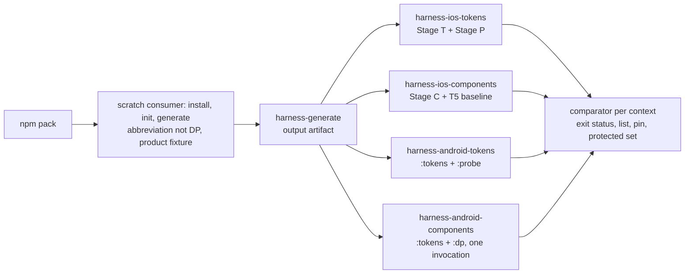

# Design Document: 129 — Consumer-Generation Completeness

**Date**: 2026-11-05
**Spec**: 129 - Consumer-Generation Completeness
**Status**: Design Phase — **R2**: the seven R1 reviews and the four owners' R2 cross-read are folded in (`feedback/design.md`, `[THURGOOD R2]`). Every R1 open item is decided by its owner, except the few in § 16, each of which has an owner and the round that closes it. Tasks start after this file merges (Spec-Feedback-Protocol § "Sequential Formalization Gate").
**Amended in the tasks round (2026-11-05)**: § 10's fallback for older configs is replaced by the registration-keyed built-in bridge (Ada and Lina, the Q3a co-owners), with a dated line in place.
**Author**: Thurgood (assembler; owner of the comparator, § 3). Every other call here belongs to its owner and is cited to where the owner made it. **The owner rule**: where an item is a named owner's call, that owner's latest position (R2 where they wrote one) is the decision; other seats' accepts and residuals are recorded beside it.
**Go**: Peter, received 2026-11-05T05:38:16Z (orchestrator relay), verbatim: "658 and 664 are merged; go for design".
**Dependencies**: as `requirements.md` header; plus Spec 133 (colour-track, placeholder outline, #669), which receives the shadow channel half (§ 8).
**Facts**: `evidence/facts-at-10ec4af5b.md`, the unedited stdout of `spec-facts.sh 129 4d10202b2 10ec4af5b`. `main` has not moved since. No root record's Trigger names this file.

**Sources, abbreviated**: **L**, **D**, **K**, **A** = the design inbounds of Lina (#665), Data (#666), Kenya (#667), Ada (#668), `inbound-from-<seat>-design-2026-11-05.md`. **`<SEAT> R1`** and **`<SEAT> R2`** are the round entries in `feedback/design.md`. Measurements, labels and counter-arguments stay there and are not restated.

---

## Overview

129 makes a stranger's `init` → `generate` produce token output, the component tier included, that compiles and is themed on all three platforms (requirements, Introduction). The design has four parts:

1. **The instrument**: a compile harness on iOS (Kenya, § 1) and Android (Data, § 2), and the comparator that turns a build into a verdict against a pinned list (Thurgood, § 3).
2. **Generation**: native theme emission (§ 4), native types, colours and font family (§§ 5–7), shadows (§ 8), the component-tier harvest (§ 9), and reading the consumer's own source (§ 10). These are Ada's, with Lina co-owning where named.
3. **The component tier's repairs** (Lina, § 13).
4. **Peter's rulings in this round** (§ 0).

Requirements 10, 12 and 13.3 get their design in § 12a (Ada R1, O-19); Requirement 14 needs none.

---

## 0. Peter's rulings in this round

All times are `date -u` at receipt, by orchestrator relay, as the cited record holds them.

| Decision | His words, verbatim | Received | Recorded in | What it sets in 129 |
|---|---|---|---|---|
| Plan decision 5, the Android minimum | "Re: 5, 26" | 05:54:32Z | D § 6, "Ruled" | `minSdk` 26, by the rule "the higher of 26 and the pinned Compose floor" (23 today). The harness pin is 26 (§ 2). `InputCheckboxLegal.android.kt` L242 needs no guard (Lina). The range numbers stay with Spec 132's D4. Core Goals' line: below |
| Shadow colours, Ada's P-2 | "Re: P-2, (1); but we need to address the surviving issue about the larger migration" | 05:54:32Z | A § P-2, "Decided" | Option (1): the four shadow primitives re-expressed in OKLCH, same colours, no new names (§ 8). The surviving issue (the channel migration) is answered by the colour-track ruling below |
| Plan decisions 4 and 7; the colour-track proposal | "yes, 4 (a), 7 (a)" | 13:05:54Z | K § 5 (4 (a)); A § P-1 (7 (a), and the "yes" is colour-track option (iv)) | **4 (a)**: iOS 17.0 stays, and is Req 2.9's deployment target; the floor is asked again at Spec 132's outline, before any native support claim. **7 (a)**: native changes made before 132's support claim ship in minor releases, item (iii) included, with deprecated-alias emission and D9's public-API diff landing before the claim; this places Req 10.1's release. **(iv)**: Spec 133's folder and its records' Triggers (#669, #670, #671) |
| How Core Goals' Android line is changed | "(a), and start the 131 ledger" | 13:43:14Z | this file; #672's body | **(a)**: a one-item LAW ballot, drafted by Thurgood from § 15's proposed text, as its own PR. Core Goals is not edited in this PR. ("Start the 131 ledger" is outside 129.) What he read: "Is it (a), the one-item ballot?" |

**The wording rule that follows 4 (a)** (Kenya's, from K § 5, with Leonardo's correction, LEONARDO R1 point 5): during 129, shipped text says "compiled for an iOS 17.0 deployment target; not run on any device or simulator". From Spec 132's D5 it says what ran, for example "built for iOS 17.0; renders on iOS 26.x; not run on 17 or 18". This applies Req 15.1 and does not change Peter's 4 (a). Kenya and Data own the "Native status" passage (Req 15.5).

**Not Peter's, and why**: whether item (ii) harvests into the adopter's web output. Lina (L § 5) and Ada (A § D-5) chose option A, and Sparky confirms that it breaks no supported web consumer (SPARKY R1 § 1). Under the rule Peter read on 2026-11-05 ("It comes to you only if it would break a web adopter"), it is the team's call.

Earlier ruling carried: D1's probe sentence, amended by Peter at 05:14:42Z (requirements, Req 2.7 note).

---

## Architecture

- **Generation** reads one token set from the consumer's barrel (§ 10), builds the theme registry from the consumer's config `themes` (§ 10), harvests our six component-token definition files as a third source on iOS and Android (§ 9), and emits native values in each platform's own types (§§ 5–7).
- **The harness** reads that output in place from the packed install (Req 2.1) and compiles it with the packaged native source. It runs no tests and builds no app.

---

## Components and Interfaces

### 1. The iOS harness

**Owner**: Kenya. **Source**: K § 1 (K-1 to K-7), amended by KENYA R1 § 2 and KENYA R2 (O-15). **Satisfies**: Req 2.4, 2.6, 2.7, 2.8, 2.9, 3.2, 3.4, 3.10 (its compiler half), 3.11, 6.2.

- **K-1, three stages on one macOS runner.**
  - Stage T compiles the generated iOS files into a module (`swiftc -emit-module … -c -wmo -parse-as-library -module-name DPHarnessTokens -swift-version 6 -diagnostic-style llvm`, target `arm64-apple-ios<min>-simulator`, `<min>` = 17.0).
  - Stage P compiles the generated probe with plain `import`, and only once Stage T wrote a module. Until then it prints `probe: blocked (token module not built)`.
  - Stage C compiles the generated files with every non-test packaged `.swift` as module `DesignerPunk`, at `-swift-version 5`, without waiting for Stage T.
  - **Pinned file order (O-15)**: Stage C's list is package files first, then generated files, each sorted by path, printed with the invocation.
  - **Same-mode baseline (O-15, KENYA R2 rule 2)**: a Swift 5 compile of the generated files alone, "T5", used only for the cross-tier difference of § 3. Stage T stays at Swift 6 for the token verdict.
- **K-2, normalisation**: only `^<path>:<line>:<col>: error: ` lines are keys. The key grammar is `<root>:<path> | <message>` (O-17, KENYA R1):
  - `root` is one of `gen`, `pkg`, `probe`;
  - `path` is POSIX and relative to its root;
  - `message` is the text after `error: ` on the `-diagnostic-style llvm` line, verbatim;
  - the parser splits at the first ` | ` after the path;
  - there is no line or column, and each key has a count.
- **K-3, the probe** is generated from the consumer's `token-index/`: every entry with a non-null `platforms.ios`, one `_ = <path>` line per read. It prints `probe: read <n> of <m> index names (…)` and fails when `n ≠ m`.
  - The theme list is every colour semantic named `theme.<name>`, read through each theme instance.
  - The root rule is the one `token-index/README.md` § "Platform names" states (§ 4, O-5).
  - It also reads the theme through `\.dpTheme`.
- **K-4, a self-test at each stage's start**:
  - a missing-return fixture must give exactly one `missing return` error;
  - at Stage P, a planted `internal` member must give one inaccessible entry and a read count of 2 of 2.
- **K-5, row 9's interim text guard**: implemented by Ada in `tokenIndexPlatformNames.test.ts`, with Kenya's oracle. Every index iOS name must resolve to a `public` member of a `public` enclosing type (Ada R1 O-5, confirming). It retires in the PR where Stage P first prints a full read count.
- **K-6, toolchain match**: the Xcode is pinned by version, build and app path; the workflow sets `DEVELOPER_DIR`; any field that differs from the pin fails the stage.
- **K-7, the Xcode pin**: the newest Xcode 26 minor on `macos-26` when the harness unit is cut, re-read by the tasks round.
- **Kenya's grant ask for the tasks round (KENYA R1 O-20)**: `harness/ios/**`, the iOS section of the pin file, and the iOS job's steps.

### 2. The Android harness

**Owner**: Data. **Source**: D § 1.1–1.5, amended by DATA R1 (O-11) and DATA R2 (O-15). **Satisfies**: Req 2.4, 2.6 (as amended), 2.7, 2.8, 2.9, 3.2, 3.4, 3.5 (c), 3.11.

- **Three modules in one Gradle build** (`harness/android/`), each `com.android.library` with the Compose compiler plugin:
  - `:tokens`: the generated Kotlin only;
  - `:probe`: generated from the index, depending on `:tokens`, every read inside `@Composable`;
  - `:dp`: the generated Kotlin plus every non-test packaged `.kt`, with Icon-Base `res/`.
- **One invocation per context** (DATA R2, answering Stacy): `./gradlew --continue :tokens:compileDebugKotlin :probe:compileDebugKotlin :dp:compileDebugKotlin`, through the Gradle wrapper committed under `harness/android/` *(amended 2026-11-06, tasks amendment 2, Data's wrapper under Peter's Decision 1, "1 A", received 2026-11-06T14:04:52Z; prior text at `8d8ba1425`: `gradle --continue …`)*. So `harness-android-components` has `:tokens`' diagnostics from its own run. If `:tokens:compileDebugKotlin` did not execute (no task outcome), the component context fails. A `:tokens` compile that fails with diagnostics is a result, not a missing one.
- **Pinned file order (O-15)**: the explicit file list is passed sorted, package files first, and printed with the invocation.
- **Capture and key**: as D § 1.2. The key is `<root>:<relative path> | <message>`, with continuation lines joined by ` ⏎ `.
- **Floor**: as D § 1.4.
- **`:probe`'s own package** is outside the reserved packages, so § 9's scan does not flag it (DATA R1 O-11).
- **Pins**: as D § 1.5, with `minSdk` 26 (§ 0).

### 3. The comparator and the workflow wiring

**Owner**: Thurgood (Req 3; the workflow wiring of Req 2). **Satisfies**: Req 2.5, 2.10, 2.11, 3.1–3.11. Folds in STACY R1 § 2 items 1–5 and the O-15 amendment. The list's file format and `harness-generate`'s name are the tasks round's.

**One comparator, two parsers.** Kenya's and Data's parsers (§§ 1, 2) write `(key, count)` pairs in the grammar `<root>:<path> | <message>`. The comparator never parses compiler text.

**Inputs per run**:
- the observed pairs;
- **the build tool's exit status** for each compile the context ran;
- the context's list at the head and at the merge base;
- the pin file at both;
- **the protected-set file at both**;
- the per-tier file count against the floor (Req 3.4);
- the issues root at the head, to resolve tags (Req 3.6).

It reads no PR body and no credential (Req 3.9).

**Verdict rules beyond Req 3's list** (Stacy R1 § 2):
1. **Exit status against the parsed set.** The context fails as `pre-compile` when a compile exits non-zero and the parser found no error for it. It fails as `parser` when a compile exits zero and the parser found errors.
   - So a resource-merge failure, an unresolvable dependency, a configuration error or a driver error with no file path can never read green.
   - This matters most when a list is empty, which is D1's acceptance state.
   - Stage P's printed "blocked" is not a compile and is exempt.
2. **The merge base.** If the list or the pin file cannot be read at the merge base (for example a shallow checkout), the context fails as `base unreadable`. Exception (b) of Req 3.5 is admitted only on positive evidence that the list is absent at a readable base.
3. **Runs with no merge base** (a dispatched run, such as Req 2.11's forced-failure run) check everything except additions. Their summary line says `additions not checked: no merge base`, so such a green is never cited as a full check.
4. **The protected set** is read at both commits, so Req 3.7's removal rule can be decided.
5. **Cross-tier keys (O-15).** In a component context, a `gen:` key that the context's own compile reports, and that the same run's baseline compile of the generated files alone does not, is kept and keyed.
   - The baselines are T5 on iOS and `:tokens` on Android.
   - If the baseline's result is missing, the context fails. It never keeps or drops everything.
   - The summary line counts these keys separately as `cross-tier` (Req 3.8 as amended).
   - Their tags follow every other entry's rules. Under Req 3.5 (c), only the "removes an entry from a list of the same platform" arm can admit them.

**Paths for Req 3.5 (c).** A `pkg:` path is relative to the package root, which is the repository root that `npm pack` packed, so it maps to the repository file at the same path (confirmed for Android, DATA R1 § 2). `gen:` and `probe:` keys have no repository file, so only the removal arm admits them.

**Output**: the verdict and the Req 3.8 summary line. Kenya's self-test (K-4) runs first, and fails the context on its own.

**Wiring**:
- `harness-generate` uploads one output artifact. Each of the four contexts downloads it, and fails, not skips, when the artifact is absent or `harness-generate` failed (Req 2.11).
- The contexts enter as non-required lanes (Req 2.12).
- **Req 2.10 is not left to a path filter** (Stacy R1 § 2 item 5). The tasks round writes the trigger so that all four contexts run on every 129 unit PR, a docs-only or records-only unit PR included.
- The falsification test (Req 3.10) runs in `lane-functional-root`, registered in `.github/in-lane-guards.json`. Besides Req 3.10's list it carries these cases (Testing Strategy):
  - a build that fails before the compiler, with an empty list;
  - a compile that exits zero with parsed errors;
  - a shallow checkout with an unreadable base;
  - a run with no merge base;
  - a removal from the protected set;
  - a cross-tier key, and a missing baseline.

**Stacy's probe question** (STACY R1 § 2, K-3): the probe reads the index that the same `generate` run writes, so it has D2's shape. Req 5.10 is the completeness half against the shipped definition files, which is the condition she named.

### 4. Native theme emission — item (i), with Q12 and Q13

**Owners**: Ada (the generator); Lina and Ada (Q12, Q13 naming); Kenya (iOS types and the iOS provider); Data (Android types and the Android local). **Source**: L §§ 1–3; A § D-4; K §§ 2–3; D §§ 3–4; R1 and R2 entries as cited. **Satisfies**: Req 4.1, 4.2 (as amended), 4.3, 4.7, 4.9, 4.10; 5.6's theme path. Provisional until Spec 132's D4 app builds (Req 4, "Carried to design").

**Q12, theme names: option (a), fixed binding names** (Lina, Ada; Kenya, Data and Leonardo accept; Leonardo withdrew his objection, LEONARDO R1):
- **The binding is DesignerPunk's**, whatever the consumer's `name` or `abbreviation`. On Swift: `DesignerPunkTheme`, `DPThemeKey`, `EnvironmentValues.dpTheme`. On Kotlin: `DesignerPunkTheme`, `LocalDPTheme`, in `package com.designerpunk.tokens`.
- **The key path stays `\.dpTheme`** (O-3: Lina, Ada; Kenya withdrew her rename, KENYA R1).
  - Leonardo's residual (LEONARDO R1 point 4): an adopter whose abbreviation is not `DP` may think the generator ignored their config. A rename to full names is cheapest now, before the support claim, and becomes a breaking change after it.
  - The owners kept `dp` for parity with `LocalDPTheme` and the 27 iOS and 25 Android reads.
- **The iOS theme type (O-1, Kenya's call, KENYA R2)**: `public protocol DesignerPunkTheme: Sendable`. Each theme instance is a generated `struct` that conforms and is `Equatable`.
  - The 11 `any DesignerPunkTheme` sites in `VisualStateStyles.swift` keep compiling. On a struct each would be an error (KENYA R1, measured in Swift 5 and 6).
  - The generator test asserts the `: Sendable` clause.
  - Lina and Ada accept (LINA R2, ADA R2). Lina withdrew her struct, so § 13 carries no `any` edits.
  - A 62-member protocol with four conforming structs, the key, the holder and the modifier compiles in Swift 5 and 6, and so does an adopter's plain-`import` Swift 6 module (KENYA R2, at her toolchain, not yet at the pin).
- **The Kotlin theme type**: `data class DesignerPunkTheme(val …: Color, …)` (D § 4; DATA R1 O-16). Data proposes an `@Immutable` annotation; that is Ada's call as the emitter's owner, and nothing in 129 observes it (§ 16).
- **No aliases in 129 (O-2; Lina and Ada, the Q12 owners; Data, Kenya and Leonardo accept)**: no `typealias <Name>Theme`, no `Local<ABBR>Theme`, no second Swift key.
  - Why: under Peter's 7 (a), every emitted name becomes API at 132's support claim. Adding an alias later is additive; removing one is a major release. Two spellings also split docs, search and agent answers (Leonardo).
  - Kenya's verification that aliases compile stands for a later addition.
- **The adopter's product name** goes on the instances and on the provider:
  - **Holder**: Kotlin `object <Name>Themes { val BaseLight; val BaseDark; val WcagLight; val WcagDark; … }`, as the 094 emitter writes it. Swift `public enum <Name>Themes { public static let baseLight, baseDark, wcagLight, wcagDark, …: any DesignerPunkTheme }`, each backed by a generated struct `<Name>BaseLightTheme`, …. There is one member per registered theme and mode (Req 4.1). `<Name>` is the config's `name`, not the abbreviation (Leonardo).
  - **iOS implicit members** (Kenya's idiom; Lina and Ada accept): a `static var` in `extension DesignerPunkTheme where Self == <Name>BaseDarkTheme`, so `.environment(\.dpTheme, .pbDark)` works. These are product-named access to instances, not aliases.
  - **iOS provider (Kenya's call, KENYA R2)**: a generated modifier `View.<name>Theme()`, the lower-camel form of `<Name>Theme`. It reads `@Environment(\.colorScheme)` and sets `\.dpTheme` to the holder's light or dark instance. This answers Leonardo's question. It is verified to compile; switching at run time is Spec 132's D5.
  - **Android provider (Data's call, DATA R2)**: a generated `<Name>Theme(darkTheme = isSystemInDarkTheme()) { content }`. With no aliases it collides with nothing.
    - ADA R2 and LINA R2 had followed Data's R1 deferral of the provider to 132. Data's R2 restores it, so both platforms have one adopter-named entry point.

**Q13, the access form for static colours: option (a), every colour semantic in the theme** (Lina, Ada; Kenya and Data accept).
- **The member set (O-4, Lina's definition; Ada withdrew hers, ADA R1)**: every entry the consumer's token index classes `category: color` among the semantics. That is 62 in DesignerPunk's index at `origin/main`, and the index is the count.
  - Kenya withdrew 61 (KENYA R1). It came from a stale header comment in the scaffolded dark-override file, which lists 54 names. That finding is Ada's (§ 16).
- **The index names every colour semantic `theme.<name>` on iOS and Android** (today 14 do), with `token-index/README.md` § "Platform names" in the same PR. This is Ada's generator work, in the emission PR.
- **The component rule** (L § 2): a native component reads a semantic colour only through `theme.<name>`, and reads primitives and every non-colour token through `DesignTokens`. Lina's guard (Req 4.4) enforces both directions against the index.
  - Its starting baseline is the 2 `DesignTokens.<semantic colour>` reads (LINA R1).

**The probe's theme list and name roots (O-5, Ada; Kenya accepts)**:
- No new index field. A native theme member is exactly a `category: color` semantic with a `theme.` platform name. The `themeVarying` flag keeps its documented base-scoped meaning.
- `token-index/README.md` § "Platform names" states the root rule:
  - a `theme.` name is read through a theme instance;
  - other primitive and semantic names are relative to `DesignTokens`;
  - `components.yaml` names are top-level types.
- K-5 asserts the rule, and the probe's `n = m` check proves it on every run.
- Req 4.2 is amended in this PR to name this set (§ 15).

**The Android `CompositionLocal` (O-6, Data's call, DATA R2)**: **`staticCompositionLocalOf { <Name>Themes.BaseLight }`, plus the provider composable above.**
- The two seats crossed in R1: Ada took Data's static form, and Data took Ada's `compositionLocalOf`. In R2, Ada yielded the call to Data ("Data's call (Android). I yield back to it"), and Data restated his original position ("I withdraw my R1 switch").
- Why static: a theme changes rarely, and the static form is the Compose convention for it (REASONING, Data).
- All seats agree the default is the base light instance, so the 31 previews in 20 files render without a provider. Lina has no component preference (LINA R2).
- Residual: a forgotten provider renders base light silently. Only a run catches it (132's D5).

**Item (i)'s emitter defects (O-7, taken in by Ada, ADA R1; no new record, so Data files none)**:
1. **Unresolved values.** The theme emitter resolves each member's value per (theme, mode) through the same resolver and the same native colour path as the base output (§ 6).
   - `rgbaToSwiftUIColor`, `rgbaToComposeColor` and the light/dark `varyingNames` comparison are removed.
   - This also removes Kenya's second iOS fault: sRGB values at two decimal places (KENYA R1 O-7).
2. **Imports mid-file.** The theme block emits no `import` lines. Each generated file has one import list at its head, computed from the types used (row 6 on Kotlin; `import SwiftUI` on iOS).
3. **Tests**: Jest, on output generated from the repository's real token definitions, not `rgba(…)` fixtures:
   - zero `Color.Unspecified`, `Color.clear` and `unresolved` in emitted themes, per platform;
   - every import line precedes the first declaration.

   This is the check that tells "themed" from "has a theme type" (Stacy R1, on Req 1.7). Req 4.2 now requires resolved values (§ 15).

**Interfaces**:
- The generator splits Spec 094's `{Name}Theme` / `{abbreviation}Theme` naming into a fixed contract and config-named instances (A § D-4). The product-token emitters write `extension DesignerPunkTheme` and `LocalDPTheme`.
- `SwiftThemeTypes.test.ts` and `KotlinThemeTypes.test.ts` re-baseline in the emission PR (Req 4.3).
- The emission PR carries row 12's item 3 colours and the Button-CTA reads (Req 4.5; § 13).
- When item (i) ships, Kenya's and Data's charter theming sections and the consumer overlays change and are re-signed (Req 4.9).
- The dated pointer in Spec 128's outline is Thurgood's, owed after this file merges (§ 15).

### 5. The native type table

**Owners**: Ada (the generator); **Data (the Android types, DATA R2)**; **Kenya (the iOS types, KENYA R2)**. **Source**: A § D-1; D § 2; R1 and R2 entries as cited. **Satisfies**: Req 6.4, 6.5, 6.7, 6.8, 6.9; rows 3, 4 (item 1), 8.

| Family | Android | iOS |
|---|---|---|
| spacing, radius (length), tapArea, borderWidth, layering, sizing | `Dp` | `CGFloat` |
| fontSize | `TextUnit` (`sp`) | `CGFloat` |
| lineHeight | `Float` (ratio) | `CGFloat` (ratio) |
| letterSpacing | **`TextUnit` in `em`** (`(-0.025).em`) | `CGFloat` em ratio |
| fontWeight | `FontWeight` | `Font.Weight` |
| radius in percent (`radiusHalf`) | **`CornerSize(percent = 50)`** | `Circle()` |
| color | Compose `Color` (§ 6) | SwiftUI `Color` (§ 6) |
| fontFamily | **`FontFamily` from the stack's generic family** (`sans-serif` → `FontFamily.SansSerif`, `monospace` → `Monospace`, `serif` → `Serif`) | `String?`, the first stack entry (§ 7) |
| typography composite | **Compose `TextStyle`**, with `lineHeight = <ratio>.em` | generated `TypographyToken`, with a computed `tracking: CGFloat` in points |
| shadow composite | generated `ShadowToken` | generated `ShadowToken` |

**Android: Data's R2 rows, as he wrote them (O-8).**
- The two seats crossed in R1: Ada took Data's original rows, and Data took Ada's. In R2:
  - Data, holding the call for Android types, wrote "Final: Ada's current rows", meaning the four rows that were his own original;
  - Ada wrote "Data's call (Android types); I set the generator to it", and proposed a combination of her own (below).
  - Lina and Kenya named Data, or Ada with Data, as holding the call.
- Under the owner rule, Data's R2 is the decision.
- **What all four agree on**: the composite is Compose `TextStyle`. Lina's evidence settles it: `ButtonCTA.android.kt` L283, L294 and L305 assign the whole composite to a `val typography: TextStyle` (L247), and a generated `TypographyToken` would not compile there.
- **Noted alternatives**, for Ada and Data to confirm in the tasks round. Each is a variant of the decision, not a new fork.
  - **The brand-font residual** (Data R2's own): a generic `FontFamily` loses the brand name ("Figtree") on Android. Data suggests the primitive keeps § 7's first-entry `String`, while the composite uses the generic `FontFamily`.
  - **Ada's R2 combination**: letterSpacing `Float` (em), fontFamily `String`, percent radius `Int 50`, and a `TextStyle` with no `fontFamily`, since that parameter is optional. The family stays in a comment and is reachable as its `String` primitive.
  - **Lina's `.style` bridge** (LINA R2): a generated `TypographyToken` carrying `val style: TextStyle`, built from every field except `fontFamily`. Button-CTA reads `.style` (3 edits), and no component hand-builds a style.
- `FontWeight(Int)` and `RoundedCornerShape(percent = 50)` compiled at the pin (DATA R1 O-8, verified). `CornerSize(percent:)` is confirmed by the harness's first run.

**iOS (Kenya's, KENYA R2)**:
- The `letterSpacing*` primitives stay `CGFloat` em ratios.
- The generated `TypographyToken` adds a computed `tracking: CGFloat` in points (`letterSpacing × fontSize`), because `.tracking` takes points (measured). Components call `.tracking(token.tracking)`. No iOS component reads it today, so there are 0 edits. A Jest test asserts the field.
- iOS keeps `TypographyToken`, because SwiftUI's `Font` has no line height.

**Unchanged from A § D-1**:
- Composites never collide with platform names.
- Primitives are flat `DesignTokens` members, and `ComponentTokens` refers to `DesignTokens.size150`.
- Non-constant types are emitted as `val`.
- Row 6's computed import list emits each Compose import only where used. On Android the token tier now also uses `ui-text` and `foundation` (ADA R1 residual).

**Couplings (Lina's, LINA R1 § 2)**: the I-1, I-2 and `fontWeight` component PRs, each in the generator PR it follows (Req 6.7, 6.8), and the governance type statements (Req 6.9, Lina drafts).
- The six badge `minWidth` sites keep today's behaviour (`font_size.value * line_height`).
- Whether a badge minimum should scale is an accessibility question for the badge's contracts, at 132 with Leonardo.
- Under `TextStyle`, the 9 composite reads change shape as D § 2 lists.

### 6. Native colour construction

**Owner**: Ada. **Source**: A § D-2; confirmations from KENYA R1 and DATA R1 (O-10). **Satisfies**: Req 6.10; rows 4 (item 2) and 11.

- Native colours are values computed at generation, in Display P3, with no runtime dependency:
  - iOS: `Color(.displayP3, red:, green:, blue:, opacity:)`;
  - Android: `Color(red, green, blue, alpha, ColorSpaces.DisplayP3)`.
- The `Color.oklch`, ChromaKit and colormath paths and INSTALL L171's consumer step are removed. The WCAG path and the theme emitter (§ 4) use the same converter.
- **Tolerance (Req 6.10)**:
  - a colour inside P3 converts back to its OKLCH source with ΔE₀₀ ≤ 0.1, channels to 4 decimal places;
  - a colour outside P3 is mapped by CSS Color 4 § 13.2 gamut mapping targeting Display P3, with ΔE_OK 0.02, asserted against a committed fixture.
- **In the same PR**: `clampToGamut` in `src/color/OklchConverter.ts` is generalised to a target gamut and uses ΔE_OK.
- **O-10, closed**:
  - the iOS constructor compiles at the iOS 17.0 target in Swift 5 and 6 (KENYA R1, verified at her toolchain);
  - the Android constructor compiles in its OKLab form at the pins, with the P3 form the same constructor (DATA R1);
  - D-2 maps every colour into P3 before emission, so no channel leaves 0–1 (ADA R1).
- **Proposed additions, Ada's to take** (§ 16):
  - the fixture test also asserts every emitted Android channel is in 0–1, because the constructor throws at run time otherwise (DATA R1);
  - the fixture names where its values come from, a reference implementation and version or the specification's worked examples, so the oracle is not hand-computed (STACY R1).

### 7. What a native font family emits

**Owners**: Ada (the generator); Kenya (iOS, O-9: ADA R1 handed it to her; KENYA R1); Data (Android, § 5). **Source**: A § D-3; KENYA R1 O-9. **Satisfies**: Req 6.3; row 5.

- **iOS**: a `String?`, the first stack entry unquoted, and **`nil`** when the stack's first entry is a generic keyword.
  - `Font.custom("", …)` does not give the system font. It renders the same fallback face as an unknown name (KENYA R1, measured on macOS).
  - A component must branch to `.system` on `nil`. No component reads `fontFamily` today, so the cost is zero.
- **Android**: § 5's row (with its noted alternative).
- A Jest test asserts:
  - the extraction;
  - that the quotes are gone;
  - `nil` for the generic case on iOS;
  - the generic mapping on Android.
- **Residual** (KENYA R1): a missing brand font on Apple platforms is silent **and** renders a different face. Ada's D-3 reasoning that it "falls back to the system font" does not hold.

### 8. Shadow colours

**Owner**: Ada; Peter reviewed the tokens. **Source**: A § D-12, § P-2; #671. **Satisfies**: Req 7.1–7.4; rows 10, 11.

- Every shadow composite's colour primitive is emitted on every platform. The web composite uses the colour's custom property. `KNOWN_UNEMITTED_SHADOW_COLORS` and its warning are removed (Req 7.1, 7.2).
- **The tokens Req 7.3 names, under Peter's P-2 (1)**: no token is created. Four primitives change representation, not colour, to OKLCH:
  - `shadowBlack100`: l 0, c 0;
  - `shadowBlue100`: l 0.2161, c 0.0306, h 269.6;
  - `shadowOrange100`: l 0.1956, c 0.0127, h 67.0;
  - `shadowGray100`: l 0.1912, c 0.0219, h 263.8.
- **Req 7.4's "record why not"** for the channel structure: channel tokens belong with blend in the colour-track spec.
  - The OKLCH record stays on 129's claims pass, split into its value half (129) and its channel half (Spec 133).
  - Its owed act at 129's claims pass is a re-rule to Spec 133's path (#671).
- **Proposed, Ada's to take** (§ 16): a Jest assertion that each re-expressed primitive converts back to its earlier `rgba` within § 6's tolerance. That makes "no colour change" a check (STACY R1).

### 9. Item (ii): the component tier reaches the consumer's `generate`

**Owners**: Ada (the harvest, precedence, the name contract, the package scan); Lina (Spec 123 Req 1.5's decision; component edits); Data (with Ada, the Kotlin package); Sparky (the web check). **Source**: A § D-5; L §§ 5–6; D § 5; R1 and R2 entries as cited. **Satisfies**: Req 5.1–5.5, 5.10, 5.11; 1.3; 1.6.

**Precedence** (A § D-5; O-12 confirmed by LINA R1):
- **Sources, in order**:
  1. the consumer's `{tokenSource}/component/`;
  2. the consumer's `componentTokens` directories;
  3. the package's six harvestable definition files, taken only from component directories that win the component union.
- **The key is the group's declared `component` name.** If any consumer source declares group G, no package token of group G is emitted.
  - The union keys on the Stemma name, and precedence keys on the token group. The directory bridges them (LINA R1).
  - Each package group is read only by its own component.
  - Progress lives in the token tier, so it is the consumer's from birth.
- **Reports**:
  - `component tokens: <G> — yours replace DesignerPunk's`, with `(copied at init)` where the files are byte-identical;
  - **added (LINA R1; ADA R2 accepts)**: `component tokens: <Group> — not emitted (DesignerPunk's <Component> is replaced by yours)`, when a package component directory loses the union;
  - two consumer files declaring one group fail `generate`, naming both.

**The hand-written token enums (ADA R2, from Kenya's O-15 finding)**: `Avatar.ios.swift` and `BadgeLabelBase.ios.swift` declare `AvatarTokens` and `BadgeLabelBaseTokens` themselves. Once item (ii) emits those groups into the consumer's output, they collide in every adopter's module.
- **So the PR that turns on the third harvest source also removes those two hand-written enums**, as a same-PR coupling with Lina's edit.
- On Android the same check applies to `AvatarTokens` and `GeneratedAvatarTokens`.

**Web: not harvested in 129** (option A; Lina, Ada; SPARKY R1 confirms no break).
- Web keeps `@3fn/core/component-tokens.css`, which binds late through `var()`. D2 stays iOS and Android. Req 10.4 names no web change.
- **The Integration Guide sentence (Lina drafts, with Sparky; a `governance/` edit, EXECUTION under Req 15, Peter merges)** must say three things (SPARKY R1 § 2):
  1. import your own generated `ComponentTokens.web.css`. This is a new instruction, since no shipped text says it today;
  2. import it after the package's `component-tokens.css`;
  3. on web, "yours wins" is **per token, by order**: a name in group G that you omit keeps our value. That differs from native's per-group rule.
- It also states the limit: order holds within one entry file, and bundler code-splitting can reorder CSS chunks.
- No duplicate-property check: duplicates are the mechanism.
- **Req 1.6's `var()` check (Sparky owns it, a `Consumer Guard` test, no browser)**: its reach includes the package's `component-tokens.css`. Every `var()` in it must resolve against the adopter's generated `DesignTokens.web.css` plus the pinned allowlist. This is the proof that "binds late to the adopter's primitives" holds (SPARKY R1 § 4). The tasks round words the check this way.

**The reserved Kotlin packages (O-11, Ada's and Data's call, ADA R2 and DATA R2): `generate` warns, never fails, in 129.**
- `com.designerpunk.tokens` and `com.designerpunk.components.*` are reserved to DesignerPunk, and INSTALL says so.
- **The scan** skips:
  - `node_modules`, `build/` and `.gradle/`;
  - `generate`'s own output, the product-token output included;
  - `config.tokenSourceRoot`.

  It warns, naming the file, on any other `.kt` file in a reserved package. A copy of our component source gets a pointer to `sync --migrate-legacy`. A Jest test accepts the warning text.
- **The facts that decided it**:
  - every consumer born with today's `init` has `src/tokens/platforms/android/MotionTokens.kt` in `package com.designerpunk.tokens` (ADA R2, measured);
  - test01 (`@3fn/core` 12.0.5) has 45 `.kt` files outside `node_modules`, all in `com.designerpunk.*`, across component, token and product-token packages (DATA R2, verified).

  A "fail" rule would break `generate` for supported web adopters. Failing can come at 17.0.0, or when 132 ships the module.
- **Considered and not taken**:
  - Lina's "fail, except a legacy copy at `src/components/core/<Component>/platforms/android/`, which warns" (LINA R2).
  - Leonardo's preference for failing (LEONARDO R1 point 7).
  - Lina's own settling question was whether any supported adopter holds a reserved-package file outside that path. The measured facts above show that one does: the copied `MotionTokens.kt` in every consumer's token source, which her rule as written would fail. test01's files also span five packages. So the owners hold every failure for a release that may break.
- **Residual**: the warning is a text scan, and an adopter can miss it. A clash in Kotlin outside the scanned tree is unseen until 132's app build (D10).

**Spec 123 Requirement 1.5, recorded decision** (Req 5.5). Lina's text from L § 6, verbatim (LINA R1 checked it, 18 of 18 lines identical):

> **Spec 123 Requirement 1.5, decided (2026-11-05, Lina, signed).**
>
> **The decision.** DesignerPunk's component token definitions reach the consumer's harvest.
> - The package ships its six harvestable `defineComponentTokens` files. `generate` harvests them as a third source after the consumer's own two, on iOS and Android.
> - Each reference is emitted by name, so it binds to the consumer's primitives.
> - Where a consumer's group and ours share an emitted group name, the consumer's wins, and the replacement is reported.
> - A file that registers no tokens is reported, not passed silently.
> - Web is not harvested in 129: it keeps `@3fn/core/component-tokens.css`, which binds late to the consumer's primitives (§ 5 of the 2026-11-05 design inbound, the team's decision).
>
> **It follows D2**, as approved by Peter on 2026-11-05 ("C yes", `evidence/2026-11-05-native-plan/plan-r2.md` § 1).
>
> **Rejected: emitting from the package's token index.** The index is a build product derived from these definitions. Emitting from it would put a snapshot of our build in the consumer's output, the class the charter's principle rules out.
>
> **Left to the owner of the file**: `Badge-Count-Notification/tokens.ts` is a constants object outside the pipeline. Its rename is `.kiro/issues/2026-10-26-badge-count-notification-tokens-file-misnamed.md` (Lina; due 16.3.0). Until it lands, the harvest reports it under the rule above.
>
> A dated pointer line at Spec 123 Requirement 1.5 cites this paragraph.
>
> *Signed: Lina, 2026-11-05.*

The quoted "§ 5" is L § 5. **Owed**: the dated pointer line at `.kiro/specs/123-consumer-distribution/requirements.md` § Requirement 1.5. It is Lina's act, in the PR that merges this file or right after it.

### 10. Item (vi): `generate` reads the consumer's own source

**Owners**: Lina and Ada (Q3a); Ada (the pipeline, the fallback, the six groups). **Source**: L § 4; A §§ D-6, D-11; ADA R1 O-13, ADA R2; LINA R1 O-13; LEONARDO R1 point 6; SPARKY R1 § 3. **Satisfies**: Req 9.2, 9.3, 9.4, 9.5; Req 9's "Carried to design".

**The source** (Lina, Ada; confirmed in R1; amended at the tasks round, below): `generate` builds the theme registry from the consumer's config `themes`, which import their copied `src/tokens/themes/**`. The static imports in `generateTokenFiles.ts` L19–21 are removed. **Registration decides**: no package override is read for a theme the config registers. An unregistered built-in map keeps the package's built-in until the next major (the bridge, below).
- **Exception, by definition: package mode** (no `tokenSource`, `tokenSourceMode: 'package'`). Every primitive and semantic comes from the package, and so do its built-in themes. Model B does not apply to an adopter who copied nothing (ADA R1).

**Ada's additions** (Lina agrees, LINA R1):
- `ConfigTheme` gains an optional `{ light, dark }` form, which is additive.
- `init` writes the WCAG entry with both maps.

**The built-in theme bridge, keyed on registration** *(Amended 2026-11-05, tasks round, by the Q3a co-owners, Ada and Lina, whose call it is; not Peter's, since no supported adopter's output changes. It replaces the R2 "fallback for older configs", which applied an unregistered copy. Prior text at `5e894837c`. Positions: `[ADA Q3a]`, `[LINA Q3a]` with its dated `[LINA Q3a R2]` line, and `[ADA Q3a R2]`, spliced in `feedback/tasks.md` § "Q3a addendum".)*

> In local mode, each built-in theme map (`dark`, `wcag` light, `wcag` dark) that the config registers is read from the adopter's file, and a missing file fails `generate`. Each map the config does not register is read, as before 129, from the installed package's built-in file, with a warning on every run naming the config line that would make it the adopter's own, until the next major release (planned 17.0.0), after which an unregistered built-in is not applied and `generate` says so. Package mode keeps the package's built-ins. A registered map whose values differ from the package's prints, on its first run after U9, how many values now differ.

*(Ada's sentence, `[ADA Q3a R2]`, verbatim.)*
- **Why registration, not file presence** (Lina's test01 reading, MEASURED, read-only, `@3fn/core` 12.0.5): test01 has copies of all three built-in maps but registers only `wcag` light. Its unregistered `dark` copy lacks four text overrides the package carries. Applying the unregistered copy, as the R2 fallback did, would have shipped dark text at its light value on dark surfaces. A bridge keyed on "no copy" would not have fired at all. An unregistered file is not a declared intent, so it does not change output.
- **The WCAG dark map** follows the same key (Ada's narrowing, accepted by Lina in `[LINA Q3a R2]`): unregistered means the package's built-in, with the warning. On test01 both readings give the same output, because its `dark-wcag` copy matches the package's (MEASURED).
- **Loading**: the bridge reads `node_modules/@3fn/core/src/tokens/themes/<dir>/SemanticOverrides.ts` at run time through `scopedTsRequire`, never by a static import, so § 10's value-import guard stays green (`[ADA Q3a]`).
- **The warning** (every run, per unregistered map; `[ADA Q3a R2]`): `generate: theme '<name>' (<mode>) is not registered in designerpunk.config.ts, so DesignerPunk's built-in overrides from @3fn/core <version> were applied, as before 129. To use your own, register it: <the config line>. From the next major release, an unregistered built-in theme is not applied.`
- **Opt-out**: register the theme with empty overrides (`{ name: 'wcag', mode: 'both', overrides: { light: {}, dark: {} } }`); no new config field.
- **Print, not fail** (Ada, #682 body; unchanged by the bridge): a registered map whose file is missing fails, because the config's import fails. An unregistered map is bridged with the warning. After the major, it is not applied, `generate` says so, and for a WCAG dark map adds that dark values fall back to light where they differ. `generate` never fails on an unregistered map.
- **The registered-map change is not a break under Req 10.4** (Ada and Lina agree). test01's registered `wcag` light changes `color.action.primary` from `teal300` to `pink300`. That is the adopter's own declared value arriving, as the shipped message "registered, not applied yet" announced, and under Model B those tokens are theirs. The release notes name it (Req 10.4), and the first-run count makes it visible. **Residual**: an adopter who registered long ago and forgot their edits sees a change with no code change of their own. The count is the mitigation. It does not reach Peter.
- **Retirement**: the next major (the 17.0.0 charter: "Breaking changes ship together there").
- **Unmeasured**: how many adopters beyond test01 have unregistered built-ins. A scratch `init` from a 15.x-born packed install would show whether that `init` registers `dark`.
- **Acceptance** (Task 14, replacing the R2 cases):
  - **Jest**: the resolver, for three maps × {registered, unregistered, registered-but-missing} × {local, package mode}.
  - **`Consumer Guard` (a)**: a test01-shaped fixture, with copies present and differing and only `wcag` light registered. The `dark` and WCAG-dark output is byte-identical to the pre-129 golden; `wcag` light equals the fixture's file, and the first-run count prints; the warning prints for `dark` and WCAG dark on two consecutive runs.
  - **(b)**: a fresh-`init` config that registers all three. No warning prints, and Req 9.5's removal case runs here.
  - **(c)**: the opt-out. No WCAG difference, and no warning.
  - **(d)**: package mode. No warning, and the built-ins apply.
- Leonardo asked how long `init` has written `themes: [dark, wcag]`. That is the unmeasured count above.

**Effects**:
- **On item (i)**: one native instance per (config theme, mode). The theme's members do not change with which themes are registered (§ 4).
- **On web**: a registered custom theme emits as `:root[data-theme="<name>"]`, which matches `<html>` only, so the "page-wide" caveat stays until Q3b (Sparky). The `generate` message "registered, not applied yet" (`errorCatalog.ts` L557) and the web agent doc change in that PR.

**Override fixes no longer reach adopters (Model B)** (LEONARDO R1 point 6 (b); L § 4's residual):
- **The release** that ships this change says plainly that dark and WCAG values now come from your copy for each theme your config registers, and from DesignerPunk's built-in, with a warning, for each it does not, until the next major (Req 10.4 and 15, release text; the bridge above, amended 2026-11-05).
- **Leonardo also asks** that `sync` report when the package's shipped override maps differ from the adopter's copy, so that an accessibility fix is never silently missed (Core Goals: accessibility-first). That report overlaps the record left out of 129 at requirements (disposition #13, `2026-11-04-consumers-get-no-report-of-what-an-upgrade-changed-in-generated-tokens.md`, re-read at CLOSEOUT).
  - Taking it into 129 needs a requirement criterion. Ada decides in the tasks round whether 129 takes the override-map half, or it stays with that record (§ 16).

**Q3b**, the web `data-theme` selector's scope, stays Peter's fork after Sparky's committed browser check. Not decided here.

**The six groups (D-11)**:
- One loaded token set from the consumer's barrel is passed to every generator.
- A Jest guard fails on a new value import from `src/tokens` under `src/generators`, `src/providers`, `src/resolvers` and `src/blend`.
- Req 9.5's removal case is the end-to-end proof.
- It is its own parent.
- **Ada's added scope (ADA R2)**: the consumer owns a copy of `src/tokens/platforms/{ios,android}/**` (for example `MotionTokens.kt`), and under Model B their copy, not the package's, is the input. Ada takes this into the 9.2 parent. Its effect on the harness input (Req 2.4 compiles the packaged `MotionTokens`) is for Kenya and Data to confirm at the tasks round (§ 16).
- The 9.2 parent's completion doc corrects Spec 133's outline § 4 (`feedback/requirements.md`, `[THURGOOD R3]`).

### 11. Q6: what "fresh" means (R5)

**Owner**: Ada. **Source**: A § D-7. **Satisfies**: Req 5.8.

Content: the check regenerates into a temporary directory and compares byte for byte, outside the generated header's timestamp. A package upgrade shows because the header names the package version.

### 12. Validators: row 21's rule and row 1's fix

**Owner**: Ada. **Source**: A §§ D-8, D-9; LINA R1 O-20. **Satisfies**: Req 13.1, 13.2.

- **Row 21 (D-8)**: a custom value conforms when it is on its family's grid, `BASE × k × step`, with `k` whole and no upper cap. `sizing` is validated too.
  - An off-grid value conforms only with a non-empty `offGridReason`.
  - Consumer tokens warn; DesignerPunk's fail.
  - **Button-VerticalList-Item's `offGridReason`, in Lina's words**: `'Padding compensation: (48 target height − 24 content height) / 2 − 1 rest border (borderWidth100) = 11. With the 2 px selected border the same formula gives 10 (space125), so the pair holds the height constant; the value is derived from the tap target, the content height and the border, not from the spacing grid.'` It lands in the PR that adds the field.
- **Row 1 (D-9)**: as A § D-9. Families are classified; `=` is exact and `≈` is within half a grid step; `blur000`'s string is corrected, and its pre-correction form is the true-positive case. About 2 sessions. No value changes, and no token is created.

### 12a. Requirements 10.3, 12 and 13.3, and the `ConfigHelpers` floors

**Owner**: Ada. **Source**: ADA R1 O-18, O-19; LEONARDO R1 point 7.

- **Req 12 (`platforms:`)**:
  - `platforms:` maps keys from a new `PLATFORM_KEYS = ['web', 'ios', 'android']` in `src/config/` to `{ output: '<path>' }`, and the CLI validation imports the constant.
  - An unknown key, or a path outside the project root, fails, naming it (12.3).
  - A named platform's native files go to its folder, which holds nothing else. The DTCG and Figma JSON and the web files stay at `output` unless `web` is named.
  - `pack-assert`'s name list checks generated names against packaged native names (12.4).
  - **`platforms:` is the single source** that 132's generated `Package.swift` and Gradle include will read, with no second path setting (Leonardo).
- **Req 13.3**: settled by its text. `src/config/index.ts` re-exports `SemanticOverrideMap` and `SemanticOverride`, plus `ConfigTheme`'s `{ light, dark }` form (§ 10).
- **Req 10.3**: `scripts/pack-assert.ts` asserts that every packed file under `platforms/android/res/` has a path of the form `res/<type>[-<qualifiers>]/<name>.<ext>`, with an Android resource type and an allowed extension. The Icon-Base README fails it until Lina's record moves the file.
- **`ConfigHelpers` (O-18)**: a small task in the Req 6 parent.
  - Android `minSdkVersion` default 24 → 26, and the validation floors 21 → 26 (`ConfigHelpers.ts` L583, L791; `BuildOrchestrator.ts` L616), with the message naming Core Goals.
  - **iOS `minimumDeploymentTarget` `'15.0'` → `'17.0'`** (L578), which brings it into line with Core Goals and Peter's 4 (a).
  - These files have no caller on a consumer path, so this is consistency, not behaviour.
  - Kotlin `1.9.0` and `targetSdkVersion` 34 are range numbers and are left to 132's D4.
  - `src/build/**` and `src/config/**` need tasks-row grants.

### 13. The component tier's repairs

**Owner**: Lina; Kenya and Data verify. **Source**: L § 2; LINA R1 § 2; LINA R2; ADA R2. **Satisfies**: Req 4.5, 4.6, 4.10, 5.1 (the enum coupling), 6.7, 6.8, 8.2.

- Lina's component parent comes after Ada's generator parent.
- **Row 16's six reads** drop the malformed prefix (Req 4.6).
- **The 2 `DesignTokens` semantic-colour reads** re-point to `theme.` (Req 4.10).
- **Row 12's item 3 colours and Button-CTA's bare reads** bind to `theme.` in Ada's emission PR (Req 4.5).
- **The 173 static reads** already through `theme.` need no change.
- **No `any` edits**: O-1 is a protocol.
- **New coupling**: the hand-written `AvatarTokens` and `BadgeLabelBaseTokens` enums (iOS), and the Android `AvatarTokens` / `GeneratedAvatarTokens` check, land in the PR that turns on the third harvest source (§ 9).
- The type couplings (I-1, I-2, `fontWeight`, the composite's reads) are § 5's.
- About 0.5 session plus the couplings.

### 14. Q4: the founder count

**Owner**: Ada; Leonardo consulted and confirmed (LEONARDO R1 point 1). **Source**: A § D-10. **Satisfies**: Req 11.1, 11.3, 11.4.

- The founder path drops from 5 to 4. INSTALL's step text, Leonardo's:
  1. "Install the package (`npm install @3fn/core`)."
  2. "Run `npx designerpunk init`: it sets up your design system and writes your first token output."
  3. "Write your personal note."
  4. "Restart your agent session so it connects to DesignerPunk."
- `init`'s closing message names the output folder and `generate`'s role: "Your token output is in `<output>`. Run `npx designerpunk generate` after every token change."
- On a failed `generate` (Req 11.4), the message leads with the re-run command.
- `path-steps: { founder: 4, … }`; joining stays 5.

---

## Data Models

Defined where each section gives them; none is restated here.
- The theme binding names, the iOS protocol, the Kotlin data class, the holders, the implicit members and the providers: § 4.
- `TextStyle` (Android), `TypographyToken` with `tracking` (iOS), `ShadowToken`: § 5.
- `ConfigTheme`'s `{ light, dark }` form: § 10.
- `platforms:` and `PLATFORM_KEYS`: § 12a.
- The comparator's key, `<root>:<path> | <message>`, its count, and the cross-tier class: §§ 1–3.
- Spec 132's `rendering:` field: L § 7.3, with Leonardo's answer (below).

---

## Error Handling

Each behaviour is its owner's, with its instrument in the cited requirement or section.
- **`generate`**:
  - a replaced group is reported, and so is a package group not emitted because its component is replaced (§ 9);
  - two consumer files declaring one group fail, naming both (Req 5.3);
  - a definition file registering no tokens is reported (Req 5.1);
  - a renamed or deleted referenced token is reported, and `sync` reports one that an upgrade introduces (Req 5.4);
  - a theme file that does not load fails, naming the file;
  - an unregistered built-in theme map is applied from the package's built-in with a warning on every run naming the config line to add, a registered map whose file is missing fails, and a registered map that differs from the package's prints its count on the first run after U9 (§ 10, amended 2026-11-05);
  - an unknown platform or out-of-root path under `platforms:` fails (Req 12.3);
  - a reserved-package `.kt` file warns (§ 9).
- **`init`**: a `generate` failure finishes the birth, leads with the re-run command, and exits non-zero (Req 11.4).
- **Harness**:
  - a `harness-generate` failure fails every compile context (Req 2.11);
  - a toolchain mismatch or missing Xcode path fails (K-6; D § 1.5);
  - a failed self-test fails as `self-test` (K-4);
  - fewer files than the floor fails (Req 3.4);
  - Stage P blocked prints its reason and does not fail.
  - **New in R2** (§ 3): `pre-compile`, `parser`, `base unreadable`, a missing cross-tier baseline, and `additions not checked: no merge base`.

---

## Testing Strategy

Each requirement names its instrument and context. The design adds these, by owner:
- **Ada**:
  - one Jest test per type-table row (§ 5);
  - `radius_half` emission (Req 6.4);
  - iOS `tracking` (§ 5);
  - font-family extraction (§ 7);
  - the ΔE₀₀ / gamut-mapping test (§ 6);
  - the value-import guard (§ 10);
  - the reserved-package warning test (§ 9);
  - the row 1 grammar and `blur000` true positive (§ 12);
  - K-5's tightened `tokenIndexPlatformNames.test.ts`;
  - the `: Sendable` clause (§ 4);
  - **O-7's two real-definition tests** (§ 4).
- **Lina**: the two-sided theme-read guard (Req 4.4), its baseline the 2 `DesignTokens` reads.
- **Kenya**: the macOS self-tests (K-4).
- **Data**: no Jest test of his own. O-7's test is in Ada's list.
- **Sparky**: Req 1.6's `var()` check, with the package's `component-tokens.css` in its reach (§ 9); the old-config web values cases are Ada's (§ 10).
- **Thurgood**: the comparator's falsification test (Req 3.10), plus § 3's added cases.
- **Not tested in 129**, by design: anything that runs (Spec 132's D5); runtime theme switching (Req 1.7); a Kotlin clash in source outside the scanned tree (DATA R1; Spec 132's D10).

---

## Design Decisions

A register: each row points to its section. "Decided" is the owner's latest position.

| # | Decision | Owner (call) | State | Where |
|---|---|---|---|---|
| 1 | iOS harness, with pinned order and T5 baseline | Kenya | decided | § 1 |
| 2 | Android harness, one invocation, pinned order | Data | decided | § 2 |
| 3 | Comparator, with exit status, base and cross-tier rules | Thurgood | decided (R2 review) | § 3 |
| 4 | Q12 (a); key path `\.dpTheme` | Lina, Ada | decided | § 4 |
| 5 | iOS theme type: `Sendable` protocol, `Equatable` generated structs | Kenya | decided | § 4 |
| 6 | No aliases; `<Name>Themes` holders; implicit members; providers on both platforms | Lina, Ada (names); Kenya, Data (providers) | decided | § 4 |
| 7 | Q13 (a): every index colour semantic, named `theme.` | Lina, Ada | decided | § 4 |
| 8 | Probe roots in the index README; no new field | Ada | decided | § 4 |
| 9 | Android local: `staticCompositionLocalOf { <Name>Themes.BaseLight }` | Data | decided | § 4 |
| 10 | Emitter defects taken into item (i) | Ada | decided | § 4 |
| 11 | Android type table: Data's R2 rows; `TextStyle` agreed | Data | decided; alternatives noted | § 5 |
| 12 | iOS types: `TypographyToken` with `tracking` in points | Kenya | decided | § 5 |
| 13 | Native colours in Display P3 | Ada | decided | § 6 |
| 14 | Font family: iOS `String?` with `nil` | Kenya | decided | § 7 |
| 15 | Shadow primitives in OKLCH, no new names | Peter (P-2 (1)) | ruled | § 8 |
| 16 | Precedence per group, with the "not emitted" report | Ada | decided | § 9 |
| 17 | Hand-written enums removed with the third source | Ada, Lina | decided | §§ 9, 13 |
| 18 | Web not harvested (option A); the cascade sentence; `var()` reach | Lina, Ada; Sparky | decided (team) | § 9 |
| 19 | Reserved Kotlin packages: warn, never fail, in 129 | Ada, Data | decided | § 9 |
| 20 | Spec 123 Req 1.5 | Lina | signed | § 9 |
| 21 | Q3a source, package-mode exception, the registration-keyed built-in bridge (amended 2026-11-05) | Lina, Ada | decided | § 10 |
| 22 | Six groups from one loaded token set | Ada | decided | § 10 |
| 23 | Q6: content | Ada | decided | § 11 |
| 24 | Row 21 grid rule and Lina's `offGridReason`; row 1 grammar | Ada; Lina | decided | § 12 |
| 25 | Req 10.3, 12, 13.3 designs; `ConfigHelpers` floors | Ada | decided | § 12a |
| 26 | Founder count 4, Leonardo's step text | Ada | decided | § 14 |
| 27 | Android API 26; iOS 17.0; native semver (a); Core Goals by ballot | Peter | ruled | § 0 |

---

## 15. Corrections, amendments and owed acts

**In this PR, to `requirements.md`** (each with a dated line in place; prior text at `10ec4af5b`):
- **Req 2.6, amended, not corrected** (STACY R1). R1 labelled this a correction; it is an amendment.
  - **The Android sentence**: Data's, from D § 1.1. The token verdict now comes from a compile of the generated files alone.
  - **What changed in reach**: a diagnostic that only the combined compile produces, located in a generated file, no longer reaches the token list. The O-15 rule below gives that sight back to the component context.
  - **The "Both" sentence (O-15)**:
    - the component context also keys a generated-file diagnostic that its compile reports and that the same run's same-language baseline compile of the generated files alone does not;
    - a missing baseline result fails the component context;
    - each context compiles in a pinned order, printed with its invocation.
  - Adopted on both platforms: Kenya (iOS), Data (Android, DATA R2) and Stacy (the requirement, with her conditions).
- **Req 3.8, amended (O-15)**: the summary line also counts cross-tier keys.
- **Req 4.2, amended (O-4, O-5, O-7)**:
  - the theme carries every colour semantic the index names `theme.`, each with its resolved value for each theme and mode;
  - a Jest test on real-definition output fails on a member that holds no colour;
  - the probe's list is that same index set, not the base-scoped `themeVarying` flag, which holds 9 colours and misses the five WCAG-only ones.

**In this PR, elsewhere**: Spec 131's outline carries one dated line that `2026-06-10-post-v12-rgba-pipeline-cleanup.md` now routes to Spec 133 (#671).

**Core Goals' Android line: by ballot, Peter's (a).**
- `.kiro/steering/core-goals.md` § "Core Project Context" still reads "Android: Not yet constrained", and it is not edited in this PR.
- Peter chose the one-item LAW ballot ("(a), and start the 131 ledger", 13:43:14Z). Another Thurgood session drafts it as its own PR, from this section's text.
- **The proposed line, revised for Stacy's two wording points (STACY R1 § 3)**: "- Android: API 26 (Android 8.0)+ — the effective minimum is the higher of 26 and the minimum SDK required by the Compose version that DesignerPunk's shipped Android module pins".
  - This names one referent: the shipped module, not the harness pin, whose pins Req 2.9 says are not minimums.
  - The item's kind in `canonical/operative-sets/core-goals.yaml` changes from `member` to `obligation`, like `principle-6`, and Stacy's confirm act re-rules her 2026-09-29 reason.
- **The path after ratification** (STACY R1 § 3):
  - one application PR: Thurgood's authoring commit, which must not move the `canonicalHash`;
  - the operative-set item re-quoted;
  - the overlay pin;
  - **Data's charter L461** ("per Core Goals (not yet constrained)", item `native-7` of his signed unit) as a CORRECTION, with his confirm act;
  - the regeneration and the lock;
  - Stacy's confirm act;
  - `verify-signing-chain --audit --pr <n>`;
  - Peter merges.
  - Preferably before 16.3.0's S.

**Owed, not in this PR**:
- **Spec 128's outline**: the dated pointer that a React Native component reads the theme through the same fixed binding (Req 4, carried). Thurgood's, after this file merges.
- **Spec 123 Req 1.5's pointer line**: Lina's (§ 9).

---

## 16. Left open, each with its owner and the round that closes it

None of these blocks the design. Each is an addition an owner proposed for another owner's area, or a confirmation the harness's first run gives.

| Item | Owner | Closes at |
|---|---|---|
| O-8's noted alternatives (the brand-font `String` primitive; Ada's R2 combination; Lina's `.style` bridge) | Ada, Data | tasks round |
| `@Immutable` on the Kotlin theme data class (DATA R1) | Ada | tasks round |
| § 6: the Android 0–1 channel assertion (Data); the fixture's named source (Stacy) | Ada | tasks round |
| § 8: the OKLCH → earlier `rgba` round-trip assertion (Stacy) | Ada | tasks round |
| The scaffolded dark-override file lists 54 of 62 colour semantics, and its header says 61 (KENYA R1) | Ada | fix or file a record before item (i)'s PR |
| Leonardo's `sync` report of override-map drift (§ 10), overlapping disposition #13's record | Ada | tasks round: a criterion, or left to that record |
| The harness input when the consumer owns `src/tokens/platforms/**` (ADA R2; Req 2.4) | Ada, Kenya, Data | tasks round, with the 9.2 parent |
| Req 2.10's trigger guarantees all four contexts on every 129 unit PR (STACY R1) | Thurgood | tasks round |
| `rendering:` one look field plus optional `platformParts:` (LEONARDO R1; Lina's position is one field); whether Input-Text-Base on iOS is drawn chrome around a system field | Lina, Leonardo | Spec 132's outline |

---

## Spec 132 inputs drafted this round (not 129 acceptance)

Lina's shapes for the native access-level ballot, the per-platform contract-validation ballot, and the `rendering:` field record are in L § 7. Data names Kotlin's explicit API mode as an input to the access-level ballot (DATA R1 O-16). Leonardo's `platformParts:` is in § 16.

---

## Traceability

| Requirement | Design |
|---|---|
| 1 | § 0; §§ 1–3 (D1, D3); § 9 (D2; 1.6's reach); § 4 (1.7's evidence, the O-7 tests) |
| 2 | §§ 1, 2, 3; 2.6 as amended (§ 15) |
| 3 | § 3; normalisation in §§ 1, 2; 3.8 as amended |
| 4 | § 4, § 13; 4.2 as amended |
| 5 | § 9 (5.1–5.5, 5.10, 5.11), § 4 (5.6's theme path), § 11 (5.8); 5.6's composite refusal, 5.7 and 5.9 by their requirement text |
| 6 | §§ 5, 6, 7, § 12a (`ConfigHelpers`); Ada's D-1 cites Req 6.1, removed in R2, whose content is Req 1.2 |
| 7 | § 8 |
| 8 | § 13; 8.4 is Spec 132's |
| 9 | § 10 |
| 10 | § 0 (7 (a) places 10.1); § 12a (10.3); § 10 (release text) |
| 11 | § 14 |
| 12 | § 12a |
| 13 | § 12; § 12a (13.3) |
| 14 | requirement text (option (a)) |
| 15 | § 0 (the iOS wording rule); § 9 (the cascade sentence); § 10 (the Model B release sentence) |
