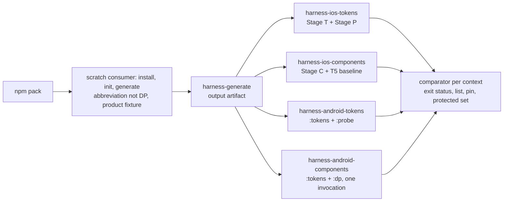

# Design Document: 129 — Consumer-Generation Completeness

**Date**: 2026-11-05
**Spec**: 129 - Consumer-Generation Completeness
**Status**: Design Phase — **R2**: the seven R1 reviews and the four owners' R2 cross-read are folded in (`feedback/design.md`, `[THURGOOD R2]`). Every R1 open item is decided by its owner, except the few in § 16, each of which has an owner and the round that closes it. Tasks start after this file merges (Spec-Feedback-Protocol § "Sequential Formalization Gate").
**Amended in the tasks round (2026-11-05)**: § 10's fallback for older configs is replaced by the registration-keyed built-in bridge (Ada and Lina, the Q3a co-owners), with a dated line in place.
**Amended in tasks amendment 3 (2026-11-06)**: § 0 (three rows), § 2 (Data's lane facts), § 4 (the theme-instance rule, the theme family and both providers, the single-mode rule, product-token names and access, and the shared harness module), § 3 (the probe's count lines and the run file's `checks`, in the review fold), § 10 (the item (i) effects line, and where a WCAG adopter first sees the bridge), Testing Strategy, the Design Decisions register and § 16, each with a dated line in place. Peter's words and their records: § 0.
**Author**: Thurgood (assembler; owner of the comparator, § 3). Every other call here belongs to its owner and is cited to where the owner made it. **The owner rule**: where an item is a named owner's call, that owner's latest position (R2 where they wrote one) is the decision; other seats' accepts and residuals are recorded beside it.
**Go**: Peter, received 2026-11-05T05:38:16Z (orchestrator relay), verbatim: "658 and 664 are merged; go for design".
**Dependencies**: as `requirements.md` header; plus Spec 133 (colour-track, placeholder outline, #669), which receives the shadow channel half (§ 8).
**Facts**: `evidence/facts-at-10ec4af5b.md`, the unedited stdout of `spec-facts.sh 129 4d10202b2 10ec4af5b`. `main` has not moved since. No root record's Trigger names this file.

**Sources, abbreviated**: **L**, **D**, **K**, **A** = the design inbounds of Lina (#665), Data (#666), Kenya (#667), Ada (#668), `inbound-from-<seat>-design-2026-11-05.md`. **`<SEAT> R1`** and **`<SEAT> R2`** are the round entries in `feedback/design.md`. Measurements, labels and counter-arguments stay there and are not restated.

---

## Overview

129 makes a stranger's `init` → `generate` produce token output, the component tier included, that compiles and is themed on all three platforms (requirements, Introduction). The design has four parts:

1. **The instrument**: a compile harness on iOS (Kenya, § 1) and Android (Data, § 2), and the comparator that turns a build into a verdict against a pinned list (Thurgood, § 3).
2. **Generation**: native theme emission (§ 4), native types, colours and font family (§§ 5–7), shadows (§ 8), the component-tier harvest (§ 9), and reading the consumer's own source (§ 10). These are Ada's, with Lina co-owning where named.
3. **The component tier's repairs** (Lina, § 13).
4. **Peter's rulings in this round** (§ 0).

Requirements 10, 12 and 13.3 get their design in § 12a (Ada R1, O-19); Requirement 14 needs none.

---

## 0. Peter's rulings in this round

All times are `date -u` at receipt, by orchestrator relay, as the cited record holds them.

| Decision | His words, verbatim | Received | Recorded in | What it sets in 129 |
|---|---|---|---|---|
| Plan decision 5, the Android minimum | "Re: 5, 26" | 05:54:32Z | D § 6, "Ruled" | `minSdk` 26, by the rule "the higher of 26 and the pinned Compose floor" (23 today). The harness pin is 26 (§ 2). `InputCheckboxLegal.android.kt` L242 needs no guard (Lina). The range numbers stay with Spec 132's D4. Core Goals' line: below |
| Shadow colours, Ada's P-2 | "Re: P-2, (1); but we need to address the surviving issue about the larger migration" | 05:54:32Z | A § P-2, "Decided" | Option (1): the four shadow primitives re-expressed in OKLCH, same colours, no new names (§ 8). The surviving issue (the channel migration) is answered by the colour-track ruling below |
| Plan decisions 4 and 7; the colour-track proposal | "yes, 4 (a), 7 (a)" | 13:05:54Z | K § 5 (4 (a)); A § P-1 (7 (a), and the "yes" is colour-track option (iv)) | **4 (a)**: iOS 17.0 stays, and is Req 2.9's deployment target; the floor is asked again at Spec 132's outline, before any native support claim. **7 (a)**: native changes made before 132's support claim ship in minor releases, item (iii) included, with deprecated-alias emission and D9's public-API diff landing before the claim; this places Req 10.1's release. **(iv)**: Spec 133's folder and its records' Triggers (#669, #670, #671) |
| How Core Goals' Android line is changed | "(a), and start the 131 ledger" | 13:43:14Z | this file; #672's body | **(a)**: a one-item LAW ballot, drafted by Thurgood from § 15's proposed text, as its own PR. Core Goals is not edited in this PR. ("Start the 131 ledger" is outside 129.) What he read: "Is it (a), the one-item ballot?" |
| Theme rulings 4–7 (2026-11-06; tasks amendment 3) | "4 combine, 5 U9, 6 (b), 7 yes; downloads approved" | 2026-11-06T22:38:12Z | `evidence/2026-11-06-peter-rulings-theme-and-downloads.md` (#702) | **4**: the theme-instance rule, with three safeguards: the shared harness module, Task 11's exact-set tests, and the per-run instance check (§ 4). **5**: config theme-name refusals land in U9, measured first under Req 10.4 (§ 4, item 5). **6 (b)**: the provider takes a theme choice in 129 (§ 4). **7**: the iOS probe reads product tokens, as Android's does (§ 4, "Product-token names and access"). "Downloads" is Task 4's toolchain, outside this file |
| The family's shape, the module's owner, the composite fixture, cold-run counting (tasks amendment 3) | "A enum, B Thurgood, C confirmed, D yes; merges done" | 2026-11-06T23:31:58Z | `evidence/2026-11-06-peter-rulings-round-3.md` | **A**: a `<Name>ThemeFamily` enum (§ 4). **B**: Thurgood owns and authors `scripts/harness/native-rules.ts` (§ 4). **C**: the composite product token leaves the harness fixture in Task 11, with Req 2.3 and 5.6 amended. **D**: tasks.md Decision 6 condition 3. "Merges done" was not yet true when he wrote it (the record says so) |
| What a theme of one mode shows in its other scheme (tasks amendment 3) | "fall back to base; merges done now" | 2026-11-06T23:37:03Z | `evidence/2026-11-06-peter-rulings-round-3.md`, § "Follow-up ruling" | Base, in the uncovered scheme (§ 4, "The single-mode rule"). He had been told the cost: a dark-only custom theme shows base light on a light device |

**The wording rule that follows 4 (a)** (Kenya's, from K § 5, with Leonardo's correction, LEONARDO R1 point 5): during 129, shipped text says "compiled for an iOS 17.0 deployment target; not run on any device or simulator". From Spec 132's D5 it says what ran, for example "built for iOS 17.0; renders on iOS 26.x; not run on 17 or 18". This applies Req 15.1 and does not change Peter's 4 (a). Kenya and Data own the "Native status" passage (Req 15.5).

**Not Peter's, and why**: whether item (ii) harvests into the adopter's web output. Lina (L § 5) and Ada (A § D-5) chose option A, and Sparky confirms that it breaks no supported web consumer (SPARKY R1 § 1). Under the rule Peter read on 2026-11-05 ("It comes to you only if it would break a web adopter"), it is the team's call.

Earlier ruling carried: D1's probe sentence, amended by Peter at 05:14:42Z (requirements, Req 2.7 note).

---

## Architecture

- **Generation** reads one token set from the consumer's barrel (§ 10), builds the theme registry from the consumer's config `themes` (§ 10), harvests our six component-token definition files as a third source on iOS and Android (§ 9), and emits native values in each platform's own types (§§ 5–7).
- **The harness** reads that output in place from the packed install (Req 2.1) and compiles it with the packaged native source. It runs no tests and builds no app.

---

## Components and Interfaces

### 1. The iOS harness

**Owner**: Kenya. **Source**: K § 1 (K-1 to K-7), amended by KENYA R1 § 2 and KENYA R2 (O-15). **Satisfies**: Req 2.4, 2.6, 2.7, 2.8, 2.9, 3.2, 3.4, 3.10 (its compiler half), 3.11, 6.2.

- **K-1, three stages on one macOS runner.**
  - Stage T compiles the generated iOS files into a module (`swiftc -emit-module … -c -wmo -parse-as-library -module-name DPHarnessTokens -swift-version 6 -diagnostic-style llvm`, target `arm64-apple-ios<min>-simulator`, `<min>` = 17.0).
  - Stage P compiles the generated probe with plain `import`, and only once Stage T wrote a module. Until then it prints `probe: blocked (token module not built)`.
  - Stage C compiles the generated files with every non-test packaged `.swift` as module `DesignerPunk`, at `-swift-version 5`, without waiting for Stage T.
  - **Pinned file order (O-15)**: Stage C's list is package files first, then generated files, each sorted by path, printed with the invocation.
  - **Same-mode baseline (O-15, KENYA R2 rule 2)**: a Swift 5 compile of the generated files alone, "T5", used only for the cross-tier difference of § 3. Stage T stays at Swift 6 for the token verdict.
- **K-2, normalisation**: only `^<path>:<line>:<col>: error: ` lines are keys. The key grammar is `<root>:<path> | <message>` (O-17, KENYA R1):
  - `root` is one of `gen`, `pkg`, `probe`;
  - `path` is POSIX and relative to its root;
  - `message` is the text after `error: ` on the `-diagnostic-style llvm` line, verbatim;
  - the parser splits at the first ` | ` after the path;
  - there is no line or column, and each key has a count.
- **K-3, the probe** is generated from the consumer's `token-index/`: every entry with a non-null `platforms.ios`, one `_ = <path>` line per read. It prints `probe: read <n> of <m> index names (…)` and fails when `n ≠ m`.
  - The theme list is every colour semantic named `theme.<name>`, read through each theme instance.
  - The root rule is the one `token-index/README.md` § "Platform names" states (§ 4, O-5).
  - It also reads the theme through `\.dpTheme`.
- **K-4, a self-test at each stage's start**:
  - a missing-return fixture must give exactly one `missing return` error;
  - at Stage P, a planted `internal` member must give one inaccessible entry and a read count of 2 of 2.
- **K-5, row 9's interim text guard**: implemented by Ada in `tokenIndexPlatformNames.test.ts`, with Kenya's oracle. Every index iOS name must resolve to a `public` member of a `public` enclosing type (Ada R1 O-5, confirming). It retires in the PR where Stage P first prints a full read count.
- **K-6, toolchain match**: the Xcode is pinned by version, build and app path; the workflow sets `DEVELOPER_DIR`; any field that differs from the pin fails the stage.
- **K-7, the Xcode pin**: the newest Xcode 26 minor on `macos-26` when the harness unit is cut, re-read by the tasks round.
- **Kenya's grant ask for the tasks round (KENYA R1 O-20)**: `harness/ios/**`, the iOS section of the pin file, and the iOS job's steps.

### 2. The Android harness

**Owner**: Data. **Source**: D § 1.1–1.5, amended by DATA R1 (O-11) and DATA R2 (O-15). **Satisfies**: Req 2.4, 2.6 (as amended), 2.7, 2.8, 2.9, 3.2, 3.4, 3.5 (c), 3.11.

- **Three modules in one Gradle build** (`harness/android/`), each `com.android.library` with the Compose compiler plugin:
  - `:tokens`: the generated Kotlin only;
  - `:probe`: generated from the index, depending on `:tokens`, every read inside `@Composable`;
  - `:dp`: the generated Kotlin plus every non-test packaged `.kt`, with Icon-Base `res/`.
- **One invocation per context** (DATA R2, answering Stacy): `./gradlew --continue :tokens:compileDebugKotlin :probe:compileDebugKotlin :dp:compileDebugKotlin`, through the Gradle wrapper committed under `harness/android/` *(amended 2026-11-06, tasks amendment 2, Data's wrapper under Peter's Decision 1, "1 A", received 2026-11-06T14:04:52Z; prior text at `8d8ba1425`: `gradle --continue …`)*. So `harness-android-components` has `:tokens`' diagnostics from its own run. If `:tokens:compileDebugKotlin` did not execute (no task outcome), the component context fails. A `:tokens` compile that fails with diagnostics is a result, not a missing one.
- **Pinned file order (O-15)**: the explicit file list is passed sorted, package files first, and printed with the invocation.
- **Capture and key**: as D § 1.2. The key is `<root>:<relative path> | <message>`, with continuation lines joined by ` ⏎ `.
- **Floor**: as D § 1.4, with the exclusion of Task 4's third criterion (the package's root token files, Req 2.4 as amended) *(amended 2026-11-06, tasks amendment 3, `[DATA R4]` item 4)*.
- **`:probe`'s own package** is outside the reserved packages, so § 9's scan does not flag it (DATA R1 O-11).
- **Pins**: as D § 1.5, with `minSdk` 26 (§ 0).
- **The blocked line is the lane's.** *(Amended 2026-11-06, tasks amendment 3; prior text: Task 4's criterion had `:probe` print `probe: blocked (:tokens not compiled)`.)* Gradle skips `:probe:compileDebugKotlin` when `:tokens:compileDebugKotlin` fails, so no code of `:probe` runs. `lane.ts` prints `probe: blocked (:tokens not compiled)` after the run when `:tokens` did not succeed (by `parseKotlin`) and the log holds no `probe: read` line. The comparator's own note, `probe: blocked (android.tokens failed); its count is not compared`, is unchanged. Task 4's criterion reads "…while `:tokens` fails, the Android lane prints `probe: blocked (:tokens not compiled)` and `:probe`'s count is not compared".
- **What the read count counts.** The line `probe: read <n> of <m> index names` is printed by `:probe`'s `compileDebugKotlin` `doFirst`, and `lane.ts` writes its result into the run file's `checks` (§ 3); the Gradle task does not fail on it *(amended 2026-11-06, tasks amendment 3, Thurgood's ruling on the count format, `[THURGOOD R7]` fork 1; prior text: "`probe: read <n> of <m> index names (<k> reads in total)` … and fails the task when `n ≠ m`")*.
  - `m` is the number of distinct Android names the index gave, counted by `probe-kotlin.ts` from the index and written to `probe-expected.txt`. A list gives one name per element, `null` gives none, and a `theme.` name counts once.
  - `n` is the number of `// @index` markers in the sources `:probe` was given.
  - So `n` says what the probe was given to read. A generator that dropped a name shows as `n < m`. Whether a read compiles is the compiler's verdict, which the comparator reads as `probe:` keys. The count is printed only when `:probe` compiles; while `:tokens` fails, the blocked line stands in for it.
  - Theme-instance, product, provider and key reads are not index names, so they are outside this line's `n` and `m`; each group prints and is compared on its own line (§ 3) *(amended 2026-11-06, tasks amendment 3, `[THURGOOD R7]` fork 1; prior text: "… so they are outside `n` and `m`", which compared them nowhere)*.
- **The counts a context prints are Gradle's.** Each compile task prints, in its `doFirst`, `harness-sources: :tokens gen=<n>` or `harness-sources: :dp gen=<n> pkg=<n>`, the number of explicit files it was given. `lane.ts` takes the run file's `compiled` counts from those lines, not from the list it wrote, and the floors from the manifest (`gen`) and the packed tarball's file list (`pkg`). A task that never starts prints nothing, and its compiled count reads 0.
- **The toolchain report.** `:tokens:compileDebugKotlin`'s `doFirst` prints `harness-toolchain: <field>=<value>` for `java.version`, `gradle.version`, `kotlin.version` (the `kotlin-compiler-embeddable` on the Kotlin Gradle plugin's own classpath), `agp.version` and `compose.bom.version` (the resolved BOM component of `debugCompileClasspath`), and `lane.ts` writes them into the run file's `toolchain`.
- **`:dp`'s namespace is `com.designerpunk.components.core`.** `IconBase.android.kt` refers to `R.drawable.*` unqualified, in its own package, so the module's AGP namespace must equal that package for `R` to resolve. `:tokens` and `:probe` use `dpharness.tokens` and `dpharness.probe`, outside the reserved `com.designerpunk.*` packages.
- **The binding constants are shared.** `LocalDPTheme`, `com.designerpunk.tokens` and `com.designerpunk.product.tokens` are DesignerPunk's fixed names (§ 4, Q12). The Android probe takes them from `scripts/harness/native-rules.ts` (§ 4, "The shared harness module"), as the iOS probe takes the Swift ones. Neither probe derives them from the consumer's abbreviation.
- **Gradle's order.** `gradle.properties` supplies the plain console and no parallel execution, so the printed invocation is exactly `./gradlew --continue :tokens:compileDebugKotlin :probe:compileDebugKotlin :dp:compileDebugKotlin`. Gradle can print a failing task's `FAILED` line before that task's output; `parse-kotlin.ts` reads a `FAILED` line that is the first to name its task as that task's output (`fixtures/parse-kotlin/planted-internal-run.txt`).
  *(The seven bullets from "The blocked line is the lane's" on: added 2026-11-06, tasks amendment 3, Data's facts from the first real Android lane runs, `[DATA R3]` item 3; spliced byte for byte.)*

### 3. The comparator and the workflow wiring

**Owner**: Thurgood (Req 3; the workflow wiring of Req 2). **Satisfies**: Req 2.5, 2.10, 2.11, 3.1–3.11. Folds in STACY R1 § 2 items 1–5 and the O-15 amendment. The list's file format and `harness-generate`'s name are the tasks round's.

**One comparator, two parsers.** Kenya's and Data's parsers (§§ 1, 2) write `(key, count)` pairs in the grammar `<root>:<path> | <message>`. The comparator never parses compiler text.

**Inputs per run**:
- the observed pairs;
- **the build tool's exit status** for each compile the context ran;
- the context's list at the head and at the merge base;
- the pin file at both;
- **the protected-set file at both**;
- the per-tier file count against the floor (Req 3.4);
- the issues root at the head, to resolve tags (Req 3.6).

It reads no PR body and no credential (Req 3.9).

**Verdict rules beyond Req 3's list** (Stacy R1 § 2):
1. **Exit status against the parsed set.** The context fails as `pre-compile` when a compile exits non-zero and the parser found no error for it. It fails as `parser` when a compile exits zero and the parser found errors.
   - So a resource-merge failure, an unresolvable dependency, a configuration error or a driver error with no file path can never read green.
   - This matters most when a list is empty, which is D1's acceptance state.
   - Stage P's printed "blocked" is not a compile and is exempt.
2. **The merge base.** If the list or the pin file cannot be read at the merge base (for example a shallow checkout), the context fails as `base unreadable`. Exception (b) of Req 3.5 is admitted only on positive evidence that the list is absent at a readable base.
3. **Runs with no merge base** (a dispatched run, such as Req 2.11's forced-failure run) check everything except additions. Their summary line says `additions not checked: no merge base`, so such a green is never cited as a full check.
4. **The protected set** is read at both commits, so Req 3.7's removal rule can be decided.
5. **Cross-tier keys (O-15).** In a component context, a `gen:` key that the context's own compile reports, and that the same run's baseline compile of the generated files alone does not, is kept and keyed.
   - The baselines are T5 on iOS and `:tokens` on Android.
   - If the baseline's result is missing, the context fails. It never keeps or drops everything.
   - The summary line counts these keys separately as `cross-tier` (Req 3.8 as amended).
   - Their tags follow every other entry's rules. Under Req 3.5 (c), only the "removes an entry from a list of the same platform" arm can admit them.

**Paths for Req 3.5 (c).** A `pkg:` path is relative to the package root, which is the repository root that `npm pack` packed, so it maps to the repository file at the same path (confirmed for Android, DATA R1 § 2). `gen:` and `probe:` keys have no repository file, so only the removal arm admits them.

**Output**: the verdict and the Req 3.8 summary line. Kenya's self-test (K-4) runs first, and fails the context on its own.

**The probe's count lines and the run file's `checks`** *(added 2026-11-06, tasks amendment 3; Thurgood's ruling as the comparator's owner, `[THURGOOD R7]` forks 1 and 2, on `[KENYA R4]` items 3 and 6 and its addendum items 1 and 4, and `[DATA R4]` items 1 and 2 and its addendum items 1 and 4)*:
- **One format, both platforms.** Each token context's probe prints one compared line per group of required reads:
  - `probe: read <n> of <m> index names`: each distinct name the token index gives the platform, a `theme.` name counted once (Req 2.7: the index's count);
  - `probe: instances read <n> of <m>`: the theme reads, `m` being the shared module's instances times the `theme.` names;
  - `probe: product read <n> of <m>`, `probe: provider read <n> of <m>` and `probe: key read <n> of <m>`.
  - `m` is computed from the inputs (the index, the shared module, the product source) and `n` from the probe source generated from them. A group with nothing to read prints `0 of 0`.
- **Gating results go through the comparator.** Each count line and the per-run instance check (`theme instances:`) is written into the run file as `checks: [{ name, ok, detail }]`. The lane exits 0 for them. The comparator fails the context as class `check` for each `ok: false` and names it in the verdict line, so the `harness-verdict` annotation records it after the logs expire. A run file with no `checks` array fails the context. While the probe is blocked, its count checks are written `ok: true` with detail `blocked`: a blocked probe is not a compile (rule 1).
- **The per-run instance check fails closed.** It writes `ok: false` when the generated code declares the `<Name>Themes` holder and no member can be parsed from it, or declares `DesignerPunkTheme` and no holder can be found. It writes `ok: true` with detail `not checked` only when the generated code declares neither (Ada's and Kenya's additions, `[ADA R3]` fork 4, `[KENYA R4]` item 6). The holder form it parses is pinned in Task 11.
- **What stops before the comparator.** The lane exits non-zero, writing no run file and so no annotation, only when the comparator would have nothing to read: a toolchain that is missing or cannot be set up, a failed self-test, or a failed setup (a duplicate native file name included).
- **A toolchain pin mismatch reaches the comparator**, on both platforms. The lane records the running versions in the run file and still runs its compiles, and the comparator fails the context as `toolchain` (Req 3.11; Task 2's falsification case). Such a run carries `harness-verdict` and counts under Decision 6 condition 3 like any FAIL. The iOS lane, which stopped before compiling, changes in 3.4.

**Wiring**:
- `harness-generate` uploads one output artifact. Each of the four contexts downloads it, and fails, not skips, when the artifact is absent or `harness-generate` failed (Req 2.11).
- The contexts enter as non-required lanes (Req 2.12).
- **Req 2.10 is not left to a path filter** (Stacy R1 § 2 item 5). The tasks round writes the trigger so that all four contexts run on every 129 unit PR, a docs-only or records-only unit PR included.
- The falsification test (Req 3.10) runs in `lane-functional-root`, registered in `.github/in-lane-guards.json`. Besides Req 3.10's list it carries these cases (Testing Strategy):
  - a build that fails before the compiler, with an empty list;
  - a compile that exits zero with parsed errors;
  - a shallow checkout with an unreadable base;
  - a run with no merge base;
  - a removal from the protected set;
  - a cross-tier key, and a missing baseline.

**Stacy's probe question** (STACY R1 § 2, K-3): the probe reads the index that the same `generate` run writes, so it has D2's shape. Req 5.10 is the completeness half against the shipped definition files, which is the condition she named.

### 4. Native theme emission — item (i), with Q12 and Q13

**Owners**: Ada (the generator); Lina and Ada (Q12, Q13 naming); Kenya (iOS types and the iOS provider); Data (Android types and the Android local). **Source**: L §§ 1–3; A § D-4; K §§ 2–3; D §§ 3–4; R1 and R2 entries as cited. **Satisfies**: Req 4.1, 4.2 (as amended), 4.3, 4.7, 4.9, 4.10; 5.6's theme path. Provisional until Spec 132's D4 app builds (Req 4, "Carried to design").

**Q12, theme names: option (a), fixed binding names** (Lina, Ada; Kenya, Data and Leonardo accept; Leonardo withdrew his objection, LEONARDO R1):
- **The binding is DesignerPunk's**, whatever the consumer's `name` or `abbreviation`. On Swift: `DesignerPunkTheme`, `DPThemeKey`, `EnvironmentValues.dpTheme`. On Kotlin: `DesignerPunkTheme`, `LocalDPTheme`, in `package com.designerpunk.tokens`.
- **The key path stays `\.dpTheme`** (O-3: Lina, Ada; Kenya withdrew her rename, KENYA R1).
  - Leonardo's residual (LEONARDO R1 point 4): an adopter whose abbreviation is not `DP` may think the generator ignored their config. A rename to full names is cheapest now, before the support claim, and becomes a breaking change after it.
  - The owners kept `dp` for parity with `LocalDPTheme` and the 27 iOS and 25 Android reads.
- **The iOS theme type (O-1, Kenya's call, KENYA R2)**: `public protocol DesignerPunkTheme: Sendable`. Each theme instance is a generated `struct` that conforms and is `Equatable`.
  - The 11 `any DesignerPunkTheme` sites in `VisualStateStyles.swift` keep compiling. On a struct each would be an error (KENYA R1, measured in Swift 5 and 6).
  - The generator test asserts the `: Sendable` clause.
  - Lina and Ada accept (LINA R2, ADA R2). Lina withdrew her struct, so § 13 carries no `any` edits.
  - A 62-member protocol with four conforming structs, the key, the holder and the modifier compiles in Swift 5 and 6, and so does an adopter's plain-`import` Swift 6 module (KENYA R2, at her toolchain, not yet at the pin).
- **The Kotlin theme type**: `data class DesignerPunkTheme(val …: Color, …)` (D § 4; DATA R1 O-16). Data proposes an `@Immutable` annotation; that is Ada's call as the emitter's owner, and nothing in 129 observes it (§ 16).
- **No aliases in 129 (O-2; Lina and Ada, the Q12 owners; Data, Kenya and Leonardo accept)**: no `typealias <Name>Theme`, no `Local<ABBR>Theme`, no second Swift key.
  - Why: under Peter's 7 (a), every emitted name becomes API at 132's support claim. Adding an alias later is additive; removing one is a major release. Two spellings also split docs, search and agent answers (Leonardo).
  - Kenya's verification that aliases compile stands for a later addition.
- **The adopter's product name** goes on the instances and on the provider:
  - **Holder**: Kotlin `object <Name>Themes { val BaseLight; val BaseDark; val WcagLight; val WcagDark; … }`, as the 094 emitter writes it. Swift `public enum <Name>Themes { public static let baseLight, baseDark, wcagLight, wcagDark, …: any DesignerPunkTheme }`, each backed by a generated struct `<Name>BaseLightTheme`, …. There is one member per instance of the theme-instance rule below (Req 4.1). *(Amended 2026-11-06, tasks amendment 3; prior text at `233e04bf1`: "There is one member per registered theme and mode (Req 4.1).")* `<Name>` is the config's `name`, not the abbreviation (Leonardo).
  - **iOS implicit members** (Kenya's idiom; Lina and Ada accept): a `static var` in `extension DesignerPunkTheme where Self == <Name>BaseDarkTheme`, so `.environment(\.dpTheme, .pbBaseDark)` works, one per instance, named by the theme-instance rule's item 4 (below). These are product-named access to instances, not aliases. *(Amended 2026-11-06, tasks amendment 3, Kenya's name rule, `[KENYA R3]` item 6.1; prior text at `233e04bf1`: "`.pbDark`", which names no instance once `dark` is not a theme.)*
- **The theme family (6(b))** *(Amended 2026-11-06, tasks amendment 3, under Peter's ruling 6, "6 (b)", received 2026-11-06T22:38:12Z (`evidence/2026-11-06-peter-rulings-theme-and-downloads.md`), and his "A enum", received 2026-11-06T23:31:58Z (`evidence/2026-11-06-peter-rulings-round-3.md`). The shape is Kenya's on iOS and Data's on Android. Prior text at `233e04bf1`: the providers took no theme choice, `View.<name>Theme()` and `<Name>Theme(darkTheme = isSystemInDarkTheme()) { content }`.)*
  - `generate` writes one family type per consumer, `<Name>ThemeFamily`.
  - **Its cases**: `base`, `wcag`, then one case per other registered theme, in config order.
    - There is no `dark` case. Dark is a mode, and the provider takes it from the system scheme.
    - A case name is the theme's words with no mode suffix (the theme-instance rule, item 4): Swift lower-camel (`.highContrast`), Kotlin Pascal (`HighContrast`).
    - Until U9 the family has exactly `base` and `wcag` (the theme-instance rule, item 3).
  - **Swift**: `public enum <Name>ThemeFamily: Sendable, Hashable, CaseIterable`.
    - A public enum is not implicitly `Sendable` outside its module, so the clause is written out.
    - A case that is a Swift reserved word is declared in backticks (`` case `default` ``) and is used as `.default`. `self`, `init` and `allCases` are refused (the theme-instance rule, item 5 (h)).
  - **Kotlin**: `enum class <Name>ThemeFamily { Base, Wcag, … }` in `package com.designerpunk.tokens`. A Pascal entry cannot collide with a Kotlin keyword.
  - **The default is `base`** on both platforms.
  - **Each case carries a generated doc comment** naming its instance in each scheme, and, for a theme of one mode, that the other scheme falls back to base: for example `/// light: brandLight · dark: baseDark (no dark overrides; falls back to base)`. From U9, where a built-in map applies through the bridge (§ 10), the `wcag` case's comment also names that source. Xcode and Android Studio show it at the call site, which is the only place an adopter meets the single-mode rule and the bridge before a run *(added 2026-11-06, tasks amendment 3, Leonardo's remedy, `[LEONARDO R2]`; Ada, the emitter's owner, to confirm in Task 11)*.
  - **`CaseIterable` stays.** It was checked against Leonardo's picker point (LEONARDO, cross-read round 3): the family is a closed set, and an app must be able to list it.
    - `allCases` lets an adopter fill a `Picker` or a settings list without restating the theme names. That is the closed set Leonardo asked the enum to give.
    - On Kotlin nothing is added, because every `enum class` has `entries`.
    - **Its cost**: the order of `allCases` can be observed. It is config order, so adding a theme appends a case, which is additive.
    - **Not in 129: a `String` raw value** (Kenya's call, 2026-11-06, `[KENYA R3]` item 4), which `@AppStorage` needs to store a case directly. It would make each theme name a stored value, a persistence contract adopters' saved data depends on. Adding it later is additive. On Kotlin an entry's `name` already serves. The two platforms differ here by decision, not drift, until Kenya and Data agree to add a raw value. *(Kenya's ruling replaces, in the splice, Ada's "It is Kenya's call, and it is not taken here … until Kenya decides".)* Without a declared raw value, adopters will persist `String(describing:)` on iOS and `name` on Android, an undeclared contract; that question is carried to Spec 132's D5 ("Spec 132 inputs", below; `[LEONARDO R2]`).
- **iOS provider** (Kenya's shape): `public extension View { func <name>Theme(_ family: <Name>ThemeFamily = .base) -> some View }`, where `<name>` is the lower-camel form of `<Name>`.
  - It keeps `@Environment(\.colorScheme)`. A generated `ViewModifier` reads the scheme and sets `\.dpTheme` to the family's instance for that scheme.
  - `.<name>Theme()` still means base, so a call written to the earlier text is unchanged.
  - A WCAG adopter writes `.<name>Theme(.wcag)` and keeps automatic light/dark switching. That is what ruling 6 asked for.
  - It is verified to compile. Switching at run time is Spec 132's D5.
- **Android provider** (Data's shape): `@Composable fun <Name>Theme(family: <Name>ThemeFamily = <Name>ThemeFamily.Base, darkTheme: Boolean = isSystemInDarkTheme(), content: @Composable () -> Unit)`.
  - It provides `LocalDPTheme` with the family's instance for `darkTheme`.
  - `<Name>Theme { … }` still means base.
  - A WCAG adopter writes `<Name>Theme(family = <Name>ThemeFamily.Wcag) { … }`, or `family = Wcag` with the entry imported.
  - `darkTheme` stays, so a caller can force a mode.
  - `LocalDPTheme`'s default stays `<Name>Themes.BaseLight` (O-6, below).
  - With no aliases, it collides with nothing, except under the default config name. `ConfigLoader` defaults `name` to `DesignerPunk`, so the provider is then `DesignerPunkTheme(family, darkTheme, content)`, the same name as the theme `data class DesignerPunkTheme` in the same package. Data compiled a hand-written equivalent of that shape on 2026-11-06 under the pinned toolchain (Gradle 9.8.2, Kotlin 2.4.21, AGP 9.5.0, BOM 2026.09.00): it compiles, both `DesignerPunkTheme { … }` and `DesignerPunkTheme(family = DesignerPunkThemeFamily.Wcag) { … }` resolve to the provider, and the class stays usable as a type (`[DATA R4]`). Task 11 still compiles the real generated output once and records the result. If it does not compile, the rename touches the provider function only, the Q12 type `DesignerPunkTheme` being fixed, and it is Ada's and Data's call, made before U6's PR opens *(added in the splice, on Data's point, `[DATA R3]` item 6.2; amended 2026-11-06 in the review fold, `[DATA R4]` and `[ADA R3]` fork 2)*.
- **Selection**: inside the generated provider, a `switch` on Swift and a `when` on Kotlin. It is not a public function, so 6(b) adds no API beyond the family type and the parameter.

  | Family | Light scheme | Dark scheme |
  |---|---|---|
  | `base` | `baseLight` | `baseDark` |
  | `wcag` | `wcagLight` | `wcagDark` |
  | a registered theme of mode `both` | `<t>Light` | `<t>Dark` |
  | a registered theme of one mode | the single-mode rule, below | the single-mode rule, below |

  - `wcag` always has both instances (the theme-instance rule, item 1), whatever mode its config entry declares, so the single-mode rule never applies to it.
  - **Why the enum** (Peter's "A enum"): it follows Leonardo's dissent and the orchestrator's lean. Ada, Kenya and Data had leaned to a light/dark pair of instances.
    - The WCAG case is one argument.
    - A swapped light/dark pair cannot be written.
    - The closed set drives a picker.
  - **Residual**:
    - At 132's support claim, every theme name in the config becomes a public case name. Renaming or removing a theme then breaks the source of any code that names its case.
    - The family has to say what a single-mode theme shows in its other scheme, which a pair of instances never had to say.
- **The single-mode rule: a theme of one mode falls back to base** *(Amended 2026-11-06, tasks amendment 3, under Peter's ruling, "fall back to base", received 2026-11-06T23:37:03Z (`evidence/2026-11-06-peter-rulings-round-3.md`, § "Follow-up ruling"). This was Ada's and Leonardo's position. Kenya and Data held that such a theme always shows its one mode, with `wcag` and `dark` exempt. Prior text at `233e04bf1`: none; the providers took no family.)*
  - A theme's `mode` says in which scheme its overrides apply. In the other scheme, its family shows that scheme's base instance:
    - a theme of mode `light` shows `<t>Light` in the light scheme and `baseDark` in the dark scheme;
    - a theme of mode `dark` shows `baseLight` in the light scheme and `<t>Dark` in the dark scheme.
  - No instance is emitted for the uncovered mode (the theme-instance rule, item 3).
  - An adopter who wants one look in both schemes registers the theme in mode `both`, with the same map for each mode.
  - `wcag` is not touched by this rule ("Selection", above).
  - **Web follows the same meaning** at U9, when a registered custom theme first emits as `:root[data-theme="<name>"]` (§ 10, "Effects").
    - The 094 web emitter does not follow it yet. It has no caller (`generateThemeOverrideBlocks`, `TokenFileGenerator.ts` L1044). It writes a theme of mode `light` as static light values (L1120–1122). It writes a theme of mode `dark` as static dark values under `color-scheme: dark` (L1109–1111, L1117–1119), which forces the page dark.
    - Task 14 changes that emitter. A theme of one mode emits `light-dark()` with base in its uncovered mode: `light-dark(<its value>, <base dark value>)` for mode `light`, and `light-dark(<base light value>, <its value>)` for mode `dark`, with no `color-scheme` line.
      - The uncovered half is read from `baseLight` or `baseDark`. Today the emitter skips a token unless both of the theme's own lookups return it (L1095), so a theme of one mode would emit nothing for it.
      - A token whose two values are equal is written as a plain value, as the emitter writes it today.
      - `CSSThemeScoping.test.ts` L27–44 pins today's dark-only output, and Task 14 rewrites it.
    - Sparky confirmed this form in his consult on Ada's text for this rule (`feedback/tasks.md` § "Tasks amendment 3", `[SPARKY R2]`). Base `:root` already depends on `light-dark()` (Baseline 2024) under `color-scheme: light dark`, so this adds no new browser floor *(reworded 2026-11-06, `[SPARKY R3]` fix 4)*. No adopter sees a change today, because a custom `data-theme` matches nothing, so it is not a Req 10.4 case; Task 14's release notes say what it means. *(Sparky's changes (a)–(d) are applied in the splice; Ada's text read "Sparky confirms the web half in Task 14.")*
  - **What it costs adopters**:
    - A light-only custom theme shows base dark in the dark scheme, so its brand colours are absent at night.
    - A dark-only custom theme shows base light in the light scheme.
    - In both cases nothing tells the adopter. Only a run or a screenshot shows it.
    - An adopter who wanted the theme's one mode in every scheme must register it in mode `both`, or force the scheme with `.preferredColorScheme` on iOS or `darkTheme` on Android.
    - On web, "uncovered mode" means the scheme of each element, not of the device. A subtree an adopter sets to `color-scheme: light` shows base light there. That matches how base tokens behave, but not the native providers, which follow the system scheme. A dark-only theme does not force the page dark, as the unwired 094 emitter's `color-scheme: dark` would have *(Sparky's residual, `[SPARKY R2]`, added in the splice; reworded 2026-11-06, `[SPARKY R3]` fix 3: no adopter ever saw the forced-dark page)*.

**The theme-instance rule** *(Amended 2026-11-06, tasks amendment 3, under Peter's ruling 4, "4 combine", and ruling 5, "5 U9", received 2026-11-06T22:38:12Z (`evidence/2026-11-06-peter-rulings-theme-and-downloads.md`). The rule is Ada's, as the emitter's owner. Kenya, Data, Lina and Leonardo were consulted in cross-read round 3. Prior text at `233e04bf1`: the instances were given only by example, "base light and dark, WCAG light and dark".)* The generator emits these theme instances and no others, and both probes read exactly these.

1. **Four fixed instances, always.**
   - The four are `baseLight`, `baseDark`, `wcagLight` and `wcagDark` (Kotlin `BaseLight`, `BaseDark`, `WcagLight`, `WcagDark`).
   - They are emitted whatever the config registers, in local mode and in package mode.
   - In local mode, each override map they apply comes from where § 10's registration-keyed bridge says:
     - the adopter's file, for a map the config registers;
     - the package's built-in file, with the bridge warning, for a map it does not.
   - No config can remove one of the four through 129. The set is re-ruled at 17.0.0, when an unregistered built-in is no longer applied (§ 10, "Retirement").
2. **Three reserved names, each with its mode semantics.**
   - **`base`** is the theme with no overrides. It is never registered. `baseLight` and `baseDark` are the base light and dark contexts.
   - **`dark`** is not a theme. It is the base theme's dark map, because dark is a mode (Spec 080).
     - It registers with mode `dark` only.
     - It adds no instance. Its overrides form `baseDark`, and they are also the first layer of `wcagDark`.
   - **`wcag`** registers with mode `light`, `dark` or `both`, or in § 10's `{ light, dark }` form.
     - It adds no instance.
     - Its light map forms `wcagLight`. Its dark map, the `dark-wcag` map, is the top layer of `wcagDark`.
   - **The WCAG dark composition.** `wcagDark` is the base dark context with three maps applied in order, the later map winning:
     1. `dark`;
     2. `wcag` light;
     3. `wcag` dark (`dark-wcag`).

     This is `src/generators/generateTokenFiles.ts` L195 at `233e04bf1`: `'dark-wcag': { ...darkSemanticOverrides, ...wcagSemanticOverrides, ...darkWcagSemanticOverrides }`.
     - Task 14 keeps this composition when the maps come from the config. Each layer is read from where the bridge says, and the order does not change.
     - So take a config that registers `wcag` in mode `light` only, as `init` writes it today. Its `wcagDark` is not plain base dark:
       - its own WCAG light overrides sit over the dark map;
       - the package's built-in `dark-wcag` map sits on top, and the bridge warning names it.
3. **Every other registered theme adds one instance per mode it covers.**
   - Mode `light` adds `<t>Light`, mode `dark` adds `<t>Dark`, and mode `both` or the `{ light, dark }` form adds both.
   - Its light instance is the base light context with its light map applied.
   - Its dark instance is the base dark context, which already carries the `dark` map, with its own dark map applied. The 094 emitter falls back to the same contexts (`src/generators/TokenFileGenerator.ts` L1223–1235 at `233e04bf1`).
   - No instance is emitted for a mode the theme does not cover. What its family shows in that scheme is the single-mode rule (above).
   - **When these first appear.** A registered custom theme first reaches native output at U9, when `generate` first builds the registry from the config's `themes` (§ 10). Until then, the config's themes print "registered, not applied yet", and U6 emits the four fixed instances only.
4. **Names.** An instance name is the theme name's words followed by the mode suffix.
   - **The words** are the theme name split at every `-` and `_`.
     - Swift writes them lower-camel: `high-contrast` gives `highContrastLight`.
     - Kotlin writes them Pascal: `high-contrast` gives `HighContrastLight`.
     - Only the first letter of each word changes case, and every other letter stays as written. So `highContrast` is one word, and gives `highContrastLight` and `HighContrastLight`.
   - **The suffix** `Light` or `Dark` is always written, for a theme of one mode too.
     - Today's emitter writes a single-mode theme with no suffix: Swift `<Name><T>` (`TokenFileGenerator.ts` L1245) and Kotlin `<T>` (L1389), with the name only capitalised (L1216, L1371). Task 11 changes both.
     - Why the suffix is always written:
       - an instance name is then never a bare word that could be a language keyword;
       - it never equals a reserved name;
       - it does not change when the theme later gains its other mode.
   - **Every name derived from an instance uses this name**: the holder member, the backing Swift struct (`<Name>` + the Pascal instance name + `Theme`, for example `<Name>HighContrastLightTheme`) and the iOS implicit members (Kenya's idiom, one per instance). An implicit member is `static var <abbr><Pascal instance name>`, where `<abbr>` is the config's abbreviation in lower case, declared on `extension DesignerPunkTheme where Self == <Name><Pascal instance name>Theme`: for example `.pbBaseDark`, `.pbWcagLight` and `.pbHighContrastLight` *(the name rule is Kenya's, `[KENYA R3]` item 6.1, added in the splice; Ada's text named no member name)*.
   - **Order.** The holder declares `baseLight`, `baseDark`, `wcagLight`, `wcagDark`, then each other registered theme in config order, its light instance before its dark. *(Added 2026-11-06, tasks amendment 3, Ada's text, `[ADA R3]` fix 1.)*
5. **Refusals.** `generate` refuses the config, and names the config entry, when any of these holds:
   - (a) A theme name:
     - is empty;
     - contains a character other than an ASCII letter, a digit, `-` or `_`;
     - has an empty word, from a leading, trailing or doubled `-` or `_`;
     - or has a first word that begins with a digit.

     So every derived name is an identifier on both platforms.
   - (b) A theme is named `base`.
   - (c) `dark` is registered with a mode other than `dark`, or in the `{ light, dark }` form.
   - (d) A name matches `base`, `dark` or `wcag` when letter case and separators are ignored, but is not spelled exactly that way (for example `WCAG`, `Dark`, `Base`). Such an entry either collides with a fixed instance or misses the reserved meaning its author most likely intended.
   - (e) Two themes give the same Pascal words when letter case is ignored (for example `high-contrast`, `high_contrast` and `highContrast`). The message names both entries.
   - (f) A name is registered twice. `ThemeRegistry.register` already throws "Theme '<name>' is already registered" (`src/themes/ThemeRegistry.ts` L47–48), and the config first reaches that check at U9.
   - (g) A theme's mode is not `light`, `dark` or `both`.
   - (h) A theme's Swift family case would be `self`, `init` or `allCases` ("The theme family (6(b))", above). `.init` cannot be used after a dot (VERIFIED by Kenya, Xcode 27.2). `` `self` `` declares and `.self` compiles, but what `.self` names is UNVERIFIED, so it stays refused until someone shows it. A case named `allCases` declares beside `CaseIterable` with no diagnostic, and which member `<Name>ThemeFamily.allCases` then names is not left to the compiler *(`allCases` and the reasons are Kenya's, `[KENYA R3]` item 6.2, added in the splice; Ada's text read "`self` or `init`. Backticks cannot make those usable after a dot")*.

   **Where the refusals land** (Peter's ruling 5, "5 U9"):
   - Every refusal above is a `generate` refusal of a consumer's config. Each lands in U9 (Task 14), the unit where a config theme first reaches output. Before U9, nothing refuses a config theme, because a config theme reaches no output.
   - Each refusal is measured first, under Req 10.4. Task 14 runs each refusal against the configs it can read: a scratch copy of test01's config and product tokens (never `generate` in test01 itself, which is Peter's real consumer), a scratch `init` from a 15.x-born packed install, and the repository's fixtures *(amended 2026-11-06, tasks amendment 3, `[ADA R3]` fix 3; prior text at `d3dd101b9`: "test01")*. Then:
     - either no supported consumer is affected, and the refusal ships in U9's release;
     - or the refusal ships at 17.0.0. Until then, `generate` prints the refusal's message as a warning. For (a), (d), (g) and (h), it emits no native instance or family case for that theme. For (e), it does the same for the later entry. For (b), it ignores the entry. For (c), it applies the entry's dark map as the base dark map and ignores any light half. For (f), it uses the first entry and ignores the later ones. *(Amended 2026-11-06, tasks amendment 3, Ada's text, `[ADA R3]` fix 2; prior text at `d3dd101b9`: "Until then, `generate` prints the refusal's message as a warning and emits no native instance or family case for that theme.", which fits (a), (d), (e), (g) and (h) only.)* That is what the theme had before 129, so no adopter loses output it had.
   - The shared harness module applies the same checks to the harness's own consumer config from Task 5. That is a check on our fixture, not a refusal of a consumer, so Req 10.4 does not apply to it.

**What checks the rule** (Peter's ruling 4, "4 combine"):
- the shared harness module holds the rule for both probes (below);
- Task 11's exact-set emitter tests assert that the emitted instance set equals this rule's, for each case in items 1–4, and Task 14's tests assert each refusal in item 5, where the refusals land *(split in the splice, on Lina's note, `[LINA R2]` note 1; Ada's text put "each refusal in item 5" in Task 11, before any refusal exists)*;
- each harness run checks the instances the generated code declares against the probe's declared instances.

**Q13, the access form for static colours: option (a), every colour semantic in the theme** (Lina, Ada; Kenya and Data accept).
- **The member set (O-4, Lina's definition; Ada withdrew hers, ADA R1)**: every entry the consumer's token index classes `category: color` among the semantics. That is 62 in DesignerPunk's index at `origin/main`, and the index is the count.
  - Kenya withdrew 61 (KENYA R1). It came from a stale header comment in the scaffolded dark-override file, which lists 54 names. That finding is Ada's (§ 16).
- **The index names every colour semantic `theme.<name>` on iOS and Android** (today 14 do), with `token-index/README.md` § "Platform names" in the same PR. This is Ada's generator work, in the emission PR.
- **The component rule** (L § 2): a native component reads a semantic colour only through `theme.<name>`, and reads primitives and every non-colour token through `DesignTokens`. Lina's guard (Req 4.4) enforces both directions against the index.
  - Its starting baseline is the 2 `DesignTokens.<semantic colour>` reads (LINA R1).

**The probe's theme list and name roots (O-5, Ada; Kenya accepts)**:
- No new index field. A native theme member is exactly a `category: color` semantic with a `theme.` platform name. The `themeVarying` flag keeps its documented base-scoped meaning.
- `token-index/README.md` § "Platform names" states the root rule:
  - a `theme.` name is read through a theme instance;
  - other primitive and semantic names are relative to `DesignTokens`;
  - `components.yaml` names are top-level types.
- K-5 asserts the rule, and the probe's `n = m` check proves it on every run.
- Req 4.2 is amended in this PR to name this set (§ 15).

**The Android `CompositionLocal` (O-6, Data's call, DATA R2)**: **`staticCompositionLocalOf { <Name>Themes.BaseLight }`, plus the provider composable above.**
- The two seats crossed in R1: Ada took Data's static form, and Data took Ada's `compositionLocalOf`. In R2, Ada yielded the call to Data ("Data's call (Android). I yield back to it"), and Data restated his original position ("I withdraw my R1 switch").
- Why static: a theme changes rarely, and the static form is the Compose convention for it (REASONING, Data).
- All seats agree the default is the base light instance, so the 31 previews in 20 files render without a provider. Lina has no component preference (LINA R2).
- Residual: a forgotten provider renders base light silently. Only a run catches it (132's D5).

**Item (i)'s emitter defects (O-7, taken in by Ada, ADA R1; no new record, so Data files none)**:
1. **Unresolved values.** The theme emitter resolves each member's value per (theme, mode) through the same resolver and the same native colour path as the base output (§ 6).
   - `rgbaToSwiftUIColor`, `rgbaToComposeColor` and the light/dark `varyingNames` comparison are removed.
   - This also removes Kenya's second iOS fault: sRGB values at two decimal places (KENYA R1 O-7).
2. **Imports mid-file.** The theme block emits no `import` lines. Each generated file has one import list at its head, computed from the types used (row 6 on Kotlin; `import SwiftUI` on iOS).
3. **Tests**: Jest, on output generated from the repository's real token definitions, not `rgba(…)` fixtures:
   - zero `Color.Unspecified`, `Color.clear` and `unresolved` in emitted themes, per platform;
   - every import line precedes the first declaration.

   This is the check that tells "themed" from "has a theme type" (Stacy R1, on Req 1.7). Req 4.2 now requires resolved values (§ 15).

**Interfaces**:
- The generator splits Spec 094's `{Name}Theme` / `{abbreviation}Theme` naming into a fixed contract and config-named instances (A § D-4). The product-token emitters write `extension DesignerPunkTheme` and `LocalDPTheme`.
- `SwiftThemeTypes.test.ts` and `KotlinThemeTypes.test.ts` re-baseline in the emission PR (Req 4.3).
- The emission PR carries row 12's item 3 colours and the Button-CTA reads (Req 4.5; § 13).
- When item (i) ships, Kenya's and Data's charter theming sections and the consumer overlays change and are re-signed (Req 4.9).
- The dated pointer in Spec 128's outline is Thurgood's, owed after this file merges (§ 15).

**Product-token names and access** *(Amended 2026-11-06, tasks amendment 3, under Peter's ruling 7, "7 yes", received 2026-11-06T22:38:12Z (`evidence/2026-11-06-peter-rulings-theme-and-downloads.md`): the iOS probe reads product tokens, as Android's does. Ada gave the rules from the generator source as the owner of product-token generation. Leonardo's conditions, given after the ruling, are carried in. Line numbers are at `233e04bf1`. Prior text at `233e04bf1`: none.)*

**What `generate` reads.**
- It reads every `*.yaml` file directly in the config's `productTokens` folder, with no subfolders (`src/build/product/ProductTokenGenerator.ts` L78). That folder is resolved against the config's folder (`src/config/ConfigLoader.ts` L141; `src/cli/generateProductTokens.ts` L30).
- It writes `<output>/product/ProductTokens.ios.swift` and `ProductTokens.android.kt` (`generateProductTokens.ts` L27, L57–58).
- A file that does not parse, or that has no `tokens` key, contributes no category (`ProductTokenGenerator.ts` L118–124).
- **The harness's keys for them.** In the harness consumer, whose platform output folders are the config's `output`, the product files are keyed `gen:product/ProductTokens.ios.swift` and `gen:product/ProductTokens.android.kt` (tasks.md, "The `gen:` path rule"), not `gen:ProductTokens.<ext>`. The shared harness module states that key form once *(Data's point, `[DATA R3]` item 6.4, added in the splice; VERIFIED by Data on Android, where the lane lists `.kt` files recursively, and by Kenya on iOS, `[KENYA R4]` item 5)*.

**The names.**
- **Category** = the file name without `.yaml` (L126).
  - The YAML's own `category:` field is not read.
  - In type names, the category is written in PascalCase split at `-` only (`SwiftEmitter.ts` L90–92, `KotlinEmitter.ts` L82–84). Each segment's first letter is uppercased and the rest is kept as written, so `brand-colors` gives `BrandColors` and `brand_colors` gives `Brand_colors`.
  - This splits differently from the theme-instance rule, which splits at `-` and `_`. The difference is the generator's behaviour at `233e04bf1`, and 129 does not change it.
- **Keys** are written as the YAML has them, in file order (`ProductTokenGenerator.ts` L130; `SwiftEmitter.ts` L39; `KotlinEmitter.ts` L52, L68–78).
- **Platforms filter.**
  - A token's `platforms` list decides which files it is emitted to. An absent list means all three (`ProductTokenGenerator.ts` L58, L131).
  - Each native emitter keeps only the tokens whose list names its platform (`SwiftEmitter.ts` L14–17, `KotlinEmitter.ts` L14–17).
  - An explicit empty list emits the token nowhere.
  - A category left with no tokens for a platform emits nothing on that platform.
- **Swift.**
  - A static token is `Product<Cat>.<key>`, a `public static let` in `public enum Product<Cat>` (L35–39).
  - A theme member is `product<Cat><Key>`, a `var … : Color { self.<member> }` on the theme protocol's extension (L52–56):
    - `<Key>` is the key with only its first letter uppercased (L94–95);
    - `<member>` is the index's iOS name for the referenced token, with `theme.` removed (L55).
- **Kotlin.**
  - Every token of a category is a member of `object Product<Cat>`, in `package com.designerpunk.product.tokens` (L24, L47–48), named by its key alone.
  - A static token is a `val` (L66–78).
  - A key that is a Kotlin hard keyword (`in`, `is`, `object`, …) makes a member that does not compile, and the probe then reads it as a `probe:` entry. Swift has the same class (`default`, `class`, `in`, `is`, `self`, `true` as a bare `static let`). Today's emitters have no backtick or refusal rule, so this is not a regression. **129 adds none** (Ada's call, `[ADA R3]` fork 1): the fix belongs at the source, where the product MCP's indexer and `validateProductTokens` would refuse a key that is a keyword on any native platform, measured under Req 10.4 when it is taken. Ada files that record, covering both platforms, before U6's PR opens *(Data's point, `[DATA R3]` item 6.3, added in the splice; ruled in the review fold)*.
  - A theme member is `val <key>: Color` with a `@Composable @ReadOnlyComposable get()` that reads `<local>.current.<member>` (L50–53), where `<member>` is the index's Android name with `theme.` removed.

**The access rule from U6 (the `theme.` rule).**
- A product token is a theme member on a platform exactly when it has a `ref` and the index entry it resolves to has a `theme.` name on that platform (Req 5.6; this section's "probe's theme list and name roots", O-5). Otherwise it is static:
  - `DesignTokens.<name>` for a `ref`;
  - a literal for a value.
- The theme member is written on the fixed binding:
  - Swift: `public extension DesignerPunkTheme`;
  - Kotlin: `LocalDPTheme` (this section's "Interfaces").
- A probe reads it as follows:
  - **Swift**: once through an `any DesignerPunkTheme` value taken from `\.dpTheme`. The member is the protocol extension's, so it is the same on every instance.
  - **Kotlin**: as `Product<Cat>.<key>` inside `@Composable`.
  - **Static tokens**: as `Product<Cat>.<key>`, on both platforms.
- **Before U6 the generator does something else.**
  - It picks theme or static by the index's base-scoped `themeVarying` flag (`ProductTokenGenerator.ts` L139). That flag misses the five WCAG-only colours.
  - It extends `<Name>Theme` on Swift (`SwiftEmitter.ts` L12, L52).
  - It reads `Local<ABBR>Theme` on Kotlin (`KotlinEmitter.ts` L12).
  - A `ref` the index cannot resolve is still emitted, with a fallback value, and `generate` warns (`ProductTokenGenerator.ts` L140–142; `generateProductTokens.ts` L62–66).

**The shared harness module encodes the rule from U6, not the generator's behaviour before U6.**
- Before U6, each place where the generated code differs from the module is a tagged entry on the token lists, not a change to the module.
  - It is tagged to row 2's record for the theme getters, or to row 13's record for the composite and WCAG-only references, by cause (Req 4.8).
  - The entries are removed in U6's diff (Task 11).
- The composite token leaves the harness fixture in Task 11, under Peter's ruling "C confirmed" (`evidence/2026-11-06-peter-rulings-round-3.md`), so the module carries no composite rule and the probe applies no filter.

**Leonardo's conditions** (given after ruling 7; conditions of his no-objection):
1. The probe reads product tokens only from the configured `productTokens` folder, through `harness-consumer.json`. It never reads the product MCP or a screen specification.
2. The probe reads the names the generator writes, as stated above. It never names a product token in a form of its own or a form taken from documentation.
3. Until item (i) emits, the probe's product-token entries are tagged, as stated above.
4. The harness fixture (`harness/fixtures/product-tokens/**`) is a test input chosen to exercise the generator. It is never precedent for product tokens. Product tokens are governed by Product-Token-Governance, and no document cites the fixture as an example of practice.

**The shared harness module** *(Amended 2026-11-06, tasks amendment 3, under Peter's "B Thurgood", received 2026-11-06T23:31:58Z (`evidence/2026-11-06-peter-rulings-round-3.md`); prior text at `233e04bf1`: none.)*
- `scripts/harness/native-rules.ts` holds the theme-instance rule, the theme family's cases and the product-token names and access rule above, as pure functions, with their test. It also holds the fixed binding names (Q12: `DesignerPunkTheme`, `DPThemeKey`, `\.dpTheme`, `LocalDPTheme`, `com.designerpunk.tokens`, `com.designerpunk.product.tokens`) and the product files' `gen:` keys, so neither probe derives them *(added in the splice, from Data's § 2 bullet "The binding constants are shared", `[DATA R3]` item 3)*.
- It is an independent copy of these rules, written from this design text. Thurgood owns and authors it, as a Task 5 subtask done first (5.4: it lands on the unit branch before Kenya's 3.4 and Data's 4.3 start, and those two subtasks import it).
- `probe-swift.ts` and `probe-kotlin.ts` import it and keep no local copy.
- The generator never imports it, and nothing under `src/` imports `scripts/harness/`. That separation is what lets one copy be checked against the other, in two places:
  - **Task 11's comparison test**, `scripts/harness/__tests__/native-rules-emitter.test.ts`, runs the generator's theme emitter and the module on the same configs (S, C and the default name, tasks.md Task 11) and asserts equal instance sets and family cases. Ada writes it in U6 under Task 11's row. **After U6 it is Thurgood's to maintain** (it lives in his folder and fails when his copy drifts), with Ada consulted on any change to its emitter side; a change after U6 rides a task-row or issue-row grant, because `scripts/harness/**` is not in a standing scope. Task 18 registers it as a named in-lane guard *(owner and registration added 2026-11-06, tasks amendment 3, on `[LINA R3]` fixes 2a and 2b and `[STACY TASKS R4]` Low-2)*. A test there may import both, because the ban runs one way: nothing under `src/` imports `scripts/harness/`, and scripts tests already import `src/`. Task 11's own exact-set tests in `src/generators/__tests__/` check the emitter against literal lists, not against the module.
  - **The per-run instance check**, on the harness consumer's real output, each run (Peter's ruling 4, third safeguard; tasks.md Tasks 3, 4 and 11). It reports through the run file's `checks` and fails closed (§ 3).
  *(Placed in the splice by Thurgood, the module's owner, on Lina's note, `[LINA R2]` note 2: Ada's sentence gave the comparison no place a test could live.)*
- Ada is consulted on every rule change. Kenya and Data each review their own platform's rules.

### 5. The native type table

**Owners**: Ada (the generator); **Data (the Android types, DATA R2)**; **Kenya (the iOS types, KENYA R2)**. **Source**: A § D-1; D § 2; R1 and R2 entries as cited. **Satisfies**: Req 6.4, 6.5, 6.7, 6.8, 6.9; rows 3, 4 (item 1), 8.

| Family | Android | iOS |
|---|---|---|
| spacing, radius (length), tapArea, borderWidth, layering, sizing | `Dp` | `CGFloat` |
| fontSize | `TextUnit` (`sp`) | `CGFloat` |
| lineHeight | `Float` (ratio) | `CGFloat` (ratio) |
| letterSpacing | **`TextUnit` in `em`** (`(-0.025).em`) | `CGFloat` em ratio |
| fontWeight | `FontWeight` | `Font.Weight` |
| radius in percent (`radiusHalf`) | **`CornerSize(percent = 50)`** | `Circle()` |
| color | Compose `Color` (§ 6) | SwiftUI `Color` (§ 6) |
| fontFamily | **`FontFamily` from the stack's generic family** (`sans-serif` → `FontFamily.SansSerif`, `monospace` → `Monospace`, `serif` → `Serif`) | `String?`, the first stack entry (§ 7) |
| typography composite | **Compose `TextStyle`**, with `lineHeight = <ratio>.em` | generated `TypographyToken`, with a computed `tracking: CGFloat` in points |
| shadow composite | generated `ShadowToken` | generated `ShadowToken` |

**Android: Data's R2 rows, as he wrote them (O-8).**
- The two seats crossed in R1: Ada took Data's original rows, and Data took Ada's. In R2:
  - Data, holding the call for Android types, wrote "Final: Ada's current rows", meaning the four rows that were his own original;
  - Ada wrote "Data's call (Android types); I set the generator to it", and proposed a combination of her own (below).
  - Lina and Kenya named Data, or Ada with Data, as holding the call.
- Under the owner rule, Data's R2 is the decision.
- **What all four agree on**: the composite is Compose `TextStyle`. Lina's evidence settles it: `ButtonCTA.android.kt` L283, L294 and L305 assign the whole composite to a `val typography: TextStyle` (L247), and a generated `TypographyToken` would not compile there.
- **Noted alternatives**, for Ada and Data to confirm in the tasks round. Each is a variant of the decision, not a new fork.
  - **The brand-font residual** (Data R2's own): a generic `FontFamily` loses the brand name ("Figtree") on Android. Data suggests the primitive keeps § 7's first-entry `String`, while the composite uses the generic `FontFamily`.
  - **Ada's R2 combination**: letterSpacing `Float` (em), fontFamily `String`, percent radius `Int 50`, and a `TextStyle` with no `fontFamily`, since that parameter is optional. The family stays in a comment and is reachable as its `String` primitive.
  - **Lina's `.style` bridge** (LINA R2): a generated `TypographyToken` carrying `val style: TextStyle`, built from every field except `fontFamily`. Button-CTA reads `.style` (3 edits), and no component hand-builds a style.
- `FontWeight(Int)` and `RoundedCornerShape(percent = 50)` compiled at the pin (DATA R1 O-8, verified). `CornerSize(percent:)` is confirmed by the harness's first run.

**iOS (Kenya's, KENYA R2)**:
- The `letterSpacing*` primitives stay `CGFloat` em ratios.
- The generated `TypographyToken` adds a computed `tracking: CGFloat` in points (`letterSpacing × fontSize`), because `.tracking` takes points (measured). Components call `.tracking(token.tracking)`. No iOS component reads it today, so there are 0 edits. A Jest test asserts the field.
- iOS keeps `TypographyToken`, because SwiftUI's `Font` has no line height.

**Unchanged from A § D-1**:
- Composites never collide with platform names.
- Primitives are flat `DesignTokens` members, and `ComponentTokens` refers to `DesignTokens.size150`.
- Non-constant types are emitted as `val`.
- Row 6's computed import list emits each Compose import only where used. On Android the token tier now also uses `ui-text` and `foundation` (ADA R1 residual).

**Couplings (Lina's, LINA R1 § 2)**: the I-1, I-2 and `fontWeight` component PRs, each in the generator PR it follows (Req 6.7, 6.8), and the governance type statements (Req 6.9, Lina drafts).
- The six badge `minWidth` sites keep today's behaviour (`font_size.value * line_height`).
- Whether a badge minimum should scale is an accessibility question for the badge's contracts, at 132 with Leonardo.
- Under `TextStyle`, the 9 composite reads change shape as D § 2 lists.

### 6. Native colour construction

**Owner**: Ada. **Source**: A § D-2; confirmations from KENYA R1 and DATA R1 (O-10). **Satisfies**: Req 6.10; rows 4 (item 2) and 11.

- Native colours are values computed at generation, in Display P3, with no runtime dependency:
  - iOS: `Color(.displayP3, red:, green:, blue:, opacity:)`;
  - Android: `Color(red, green, blue, alpha, ColorSpaces.DisplayP3)`.
- The `Color.oklch`, ChromaKit and colormath paths and INSTALL L171's consumer step are removed. The WCAG path and the theme emitter (§ 4) use the same converter.
- **Tolerance (Req 6.10)**:
  - a colour inside P3 converts back to its OKLCH source with ΔE₀₀ ≤ 0.1, channels to 4 decimal places;
  - a colour outside P3 is mapped by CSS Color 4 § 13.2 gamut mapping targeting Display P3, with ΔE_OK 0.02, asserted against a committed fixture.
- **In the same PR**: `clampToGamut` in `src/color/OklchConverter.ts` is generalised to a target gamut and uses ΔE_OK.
- **O-10, closed**:
  - the iOS constructor compiles at the iOS 17.0 target in Swift 5 and 6 (KENYA R1, verified at her toolchain);
  - the Android constructor compiles in its OKLab form at the pins, with the P3 form the same constructor (DATA R1);
  - D-2 maps every colour into P3 before emission, so no channel leaves 0–1 (ADA R1).
- **Proposed additions, Ada's to take** (§ 16):
  - the fixture test also asserts every emitted Android channel is in 0–1, because the constructor throws at run time otherwise (DATA R1);
  - the fixture names where its values come from, a reference implementation and version or the specification's worked examples, so the oracle is not hand-computed (STACY R1).

### 7. What a native font family emits

**Owners**: Ada (the generator); Kenya (iOS, O-9: ADA R1 handed it to her; KENYA R1); Data (Android, § 5). **Source**: A § D-3; KENYA R1 O-9. **Satisfies**: Req 6.3; row 5.

- **iOS**: a `String?`, the first stack entry unquoted, and **`nil`** when the stack's first entry is a generic keyword.
  - `Font.custom("", …)` does not give the system font. It renders the same fallback face as an unknown name (KENYA R1, measured on macOS).
  - A component must branch to `.system` on `nil`. No component reads `fontFamily` today, so the cost is zero.
- **Android**: § 5's row (with its noted alternative).
- A Jest test asserts:
  - the extraction;
  - that the quotes are gone;
  - `nil` for the generic case on iOS;
  - the generic mapping on Android.
- **Residual** (KENYA R1): a missing brand font on Apple platforms is silent **and** renders a different face. Ada's D-3 reasoning that it "falls back to the system font" does not hold.

### 8. Shadow colours

**Owner**: Ada; Peter reviewed the tokens. **Source**: A § D-12, § P-2; #671. **Satisfies**: Req 7.1–7.4; rows 10, 11.

- Every shadow composite's colour primitive is emitted on every platform. The web composite uses the colour's custom property. `KNOWN_UNEMITTED_SHADOW_COLORS` and its warning are removed (Req 7.1, 7.2).
- **The tokens Req 7.3 names, under Peter's P-2 (1)**: no token is created. Four primitives change representation, not colour, to OKLCH:
  - `shadowBlack100`: l 0, c 0;
  - `shadowBlue100`: l 0.2161, c 0.0306, h 269.6;
  - `shadowOrange100`: l 0.1956, c 0.0127, h 67.0;
  - `shadowGray100`: l 0.1912, c 0.0219, h 263.8.
- **Req 7.4's "record why not"** for the channel structure: channel tokens belong with blend in the colour-track spec.
  - The OKLCH record stays on 129's claims pass, split into its value half (129) and its channel half (Spec 133).
  - Its owed act at 129's claims pass is a re-rule to Spec 133's path (#671).
- **Proposed, Ada's to take** (§ 16): a Jest assertion that each re-expressed primitive converts back to its earlier `rgba` within § 6's tolerance. That makes "no colour change" a check (STACY R1).

### 9. Item (ii): the component tier reaches the consumer's `generate`

**Owners**: Ada (the harvest, precedence, the name contract, the package scan); Lina (Spec 123 Req 1.5's decision; component edits); Data (with Ada, the Kotlin package); Sparky (the web check). **Source**: A § D-5; L §§ 5–6; D § 5; R1 and R2 entries as cited. **Satisfies**: Req 5.1–5.5, 5.10, 5.11; 1.3; 1.6.

**Precedence** (A § D-5; O-12 confirmed by LINA R1):
- **Sources, in order**:
  1. the consumer's `{tokenSource}/component/`;
  2. the consumer's `componentTokens` directories;
  3. the package's six harvestable definition files, taken only from component directories that win the component union.
- **The key is the group's declared `component` name.** If any consumer source declares group G, no package token of group G is emitted.
  - The union keys on the Stemma name, and precedence keys on the token group. The directory bridges them (LINA R1).
  - Each package group is read only by its own component.
  - Progress lives in the token tier, so it is the consumer's from birth.
- **Reports**:
  - `component tokens: <G> — yours replace DesignerPunk's`, with `(copied at init)` where the files are byte-identical;
  - **added (LINA R1; ADA R2 accepts)**: `component tokens: <Group> — not emitted (DesignerPunk's <Component> is replaced by yours)`, when a package component directory loses the union;
  - two consumer files declaring one group fail `generate`, naming both.

**The hand-written token enums (ADA R2, from Kenya's O-15 finding)**: `Avatar.ios.swift` and `BadgeLabelBase.ios.swift` declare `AvatarTokens` and `BadgeLabelBaseTokens` themselves. Once item (ii) emits those groups into the consumer's output, they collide in every adopter's module.
- **So the PR that turns on the third harvest source also removes those two hand-written enums**, as a same-PR coupling with Lina's edit.
- On Android the same check applies to `AvatarTokens` and `GeneratedAvatarTokens`.

**Web: not harvested in 129** (option A; Lina, Ada; SPARKY R1 confirms no break).
- Web keeps `@3fn/core/component-tokens.css`, which binds late through `var()`. D2 stays iOS and Android. Req 10.4 names no web change.
- **The Integration Guide sentence (Lina drafts, with Sparky; a `governance/` edit, EXECUTION under Req 15, Peter merges)** must say three things (SPARKY R1 § 2):
  1. import your own generated `ComponentTokens.web.css`. This is a new instruction, since no shipped text says it today;
  2. import it after the package's `component-tokens.css`;
  3. on web, "yours wins" is **per token, by order**: a name in group G that you omit keeps our value. That differs from native's per-group rule.
- It also states the limit: order holds within one entry file, and bundler code-splitting can reorder CSS chunks.
- No duplicate-property check: duplicates are the mechanism.
- **Req 1.6's `var()` check (Sparky owns it, a `Consumer Guard` test, no browser)**: its reach includes the package's `component-tokens.css`. Every `var()` in it must resolve against the adopter's generated `DesignTokens.web.css` plus the pinned allowlist. This is the proof that "binds late to the adopter's primitives" holds (SPARKY R1 § 4). The tasks round words the check this way.

**The reserved Kotlin packages (O-11, Ada's and Data's call, ADA R2 and DATA R2): `generate` warns, never fails, in 129.**
- `com.designerpunk.tokens` and `com.designerpunk.components.*` are reserved to DesignerPunk, and INSTALL says so.
- **The scan** skips:
  - `node_modules`, `build/` and `.gradle/`;
  - `generate`'s own output, the product-token output included;
  - `config.tokenSourceRoot`.

  It warns, naming the file, on any other `.kt` file in a reserved package. A copy of our component source gets a pointer to `sync --migrate-legacy`. A Jest test accepts the warning text.
- **The facts that decided it**:
  - every consumer born with today's `init` has `src/tokens/platforms/android/MotionTokens.kt` in `package com.designerpunk.tokens` (ADA R2, measured);
  - test01 (`@3fn/core` 12.0.5) has 45 `.kt` files outside `node_modules`, all in `com.designerpunk.*`, across component, token and product-token packages (DATA R2, verified).

  A "fail" rule would break `generate` for supported web adopters. Failing can come at 17.0.0, or when 132 ships the module.
- **Considered and not taken**:
  - Lina's "fail, except a legacy copy at `src/components/core/<Component>/platforms/android/`, which warns" (LINA R2).
  - Leonardo's preference for failing (LEONARDO R1 point 7).
  - Lina's own settling question was whether any supported adopter holds a reserved-package file outside that path. The measured facts above show that one does: the copied `MotionTokens.kt` in every consumer's token source, which her rule as written would fail. test01's files also span five packages. So the owners hold every failure for a release that may break.
- **Residual**: the warning is a text scan, and an adopter can miss it. A clash in Kotlin outside the scanned tree is unseen until 132's app build (D10).

**Spec 123 Requirement 1.5, recorded decision** (Req 5.5). Lina's text from L § 6, verbatim (LINA R1 checked it, 18 of 18 lines identical):

> **Spec 123 Requirement 1.5, decided (2026-11-05, Lina, signed).**
>
> **The decision.** DesignerPunk's component token definitions reach the consumer's harvest.
> - The package ships its six harvestable `defineComponentTokens` files. `generate` harvests them as a third source after the consumer's own two, on iOS and Android.
> - Each reference is emitted by name, so it binds to the consumer's primitives.
> - Where a consumer's group and ours share an emitted group name, the consumer's wins, and the replacement is reported.
> - A file that registers no tokens is reported, not passed silently.
> - Web is not harvested in 129: it keeps `@3fn/core/component-tokens.css`, which binds late to the consumer's primitives (§ 5 of the 2026-11-05 design inbound, the team's decision).
>
> **It follows D2**, as approved by Peter on 2026-11-05 ("C yes", `evidence/2026-11-05-native-plan/plan-r2.md` § 1).
>
> **Rejected: emitting from the package's token index.** The index is a build product derived from these definitions. Emitting from it would put a snapshot of our build in the consumer's output, the class the charter's principle rules out.
>
> **Left to the owner of the file**: `Badge-Count-Notification/tokens.ts` is a constants object outside the pipeline. Its rename is `.kiro/issues/2026-10-26-badge-count-notification-tokens-file-misnamed.md` (Lina; due 16.3.0). Until it lands, the harvest reports it under the rule above.
>
> A dated pointer line at Spec 123 Requirement 1.5 cites this paragraph.
>
> *Signed: Lina, 2026-11-05.*

The quoted "§ 5" is L § 5. **Owed**: the dated pointer line at `.kiro/specs/123-consumer-distribution/requirements.md` § Requirement 1.5. It is Lina's act, in the PR that merges this file or right after it.

### 10. Item (vi): `generate` reads the consumer's own source

**Owners**: Lina and Ada (Q3a); Ada (the pipeline, the fallback, the six groups). **Source**: L § 4; A §§ D-6, D-11; ADA R1 O-13, ADA R2; LINA R1 O-13; LEONARDO R1 point 6; SPARKY R1 § 3. **Satisfies**: Req 9.2, 9.3, 9.4, 9.5; Req 9's "Carried to design".

**The source** (Lina, Ada; confirmed in R1; amended at the tasks round, below): `generate` builds the theme registry from the consumer's config `themes`, which import their copied `src/tokens/themes/**`. The static imports in `generateTokenFiles.ts` L19–21 are removed. **Registration decides**: no package override is read for a theme the config registers. An unregistered built-in map keeps the package's built-in until the next major (the bridge, below).
- **Exception, by definition: package mode** (no `tokenSource`, `tokenSourceMode: 'package'`). Every primitive and semantic comes from the package, and so do its built-in themes. Model B does not apply to an adopter who copied nothing (ADA R1).

**Ada's additions** (Lina agrees, LINA R1):
- `ConfigTheme` gains an optional `{ light, dark }` form, which is additive.
- `init` writes the WCAG entry with both maps.

**The built-in theme bridge, keyed on registration** *(Amended 2026-11-05, tasks round, by the Q3a co-owners, Ada and Lina, whose call it is; not Peter's, since no supported adopter's output changes. It replaces the R2 "fallback for older configs", which applied an unregistered copy. Prior text at `5e894837c`. Positions: `[ADA Q3a]`, `[LINA Q3a]` with its dated `[LINA Q3a R2]` line, and `[ADA Q3a R2]`, spliced in `feedback/tasks.md` § "Q3a addendum".)*

> In local mode, each built-in theme map (`dark`, `wcag` light, `wcag` dark) that the config registers is read from the adopter's file, and a missing file fails `generate`. Each map the config does not register is read, as before 129, from the installed package's built-in file, with a warning on every run naming the config line that would make it the adopter's own, until the next major release (planned 17.0.0), after which an unregistered built-in is not applied and `generate` says so. Package mode keeps the package's built-ins. A registered map whose values differ from the package's prints, on its first run after U9, how many values now differ.

*(Ada's sentence, `[ADA Q3a R2]`, verbatim.)*
- **Why registration, not file presence** (Lina's test01 reading, MEASURED, read-only, `@3fn/core` 12.0.5): test01 has copies of all three built-in maps but registers only `wcag` light. Its unregistered `dark` copy lacks four text overrides the package carries. Applying the unregistered copy, as the R2 fallback did, would have shipped dark text at its light value on dark surfaces. A bridge keyed on "no copy" would not have fired at all. An unregistered file is not a declared intent, so it does not change output.
- **The WCAG dark map** follows the same key (Ada's narrowing, accepted by Lina in `[LINA Q3a R2]`): unregistered means the package's built-in, with the warning. On test01 both readings give the same output, because its `dark-wcag` copy matches the package's (MEASURED).
- **Loading**: the bridge reads `node_modules/@3fn/core/src/tokens/themes/<dir>/SemanticOverrides.ts` at run time through `scopedTsRequire`, never by a static import, so § 10's value-import guard stays green (`[ADA Q3a]`).
- **The warning** (every run, per unregistered map; `[ADA Q3a R2]`): `generate: theme '<name>' (<mode>) is not registered in designerpunk.config.ts, so DesignerPunk's built-in overrides from @3fn/core <version> were applied, as before 129. To use your own, register it: <the config line>. From the next major release, an unregistered built-in theme is not applied.`
- **Opt-out**: register the theme with empty overrides (`{ name: 'wcag', mode: 'both', overrides: { light: {}, dark: {} } }`); no new config field.
- **Print, not fail** (Ada, #682 body; unchanged by the bridge): a registered map whose file is missing fails, because the config's import fails. An unregistered map is bridged with the warning. After the major, it is not applied, `generate` says so, and for a WCAG dark map adds that dark values fall back to light where they differ. `generate` never fails on an unregistered map.
- **The registered-map change is not a break under Req 10.4** (Ada and Lina agree). test01's registered `wcag` light changes `color.action.primary` from `teal300` to `pink300`. That is the adopter's own declared value arriving, as the shipped message "registered, not applied yet" announced, and under Model B those tokens are theirs. The release notes name it (Req 10.4), and the first-run count makes it visible. **Residual**: an adopter who registered long ago and forgot their edits sees a change with no code change of their own. The count is the mitigation. It does not reach Peter.
- **Retirement**: the next major (the 17.0.0 charter: "Breaking changes ship together there").
- **Where a WCAG adopter first sees the bridge on native** (Kenya's point, `[KENYA R3]` item 6.7, kept after the orchestrator's correction of 2026-11-06, `evidence/2026-11-06-peter-rulings-round-3.md`, § "Correction recorded with this ruling"). A config that registers `wcag` in mode `light` only, as `init` writes it today, gets a `wcagDark` of its own WCAG light overrides over the `dark` map, with the package's built-in `dark-wcag` map on top (§ 4, the theme-instance rule, item 2). It is not plain base dark. So `.<name>Theme(.wcag)` or `family = <Name>ThemeFamily.Wcag` shows, in the dark scheme, built-in WCAG dark values the adopter did not write. The bridge warning at `generate` is the only signal; nothing in the family or the provider says so. `init` writing both maps (Ada's addition, above) closes it for new adopters only. *(Added 2026-11-06, tasks amendment 3. Kenya's earlier "silently gives base dark" was disproved by `generateTokenFiles.ts` L195; what survives is that the provider is where the adopter first meets the built-in map.)*
- **Unmeasured**: how many adopters beyond test01 have unregistered built-ins. A scratch `init` from a 15.x-born packed install would show whether that `init` registers `dark`.
- **Acceptance** (Task 14, replacing the R2 cases):
  - **Jest**: the resolver, for three maps × {registered, unregistered, registered-but-missing} × {local, package mode}.
  - **`Consumer Guard` (a)**: a test01-shaped fixture, with copies present and differing and only `wcag` light registered. The `dark` and WCAG-dark output is byte-identical to the pre-129 golden; `wcag` light equals the fixture's file, and the first-run count prints; the warning prints for `dark` and WCAG dark on two consecutive runs.
  - **(b)**: a fresh-`init` config that registers all three. No warning prints, and Req 9.5's removal case runs here.
  - **(c)**: the opt-out. No WCAG difference, and no warning.
  - **(d)**: package mode. No warning, and the built-ins apply.
- Leonardo asked how long `init` has written `themes: [dark, wcag]`. That is the unmeasured count above.

**Effects**:
- **On item (i)**: the native instances are those of § 4's theme-instance rule. They are the four fixed instances, and from U9 one more per mode that each non-reserved registered theme covers. The theme's members do not change with which themes are registered (§ 4). *(Amended 2026-11-06, tasks amendment 3, by Ada, whose line it was. "One native instance per (config theme, mode)" made the `dark` entry an instance of its own, duplicating base dark, and it gave a config that registers `wcag` light only no `wcagDark`. Prior text at `233e04bf1`.)*
- **On web**: a registered custom theme emits as `:root[data-theme="<name>"]`, which matches `<html>` only, so the "page-wide" caveat stays until Q3b (Sparky). The `generate` message "registered, not applied yet" (`errorCatalog.ts` L557) and the web agent doc change in that PR.

**Override fixes no longer reach adopters (Model B)** (LEONARDO R1 point 6 (b); L § 4's residual):
- **The release** that ships this change says plainly that dark and WCAG values now come from your copy for each theme your config registers, and from DesignerPunk's built-in, with a warning, for each it does not, until the next major (Req 10.4 and 15, release text; the bridge above, amended 2026-11-05).
- **Leonardo also asks** that `sync` report when the package's shipped override maps differ from the adopter's copy, so that an accessibility fix is never silently missed (Core Goals: accessibility-first). That report overlaps the record left out of 129 at requirements (disposition #13, `2026-11-04-consumers-get-no-report-of-what-an-upgrade-changed-in-generated-tokens.md`, re-read at CLOSEOUT).
  - Taking it into 129 needs a requirement criterion. Ada decides in the tasks round whether 129 takes the override-map half, or it stays with that record (§ 16).

**Q3b**, the web `data-theme` selector's scope, stays Peter's fork after Sparky's committed browser check. Not decided here.

**The six groups (D-11)**:
- One loaded token set from the consumer's barrel is passed to every generator.
- A Jest guard fails on a new value import from `src/tokens` under `src/generators`, `src/providers`, `src/resolvers` and `src/blend`.
- Req 9.5's removal case is the end-to-end proof.
- It is its own parent.
- **Ada's added scope (ADA R2)**: the consumer owns a copy of `src/tokens/platforms/{ios,android}/**` (for example `MotionTokens.kt`), and under Model B their copy, not the package's, is the input. Ada takes this into the 9.2 parent. Its effect on the harness input (Req 2.4 compiles the packaged `MotionTokens`) is for Kenya and Data to confirm at the tasks round (§ 16).
- The 9.2 parent's completion doc corrects Spec 133's outline § 4 (`feedback/requirements.md`, `[THURGOOD R3]`).

### 11. Q6: what "fresh" means (R5)

**Owner**: Ada. **Source**: A § D-7. **Satisfies**: Req 5.8.

Content: the check regenerates into a temporary directory and compares byte for byte, outside the generated header's timestamp. A package upgrade shows because the header names the package version.

### 12. Validators: row 21's rule and row 1's fix

**Owner**: Ada. **Source**: A §§ D-8, D-9; LINA R1 O-20. **Satisfies**: Req 13.1, 13.2.

- **Row 21 (D-8)**: a custom value conforms when it is on its family's grid, `BASE × k × step`, with `k` whole and no upper cap. `sizing` is validated too.
  - An off-grid value conforms only with a non-empty `offGridReason`.
  - Consumer tokens warn; DesignerPunk's fail.
  - **Button-VerticalList-Item's `offGridReason`, in Lina's words**: `'Padding compensation: (48 target height − 24 content height) / 2 − 1 rest border (borderWidth100) = 11. With the 2 px selected border the same formula gives 10 (space125), so the pair holds the height constant; the value is derived from the tap target, the content height and the border, not from the spacing grid.'` It lands in the PR that adds the field.
- **Row 1 (D-9)**: as A § D-9. Families are classified; `=` is exact and `≈` is within half a grid step; `blur000`'s string is corrected, and its pre-correction form is the true-positive case. About 2 sessions. No value changes, and no token is created.

### 12a. Requirements 10.3, 12 and 13.3, and the `ConfigHelpers` floors

**Owner**: Ada. **Source**: ADA R1 O-18, O-19; LEONARDO R1 point 7.

- **Req 12 (`platforms:`)**:
  - `platforms:` maps keys from a new `PLATFORM_KEYS = ['web', 'ios', 'android']` in `src/config/` to `{ output: '<path>' }`, and the CLI validation imports the constant.
  - An unknown key, or a path outside the project root, fails, naming it (12.3).
  - A named platform's native files go to its folder, which holds nothing else. The DTCG and Figma JSON and the web files stay at `output` unless `web` is named.
  - `pack-assert`'s name list checks generated names against packaged native names (12.4).
  - **`platforms:` is the single source** that 132's generated `Package.swift` and Gradle include will read, with no second path setting (Leonardo).
- **Req 13.3**: settled by its text. `src/config/index.ts` re-exports `SemanticOverrideMap` and `SemanticOverride`, plus `ConfigTheme`'s `{ light, dark }` form (§ 10).
- **Req 10.3**: `scripts/pack-assert.ts` asserts that every packed file under `platforms/android/res/` has a path of the form `res/<type>[-<qualifiers>]/<name>.<ext>`, with an Android resource type and an allowed extension. The Icon-Base README fails it until Lina's record moves the file.
- **`ConfigHelpers` (O-18)**: a small task in the Req 6 parent.
  - Android `minSdkVersion` default 24 → 26, and the validation floors 21 → 26 (`ConfigHelpers.ts` L583, L791; `BuildOrchestrator.ts` L616), with the message naming Core Goals.
  - **iOS `minimumDeploymentTarget` `'15.0'` → `'17.0'`** (L578), which brings it into line with Core Goals and Peter's 4 (a).
  - These files have no caller on a consumer path, so this is consistency, not behaviour.
  - Kotlin `1.9.0` and `targetSdkVersion` 34 are range numbers and are left to 132's D4.
  - `src/build/**` and `src/config/**` need tasks-row grants.

### 13. The component tier's repairs

**Owner**: Lina; Kenya and Data verify. **Source**: L § 2; LINA R1 § 2; LINA R2; ADA R2. **Satisfies**: Req 4.5, 4.6, 4.10, 5.1 (the enum coupling), 6.7, 6.8, 8.2.

- Lina's component parent comes after Ada's generator parent.
- **Row 16's six reads** drop the malformed prefix (Req 4.6).
- **The 2 `DesignTokens` semantic-colour reads** re-point to `theme.` (Req 4.10).
- **Row 12's item 3 colours and Button-CTA's bare reads** bind to `theme.` in Ada's emission PR (Req 4.5).
- **The 173 static reads** already through `theme.` need no change.
- **No `any` edits**: O-1 is a protocol.
- **New coupling**: the hand-written `AvatarTokens` and `BadgeLabelBaseTokens` enums (iOS), and the Android `AvatarTokens` / `GeneratedAvatarTokens` check, land in the PR that turns on the third harvest source (§ 9).
- The type couplings (I-1, I-2, `fontWeight`, the composite's reads) are § 5's.
- About 0.5 session plus the couplings.

### 14. Q4: the founder count

**Owner**: Ada; Leonardo consulted and confirmed (LEONARDO R1 point 1). **Source**: A § D-10. **Satisfies**: Req 11.1, 11.3, 11.4.

- The founder path drops from 5 to 4. INSTALL's step text, Leonardo's:
  1. "Install the package (`npm install @3fn/core`)."
  2. "Run `npx designerpunk init`: it sets up your design system and writes your first token output."
  3. "Write your personal note."
  4. "Restart your agent session so it connects to DesignerPunk."
- `init`'s closing message names the output folder and `generate`'s role: "Your token output is in `<output>`. Run `npx designerpunk generate` after every token change."
- On a failed `generate` (Req 11.4), the message leads with the re-run command.
- `path-steps: { founder: 4, … }`; joining stays 5.

---

## Data Models

Defined where each section gives them; none is restated here.
- The theme binding names, the iOS protocol, the Kotlin data class, the holders, the implicit members and the providers: § 4.
- `TextStyle` (Android), `TypographyToken` with `tracking` (iOS), `ShadowToken`: § 5.
- `ConfigTheme`'s `{ light, dark }` form: § 10.
- `platforms:` and `PLATFORM_KEYS`: § 12a.
- The comparator's key, `<root>:<path> | <message>`, its count, and the cross-tier class: §§ 1–3.
- Spec 132's `rendering:` field: L § 7.3, with Leonardo's answer (below).

---

## Error Handling

Each behaviour is its owner's, with its instrument in the cited requirement or section.
- **`generate`**:
  - a replaced group is reported, and so is a package group not emitted because its component is replaced (§ 9);
  - two consumer files declaring one group fail, naming both (Req 5.3);
  - a definition file registering no tokens is reported (Req 5.1);
  - a renamed or deleted referenced token is reported, and `sync` reports one that an upgrade introduces (Req 5.4);
  - a theme file that does not load fails, naming the file;
  - an unregistered built-in theme map is applied from the package's built-in with a warning on every run naming the config line to add, a registered map whose file is missing fails, and a registered map that differs from the package's prints its count on the first run after U9 (§ 10, amended 2026-11-05);
  - an unknown platform or out-of-root path under `platforms:` fails (Req 12.3);
  - a reserved-package `.kt` file warns (§ 9).
- **`init`**: a `generate` failure finishes the birth, leads with the re-run command, and exits non-zero (Req 11.4).
- **Harness**:
  - a `harness-generate` failure fails every compile context (Req 2.11);
  - a toolchain mismatch or missing Xcode path fails (K-6; D § 1.5);
  - a failed self-test fails as `self-test` (K-4);
  - fewer files than the floor fails (Req 3.4);
  - Stage P blocked prints its reason and does not fail.
  - **New in R2** (§ 3): `pre-compile`, `parser`, `base unreadable`, a missing cross-tier baseline, and `additions not checked: no merge base`.

---

## Testing Strategy

Each requirement names its instrument and context. The design adds these, by owner:
- **Ada**:
  - one Jest test per type-table row (§ 5);
  - `radius_half` emission (Req 6.4);
  - iOS `tracking` (§ 5);
  - font-family extraction (§ 7);
  - the ΔE₀₀ / gamut-mapping test (§ 6);
  - the value-import guard (§ 10);
  - the reserved-package warning test (§ 9);
  - the row 1 grammar and `blur000` true positive (§ 12);
  - K-5's tightened `tokenIndexPlatformNames.test.ts`;
  - the `: Sendable` clause (§ 4);
  - **O-7's two real-definition tests** (§ 4);
  - the theme-instance rule's exact-set emitter tests on configs S and C, the family and both providers, with a default-name case (§ 4; Task 11), and each refusal of item 5 where it lands (Task 14);
  - the comparison test of the emitter against the shared harness module, under `scripts/harness/__tests__/` (§ 4, "The shared harness module"; Task 11). *(Added 2026-11-06, tasks amendment 3.)*
- **Lina**: the two-sided theme-read guard (Req 4.4), its baseline the 2 `DesignTokens` reads.
- **Kenya**: the macOS self-tests (K-4); the iOS probe's product-token reads and its import of the shared module, in `probe-swift.test.ts`; the iOS half of the per-run instance check.
- **Data**: no Jest test of his own for the generator. O-7's test is in Ada's list. In the harness: the Android probe's import of the shared module, in `probe-kotlin.test.ts`, and the Android half of the per-run instance check. *(Kenya's and Data's harness lines added 2026-11-06, tasks amendment 3.)*
- **Sparky**: Req 1.6's `var()` check, with the package's `component-tokens.css` in its reach (§ 9); the old-config web values cases are Ada's (§ 10).
- **Thurgood**: the comparator's falsification test (Req 3.10), plus § 3's added cases; `scripts/harness/__tests__/native-rules.test.ts`, the shared harness module's test (§ 4; added 2026-11-06, tasks amendment 3).
- **Not tested in 129**, by design: anything that runs (Spec 132's D5); runtime theme switching (Req 1.7); a Kotlin clash in source outside the scanned tree (DATA R1; Spec 132's D10).

---

## Design Decisions

A register: each row points to its section. "Decided" is the owner's latest position.

| # | Decision | Owner (call) | State | Where |
|---|---|---|---|---|
| 1 | iOS harness, with pinned order and T5 baseline | Kenya | decided | § 1 |
| 2 | Android harness, one invocation, pinned order | Data | decided | § 2 |
| 3 | Comparator, with exit status, base and cross-tier rules | Thurgood | decided (R2 review) | § 3 |
| 4 | Q12 (a); key path `\.dpTheme` | Lina, Ada | decided | § 4 |
| 5 | iOS theme type: `Sendable` protocol, `Equatable` generated structs | Kenya | decided | § 4 |
| 6 | No aliases; `<Name>Themes` holders; implicit members; providers on both platforms | Lina, Ada (names); Kenya, Data (providers) | decided | § 4 |
| 7 | Q13 (a): every index colour semantic, named `theme.` | Lina, Ada | decided | § 4 |
| 8 | Probe roots in the index README; no new field | Ada | decided | § 4 |
| 9 | Android local: `staticCompositionLocalOf { <Name>Themes.BaseLight }` | Data | decided | § 4 |
| 10 | Emitter defects taken into item (i) | Ada | decided | § 4 |
| 11 | Android type table: Data's R2 rows; `TextStyle` agreed | Data | decided; alternatives noted | § 5 |
| 12 | iOS types: `TypographyToken` with `tracking` in points | Kenya | decided | § 5 |
| 13 | Native colours in Display P3 | Ada | decided | § 6 |
| 14 | Font family: iOS `String?` with `nil` | Kenya | decided | § 7 |
| 15 | Shadow primitives in OKLCH, no new names | Peter (P-2 (1)) | ruled | § 8 |
| 16 | Precedence per group, with the "not emitted" report | Ada | decided | § 9 |
| 17 | Hand-written enums removed with the third source | Ada, Lina | decided | §§ 9, 13 |
| 18 | Web not harvested (option A); the cascade sentence; `var()` reach | Lina, Ada; Sparky | decided (team) | § 9 |
| 19 | Reserved Kotlin packages: warn, never fail, in 129 | Ada, Data | decided | § 9 |
| 20 | Spec 123 Req 1.5 | Lina | signed | § 9 |
| 21 | Q3a source, package-mode exception, the registration-keyed built-in bridge (amended 2026-11-05) | Lina, Ada | decided | § 10 |
| 22 | Six groups from one loaded token set | Ada | decided | § 10 |
| 23 | Q6: content | Ada | decided | § 11 |
| 24 | Row 21 grid rule and Lina's `offGridReason`; row 1 grammar | Ada; Lina | decided | § 12 |
| 25 | Req 10.3, 12, 13.3 designs; `ConfigHelpers` floors | Ada | decided | § 12a |
| 26 | Founder count 4, Leonardo's step text | Ada | decided | § 14 |
| 27 | Android API 26; iOS 17.0; native semver (a); Core Goals by ballot | Peter | ruled | § 0 |
| 28 | The theme-instance rule: four fixed instances, three reserved names, one instance per covered mode, the names, the refusals (amended 2026-11-06) | Ada (the rule); Peter (4 and 5: its safeguards, and the refusals at U9) | decided; ruled | § 4 |
| 29 | The theme family `<Name>ThemeFamily` and both providers' family parameter; no `String` raw value in 129 | Peter ("6 (b)", "A enum"); Kenya (iOS shape, the raw value); Data (Android shape) | ruled; decided | § 4 |
| 30 | A theme of one mode falls back to base in its other scheme, native and web | Peter ("fall back to base") | ruled | § 4 |
| 31 | Product-token names and access, from U6; Leonardo's conditions | Ada; Leonardo (conditions) | decided | § 4 |
| 32 | The shared harness module, its owner, and where one copy is checked against the other | Peter ("B Thurgood"); Thurgood (placement) | ruled; decided | § 4 |

---

## 15. Corrections, amendments and owed acts

**In this PR, to `requirements.md`** (each with a dated line in place; prior text at `10ec4af5b`):
- **Req 2.6, amended, not corrected** (STACY R1). R1 labelled this a correction; it is an amendment.
  - **The Android sentence**: Data's, from D § 1.1. The token verdict now comes from a compile of the generated files alone.
  - **What changed in reach**: a diagnostic that only the combined compile produces, located in a generated file, no longer reaches the token list. The O-15 rule below gives that sight back to the component context.
  - **The "Both" sentence (O-15)**:
    - the component context also keys a generated-file diagnostic that its compile reports and that the same run's same-language baseline compile of the generated files alone does not;
    - a missing baseline result fails the component context;
    - each context compiles in a pinned order, printed with its invocation.
  - Adopted on both platforms: Kenya (iOS), Data (Android, DATA R2) and Stacy (the requirement, with her conditions).
- **Req 3.8, amended (O-15)**: the summary line also counts cross-tier keys.
- **Req 4.2, amended (O-4, O-5, O-7)**:
  - the theme carries every colour semantic the index names `theme.`, each with its resolved value for each theme and mode;
  - a Jest test on real-definition output fails on a member that holds no colour;
  - the probe's list is that same index set, not the base-scoped `themeVarying` flag, which holds 9 colours and misses the five WCAG-only ones.

**In this PR, elsewhere**: Spec 131's outline carries one dated line that `2026-06-10-post-v12-rgba-pipeline-cleanup.md` now routes to Spec 133 (#671).

**Core Goals' Android line: by ballot, Peter's (a).**
- `.kiro/steering/core-goals.md` § "Core Project Context" still reads "Android: Not yet constrained", and it is not edited in this PR.
- Peter chose the one-item LAW ballot ("(a), and start the 131 ledger", 13:43:14Z). Another Thurgood session drafts it as its own PR, from this section's text.
- **The proposed line, revised for Stacy's two wording points (STACY R1 § 3)**: "- Android: API 26 (Android 8.0)+ — the effective minimum is the higher of 26 and the minimum SDK required by the Compose version that DesignerPunk's shipped Android module pins".
  - This names one referent: the shipped module, not the harness pin, whose pins Req 2.9 says are not minimums.
  - The item's kind in `canonical/operative-sets/core-goals.yaml` changes from `member` to `obligation`, like `principle-6`, and Stacy's confirm act re-rules her 2026-09-29 reason.
- **The path after ratification** (STACY R1 § 3):
  - one application PR: Thurgood's authoring commit, which must not move the `canonicalHash`;
  - the operative-set item re-quoted;
  - the overlay pin;
  - **Data's charter L461** ("per Core Goals (not yet constrained)", item `native-7` of his signed unit) as a CORRECTION, with his confirm act;
  - the regeneration and the lock;
  - Stacy's confirm act;
  - `verify-signing-chain --audit --pr <n>`;
  - Peter merges.
  - Preferably before 16.3.0's S.

**Owed, not in this PR**:
- **Spec 128's outline**: the dated pointer that a React Native component reads the theme through the same fixed binding (Req 4, carried). Thurgood's, after this file merges.
- **Spec 123 Req 1.5's pointer line**: Lina's (§ 9).

---

## 16. Left open, each with its owner and the round that closes it

None of these blocks the design. Each is an addition an owner proposed for another owner's area, or a confirmation the harness's first run gives.

| Item | Owner | Closes at |
|---|---|---|
| O-8's noted alternatives (the brand-font `String` primitive; Ada's R2 combination; Lina's `.style` bridge) | Ada, Data | tasks round |
| `@Immutable` on the Kotlin theme data class (DATA R1) | Ada | tasks round |
| § 6: the Android 0–1 channel assertion (Data); the fixture's named source (Stacy) | Ada | tasks round |
| § 8: the OKLCH → earlier `rgba` round-trip assertion (Stacy) | Ada | tasks round |
| The scaffolded dark-override file lists 54 of 62 colour semantics, and its header says 61 (KENYA R1) | Ada | fix or file a record before item (i)'s PR |
| Leonardo's `sync` report of override-map drift (§ 10), overlapping disposition #13's record | Ada | tasks round: a criterion, or left to that record |
| The harness input when the consumer owns `src/tokens/platforms/**` (ADA R2; Req 2.4) | Ada, Kenya, Data | tasks round, with the 9.2 parent |
| Req 2.10's trigger guarantees all four contexts on every 129 unit PR (STACY R1) | Thurgood | tasks round |
| A product-token key that is a Kotlin hard keyword: a backtick or refusal rule, or none (DATA, tasks amendment 3, § 4) | Ada | **Closed in the review fold**: none in 129 (Ada, amendment 3 review); the record names both platforms, filed by Ada before U6's PR opens |
| Whether `DesignerPunkTheme(family, darkTheme, content)` compiles beside `data class DesignerPunkTheme` under the default config name, and a rename if it does not (DATA, tasks amendment 3, § 4). Data's hand-written equivalent compiles (`[DATA R4]`); a rename, if the real output needs one, touches the provider only | Ada, Data | Task 11, before U6's PR opens |
| What `generate` does with a refused composite product `ref`: fail naming it, or skip it with a warning (Req 5.6 as amended). Ada's lean: fail with `validateProductTokens`' own message; warn and skip on every platform until 17.0.0 only if the measurement finds a supported consumer holding one (`[ADA R3]` fork 3) | Ada | Task 11, measured under Req 10.4 |
| The probe read counts differ by platform: iOS counts theme-instance and product reads in `n` and `m`, Android counts index names only (§ 2; tasks.md Task 3). A content-consistency flag, not a defect in either lane | Kenya, Data | **Closed in the review fold**: one format on both platforms, § 3 (`[THURGOOD R7]` fork 1) |
| `rendering:` one look field plus optional `platformParts:` (LEONARDO R1; Lina's position is one field); whether Input-Text-Base on iOS is drawn chrome around a system field | Lina, Leonardo | Spec 132's outline |

---

## Spec 132 inputs drafted this round (not 129 acceptance)

Lina's shapes for the native access-level ballot, the per-platform contract-validation ballot, and the `rendering:` field record are in L § 7. Data names Kotlin's explicit API mode as an input to the access-level ballot (DATA R1 O-16). Leonardo's `platformParts:` is in § 16.

- **The theme family's persisted form, for 132's D5** *(added 2026-11-06, tasks amendment 3, Leonardo's ask, `[LEONARDO R2]`; owner Kenya (iOS), with Data for Android; Kenya to confirm in the next round)*: whether `<Name>ThemeFamily` declares a `String` raw value on iOS, and whether Android's implicit `name` is ruled a persistence contract, decided together with runtime switching and persistence at D5. Kenya ruled no raw value in 129 (§ 4, "The theme family (6(b))"). Trigger: Spec 132's design outline, which reads this section.

---

## Traceability

| Requirement | Design |
|---|---|
| 1 | § 0; §§ 1–3 (D1, D3); § 9 (D2; 1.6's reach); § 4 (1.7's evidence, the O-7 tests) |
| 2 | §§ 1, 2, 3; 2.6 as amended (§ 15) |
| 3 | § 3; normalisation in §§ 1, 2; 3.8 as amended |
| 4 | § 4, § 13; 4.2 as amended |
| 5 | § 9 (5.1–5.5, 5.10, 5.11), § 4 (5.6's theme path), § 11 (5.8); 5.6's composite refusal, 5.7 and 5.9 by their requirement text |
| 6 | §§ 5, 6, 7, § 12a (`ConfigHelpers`); Ada's D-1 cites Req 6.1, removed in R2, whose content is Req 1.2 |
| 7 | § 8 |
| 8 | § 13; 8.4 is Spec 132's |
| 9 | § 10 |
| 10 | § 0 (7 (a) places 10.1); § 12a (10.3); § 10 (release text) |
| 11 | § 14 |
| 12 | § 12a |
| 13 | § 12; § 12a (13.3) |
| 14 | requirement text (option (a)) |
| 15 | § 0 (the iOS wording rule); § 9 (the cascade sentence); § 10 (the Model B release sentence) |
